# Лабораторная работа №2. Облачные вычислительные сервисы. Amazon EC2

> ЧЕРНОВИК. Места, помеченные `[ЗАПОЛНИТЬ: ...]`, заполняются после выполнения соответствующих шагов (см. `CONSOLE_TODO.md` рабочей папки). Репозиторий не публиковался.

| Поле | Значение |
| --- | --- |
| Студент | Metelska Daniela |
| Группа | I2402 |
| Специальность | Informatică |
| Уровень | продвинутый (Часть 1 и Часть 2, задания 1-14) |
| Приложение | TimeCapsule, `open_capsules_php_functional` (PHP без фреймворка, PostgreSQL) |
| Вариант деплоя | B: скрипт [`ops/deploy.sh`](ops/deploy.sh), запуск с ноутбука по SSH |
| Репозиторий | https://github.com/b-blizzard-d-cloud/timecapsule (публичный) `[ЗАПОЛНИТЬ: после создания]` |
| ADR | [docs/adr/0001-deploy-method.md](docs/adr/0001-deploy-method.md) |

## Паспорт ресурсов

| Ресурс | Значение | Проверка |
| --- | --- | --- |
| Регион, пользователь | `eu-central-1`, IAM-пользователь `danametelska_student` (группа `Admins`, политика `AdministratorAccess`) | `aws iam get-group`, `aws iam list-attached-group-policies` |
| Экземпляр | `webserver`, `i-0aea4124c77610955`, `t3.micro`, Amazon Linux 2023 (`ami-0b03c2ca9a940f9ab`), зона `eu-central-1b`, диск gp3 8 ГиБ (`vol-082c552176e0c4f17`) | `aws ec2 describe-instances`, `describe-volumes` |
| Группа безопасности | `webserver-sg`, `sg-02979f7142deff056`: SSH (22) только с моего адреса `/32`, HTTP (80) с `0.0.0.0/0` | `aws ec2 describe-security-groups` |
| Пара ключей | `danametelska-keypair`, ED25519, файл `~/.ssh/danametelska-keypair.pem`, права 400 | `aws ec2 describe-key-pairs` |
| Теги | `Name`, `Project=timecapsule`, `Environment=dev`, `Owner=danametelska`, `Course=cloud-computing`, `Group=i2402` на экземпляре, диске, группе безопасности и паре ключей | `describe-*` |

Номер аккаунта в отчёте не приводится.

## Как выполнялась работа

Ресурсы создавались командами AWS CLI под профилем студента; консоль AWS использовалась для проверок и снимков экрана. Каждая настройка подтверждена независимой командой `describe-*`. Команды на сервере выполнялись в интерактивных сессиях SSH с ноутбука, выводы воспроизведены без изменений. Из выводов скрыты номер аккаунта и домашний IP-адрес; публичный IP сервера не скрывался.

## Отклонения от задания и ограничения

1. Экземпляр, группа безопасности и пара ключей созданы через AWS CLI, а не мастером консоли. Параметры совпадают с заданием: Amazon Linux 2023, `t3.micro`, default VPC с публичным IP, диск по умолчанию, User data из задания дословно, правила SSH и HTTP как указано. Зона `eu-central-1b` выбрана явно по подсети default VPC.
2. Бюджет `ZeroSpend` создаётся в консоли по шаблону `Zero spend budget`.
3. Организация GitHub `b-blizzard-d-cloud` существовала до работы и не создавалась заново (в задании предложено создать `<nickname>-cloud`).
4. Тариф AWS Free plan; после работы экземпляр остановлен, не удалён.
5. `scp` выполнялся без терминала-интерфейса прогресса, поэтому в выводе нет строки прогресса; список файлов подтверждён командой `ls -l`.
6. `[ЗАПОЛНИТЬ: прочие отклонения по мере выполнения]`

## Часть 1. Базовый уровень

### Задание 1. Подготовка аккаунта

Выполнено: пользователь IAM существует, вход не под root; группа `Admins` с `AdministratorAccess` проверена командами `aws iam list-attached-group-policies --group-name Admins` и `aws iam get-group --group-name Admins`. Бюджет `ZeroSpend` создан по шаблону `Zero spend budget` `[ЗАПОЛНИТЬ: после создания в консоли]`.

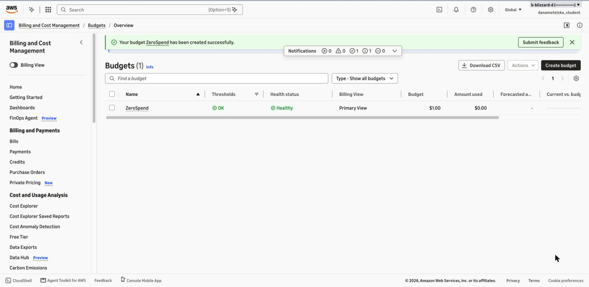

Рисунок 1.1. Бюджет `ZeroSpend` в списке `Budgets`. `[ЗАПОЛНИТЬ]`

**Ответ (AdministratorAccess, root).** Политика `AdministratorAccess` разрешает любые действия над любыми ресурсами аккаунта, то есть она равна полному доступу без ограничений. Вход под root запрещён практикой, потому что у root нельзя урезать права и его ключ при утечке даёт полный контроль над аккаунтом и платёжными данными. Пользователь IAM позволяет ограничивать права, включать MFA и отзывать ключи, не затрагивая сам аккаунт. Поэтому root используется только для задач, которые доступны лишь ему.

### Задание 2. Запуск экземпляра EC2

Выполнено командой `aws ec2 run-instances` с параметрами из таблицы паспорта; User data взят из файла `files/userdata.sh` (три команды из задания). Проверено: состояние `running`, статус-проверки `ok/ok`, диск и теги подтверждены `describe-volumes`, страница nginx по публичному IP отвечает.

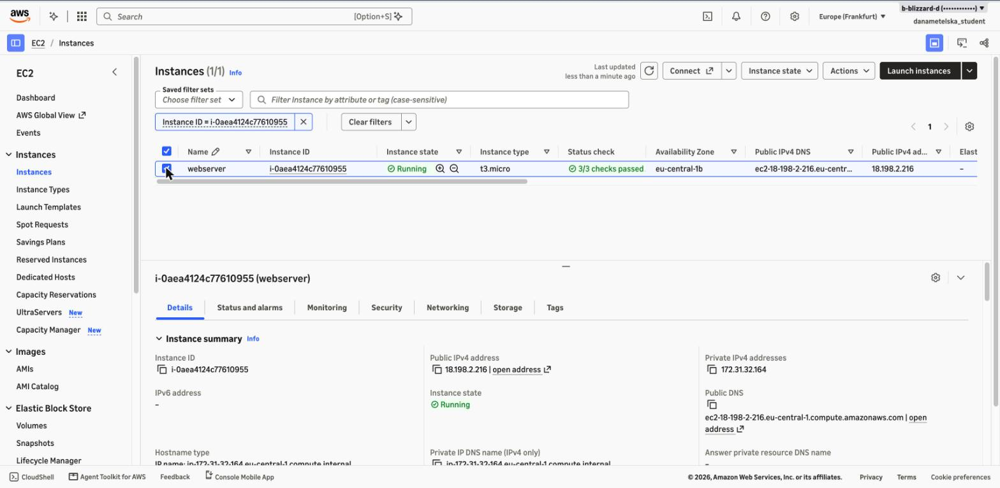

Рисунок 2.1. Экземпляр `webserver` в состоянии `Running`, проверки пройдены, виден `i-0aea4124c77610955`. `[ЗАПОЛНИТЬ]`

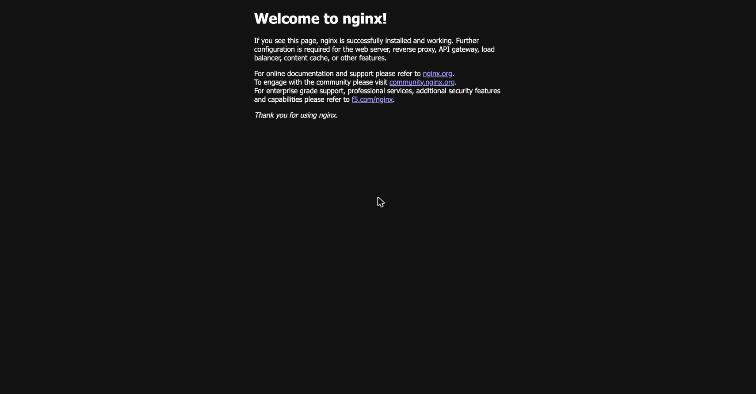

Рисунок 2.2. Приветственная страница nginx по `http://18.198.2.216`. `[ЗАПОЛНИТЬ: адрес]`

**Ответ (User data).** User data - это скрипт, который cloud-init выполняет от имени root при первом запуске экземпляра, поэтому в нём удобно устанавливать пакеты и включать службы. После обычной перезагрузки или остановки и запуска скрипт повторно не выполняется, потому что отметка о выполнении хранится на диске для данного экземпляра. Чтобы выполнить его заново, нужно изменить User data и сбросить состояние cloud-init либо создать новый экземпляр. Установленные скриптом пакеты и включённая служба nginx при этом сохраняются на диске.

### Задание 3. Мониторинг и диагностика

Просмотрены `Status and alarms`, `Monitoring`, системный журнал и снимок экрана экземпляра. Копия системного журнала первой загрузки сохранена командой `aws ec2 get-console-output --latest` (`logs/console-output-first-boot.txt`, содержит строки установки nginx).

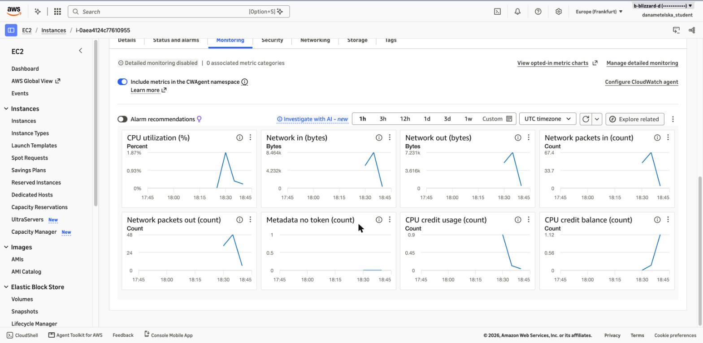

Рисунок 3.1. Вкладка `Monitoring` экземпляра. `[ЗАПОЛНИТЬ]`

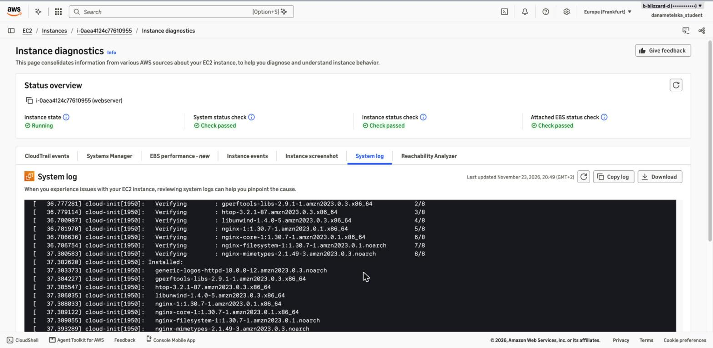

Рисунок 3.2. Фрагмент `System log` со строками установки nginx. `[ЗАПОЛНИТЬ]`

**Ответ (проверки состояния).** Проверка системы (system status check) относится к инфраструктуре AWS: физический хост и сеть, и при её сбое исправить ничего нельзя, остаётся ждать или пересоздать экземпляр на другом хосте остановкой и запуском. Проверка экземпляра (instance status check) относится к самой виртуальной машине: загрузка ОС, сеть, файловая система, и именно её сбой чаще вызван действиями пользователя. Проверка подключённых томов EBS показывает доступность диска. Таким образом, проблему на стороне пользователя показывает instance status check, а проблему AWS показывает system status check.

**Ответ (детальный мониторинг).** Детальный мониторинг даёт метрики раз в минуту вместо раза в пять минут и стоит дополнительных денег. Его включают для экземпляров, где важна быстрая реакция: автоматическое масштабирование, тревоги на короткие всплески нагрузки, разбор инцидентов. Для учебного сервера достаточно базового мониторинга.

### Задание 4. Подключение по SSH

Выполнено: `chmod 400`, подключение командой из задания, ответ `yes` на запрос отпечатка, проверка `systemctl status nginx` (служба `active (running)`, `enabled`).

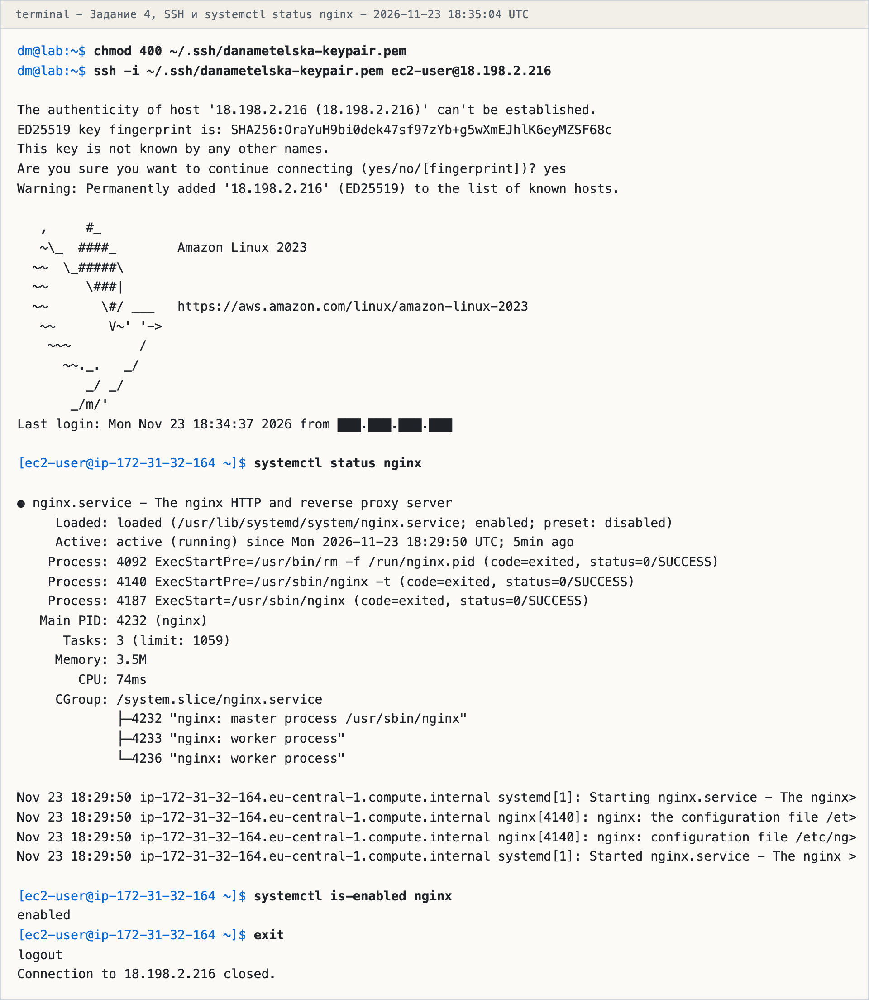

Рисунок 4.1. Вход по SSH в `ec2-user@ip-172-31-32-164` и вывод `systemctl status nginx` (`active (running)`).

**Ответ (ключ вместо пароля).** Пароль можно подобрать перебором или перехватить при вводе, а закрытый ключ ED25519 не передаётся по сети: сервер проверяет подпись, которую может создать только владелец ключа. Поэтому вход по паролю на облачных образах отключён, а ключ защищён правами 400 на ноутбуке. Потеря ключа означает потерю доступа, зато его утечку можно локализовать заменой пары ключей.

### Задание 5. Статический сайт

Созданы три страницы справочника команд Linux (`index.html`, `about.html`, `contact.html`, ссылки между ними в навигации), исходники в `site/`. Страницы скопированы командой `scp` в `~` (`logs/t05-scp.txt`), затем переложены в `/usr/share/nginx/html/` командой `sudo cp` (после снимка приветственной страницы nginx).

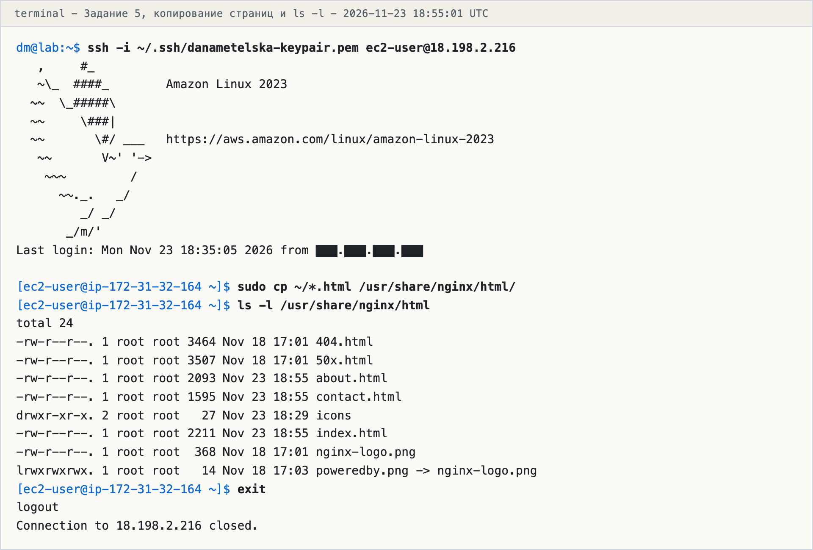

Рисунок 5.1. Копирование страниц и `ls -l /usr/share/nginx/html`. `[ЗАПОЛНИТЬ: после запуска scripts/t05-cp.sh]`

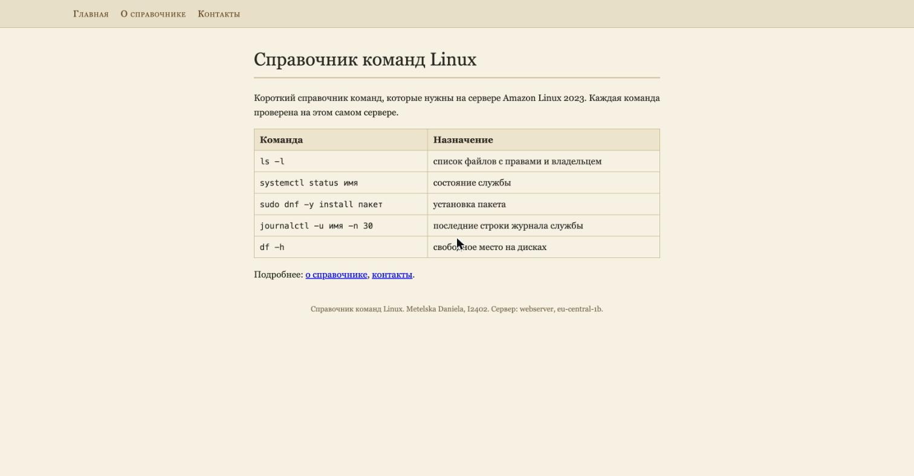

Рисунок 5.2. Главная страница сайта в браузере, виден IP сервера. `[ЗАПОЛНИТЬ]` (аналогично `c07-site-about.png`, `c07-site-contact.png`).

**Ответ (scp).** `scp` копирует файлы между компьютерами по протоколу SSH, поэтому использует те же ключи и тот же порт 22. Как и `ssh`, команда выполняется на локальном компьютере и шифрует передачу, а отличается тем, что вместо оболочки передаёт файлы. Прямо в `/usr/share/nginx/html` она записать не может, так как папка принадлежит root, а вход выполняется как `ec2-user`; поэтому файлы сначала копируются в `~`.

### Задание 6. Остановка через AWS CLI

Выполнено на ноутбуке командой `aws ec2 stop-instances --instance-ids i-0aea4124c77610955 --region eu-central-1`. Проверено командой `describe-instances` (состояние `stopped`).

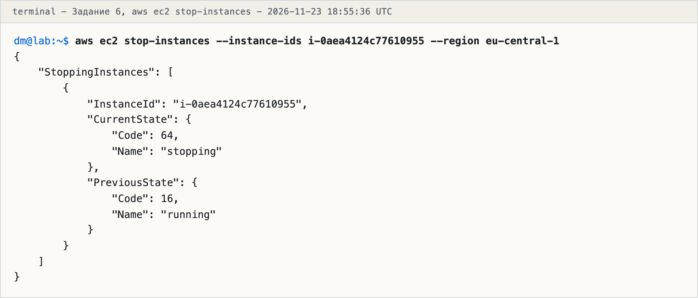

Рисунок 6.1. Команда `stop-instances` и её вывод (`stopping`). `[ЗАПОЛНИТЬ: после запуска scripts/t06-stop.sh]`

**Ответ (Stop и Terminate).** Stop выключает экземпляр, но сохраняет диск EBS и идентификатор; потом его можно запустить снова, при этом публичный IPv4-адрес меняется. Terminate удаляет экземпляр безвозвратно, а диск удаляется вместе с ним, если включено `DeleteOnTermination`. Пока экземпляр остановлен, оплачивается хранение томов EBS (и неиспользуемых Elastic IP), а время работы вычислений не оплачивается.

## Часть 2. Продвинутый уровень

### Задание 7. Организация и репозиторий

Организация `b-blizzard-d-cloud` существует. Репозиторий `timecapsule` публичный, без README, `.gitignore` и лицензии от GitHub; код `open_capsules_php_functional` лежит в корне. Первый коммит: `chore: initial import of TimeCapsule (open_capsules_php_functional)`. `[ЗАПОЛНИТЬ: после создания репозитория]`

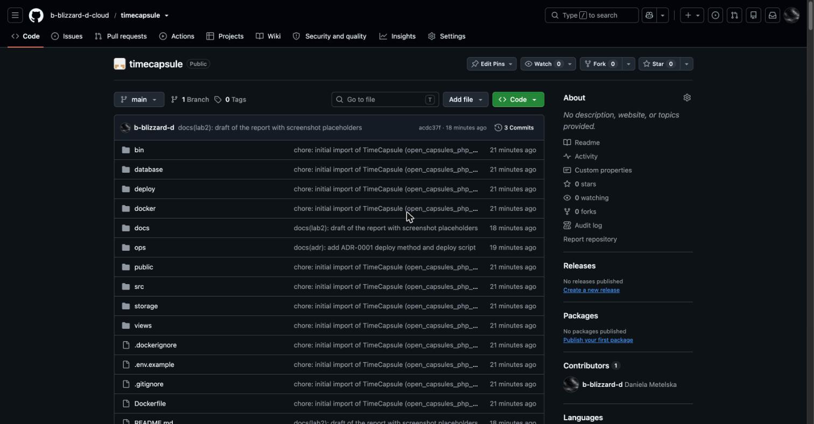

Рисунок 7.1. Корень репозитория: `public`, `src`, `views`, `composer.json`. `[ЗАПОЛНИТЬ]`

**Ответ (vendor и .env).** В `.gitignore` указаны `/vendor/` и `/.env`. Папка `vendor` создаётся командой `composer install` по `composer.lock`, поэтому хранить её не нужно, она велика и зависит от платформы. Файл `.env` содержит пароль базы данных, а репозиторий публичный, поэтому секрет в него попадать не должен.

### Задание 8. Подготовка сервера

`[ЗАПОЛНИТЬ: после scripts/b1-start-packages.sh]` Экземпляр запущен после остановки, новый IP: `[ЗАПОЛНИТЬ]`. Установлены пакеты `git composer postgresql16-server php8.4-fpm php8.4-cli php8.4-pgsql php8.4-mbstring php8.4-xml` (вывод в `logs/t08-install.txt`).

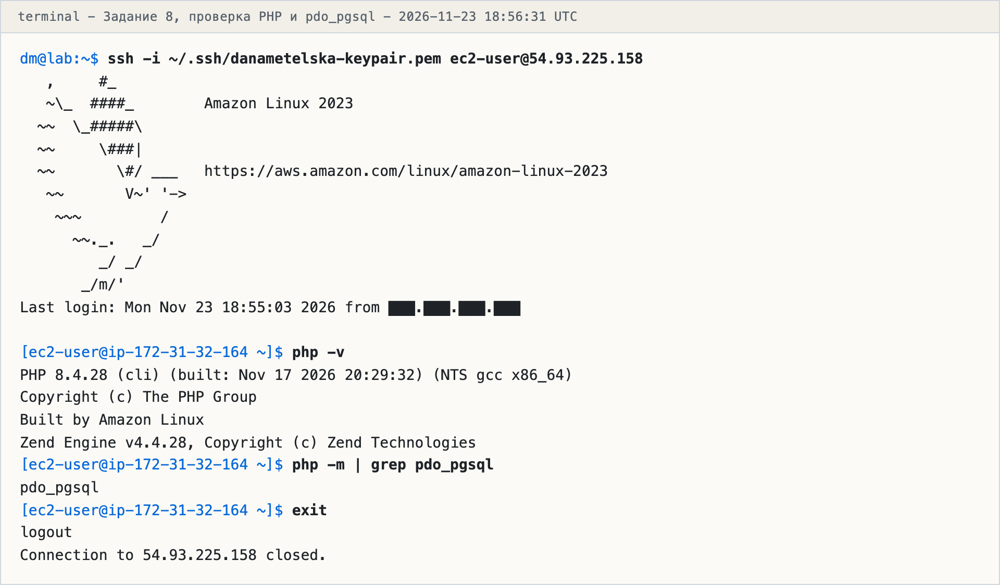

Рисунок 8.1. `php -v` и `php -m | grep pdo_pgsql`. `[ЗАПОЛНИТЬ]`

**Ответ (пакеты вручную).** User data выполняется один раз при первом запуске и не оставляет в репозитории или на экране понятного следа, а установка PHP и PostgreSQL долгая и может завершиться ошибкой. При ручной установке ошибка видна сразу, и команды можно повторить. Кроме того, набор пакетов относится к приложению и меняется чаще, чем начальная настройка сервера.

### Задание 9. PostgreSQL

`[ЗАПОЛНИТЬ: после scripts/b2-database.sh]` Выполнены `postgresql-setup --initdb`, замена `ident` на `scram-sha-256` в `pg_hba.conf` (вывод до и после в `logs/t09-*.txt`), `systemctl enable --now postgresql`, созданы пользователь и база `timecapsule` (владелец пользователь). Пароль сгенерирован командой `openssl rand -base64 24`, хранится вне репозитория (права 600) и в отчёт не включён.

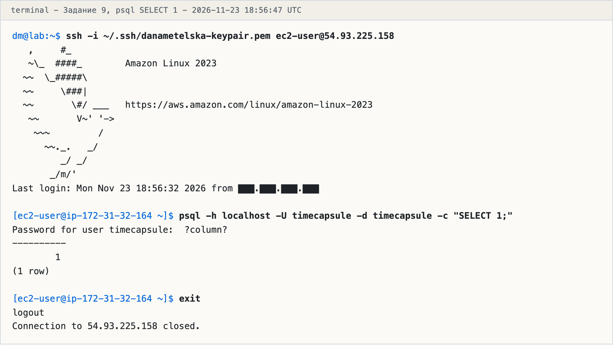

Рисунок 9.1. `psql -h localhost -U timecapsule -d timecapsule -c "SELECT 1;"` возвращает `1`. `[ЗАПОЛНИТЬ]`

### Задание 10. Развёртывание кода

`[ЗАПОЛНИТЬ: после scripts/b3-app.sh]` Каталог `/var/www/timecapsule` принадлежит `ec2-user`, код получен `git clone` по HTTPS без ключей. Файл `.env` создан по шаблону задания, права `640`, группа `apache`; `storage` принадлежит `apache` (проверено `ls -l`, `logs/t10-perms.txt`).

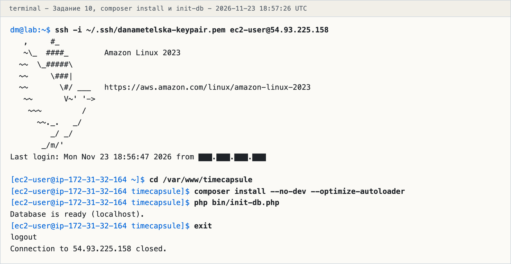

Рисунок 10.1. `composer install` и `php bin/init-db.php` (`Database is ready`). `[ЗАПОЛНИТЬ]`

**Ответ (пароль в .env).** Пароль в `.env` относится к конкретному серверу и не должен попадать в историю Git, где его невозможно надёжно удалить. В репозитории лежит только `.env.example` без секретов. Публичный репозиторий безопасен, потому что он содержит исходный код приложения, а доступ к базе ограничен: PostgreSQL слушает только `localhost`, а порт 5432 закрыт группой безопасности.

### Задание 11. PHP-FPM и nginx

`[ЗАПОЛНИТЬ: после scripts/b3-app.sh]` `upload_max_filesize = 6M` в `/etc/php.ini` (`logs/t11-php-ini.txt`); конфигурация `/etc/nginx/conf.d/timecapsule.conf` совпадает с заданием (копия в [`ops/nginx-timecapsule.conf`](ops/nginx-timecapsule.conf)).

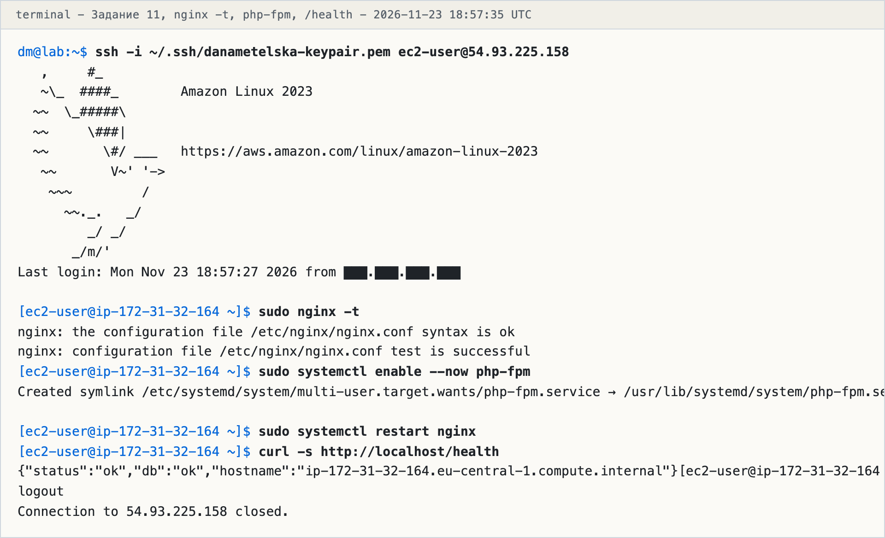

Рисунок 11.1. `sudo nginx -t` (`test is successful`) и локальный запрос `/health`. `[ЗАПОЛНИТЬ]`

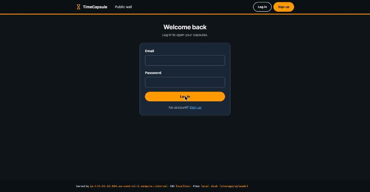

Рисунок 11.2. Страница входа TimeCapsule по IP сервера. `[ЗАПОЛНИТЬ]`

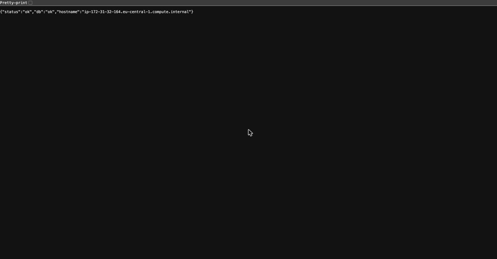

Рисунок 11.3. Ответ `/health`: `{"status":"ok","db":"ok",...}`. `[ЗАПОЛНИТЬ]`

### Задание 12. Обновление приложения (вариант B)

`[ЗАПОЛНИТЬ: после scripts/b4-deploy.sh]` Скрипт [`ops/deploy.sh`](ops/deploy.sh) содержит шаги задания (`set -euo pipefail`, `git pull --ff-only`, `composer install --no-dev --optimize-autoloader --no-interaction`, `php bin/init-db.php`, `sudo systemctl reload php-fpm`, итоговая строка с `git log -1 --oneline`) и дополнения: проверка чистоты рабочей копии и `nginx -t` перед выпуском, `curl /health` после, метки времени UTC. На сервере установлена копия `~/deploy.sh`.

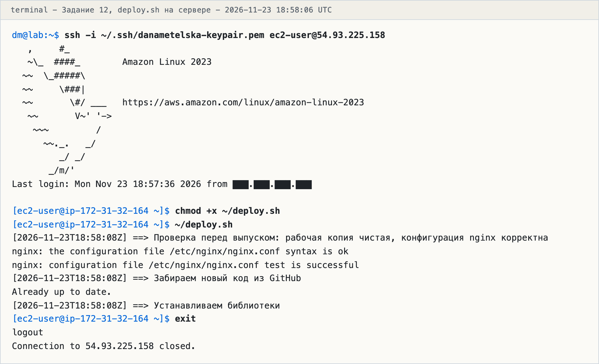

Рисунок 12.1. Запуск `~/deploy.sh` на сервере (`Already up to date`). `[ЗАПОЛНИТЬ]`

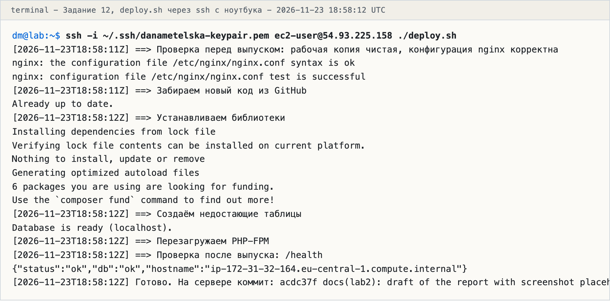

Рисунок 12.2. Запуск `ssh -i ... ec2-user@<IP> ./deploy.sh` с ноутбука. `[ЗАПОЛНИТЬ]`

**Ответ (во время git pull).** `git pull` заменяет файлы по одному, поэтому посетитель в этот момент может получить страницу, собранную из смеси старых и новых файлов, или ошибку, если шаблон уже новый, а исходный код ещё старый. Если после `git pull` не выполнить `composer install`, а список библиотек изменился, приложение не найдёт новые классы в `vendor` и вернёт ошибку 500 или сообщение `vendor/ is missing`. Аналогично, без `init-db.php` не появятся новые таблицы.

### Задание 13. Новая версия, поломка и откат

`[ЗАПОЛНИТЬ: пользователь регистрируется в приложении и создаёт капсулу с файлом; затем scripts/release.sh v2 | break | revert]`

Рисунок 13.1. Новая версия: в подвале строка `Release by Metelska Daniela, group I2402`, капсула сохранилась. `[ЗАПОЛНИТЬ]`

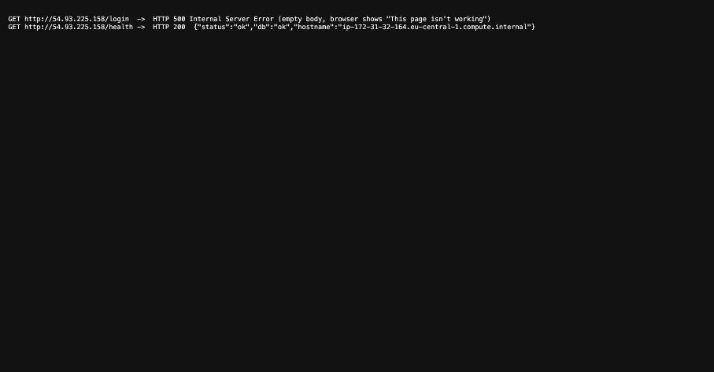

Рисунок 13.2. Главная страница после сломанного выпуска: ошибка 500 (`/health` отвечает `ok`). `[ЗАПОЛНИТЬ]`

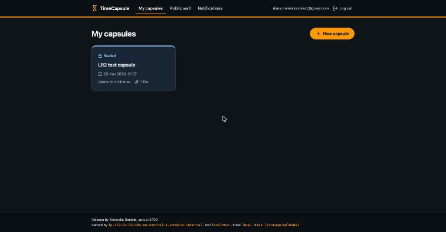

Рисунок 13.3. Сайт после `git revert` и повторного выпуска. `[ЗАПОЛНИТЬ]`

Хронология поломки (UTC, из `logs/q13-times.txt`): `[ЗАПОЛНИТЬ]`.

**Ответ (/health).** Адрес `/health` выполняет запрос к базе данных и отвечает `ok`, если соединение работает, при этом шаблон `layout.php` не подключается. Поэтому синтаксическая ошибка в шаблоне ломает главную страницу, но не проверку. Такой проверке не хватает запроса настоящей страницы (например, `/` с проверкой кода 200 и ожидаемого текста), проверки версии кода и записи ошибок PHP-FPM.

**Ответ (время поломки).** `[ЗАПОЛНИТЬ: время между завершением деплоя сломанной версии и завершением деплоя отката; шаги: заметить 500, найти причину, git revert, push, deploy]`. Сократить время можно автоматической проверкой главной страницы после выпуска (скрипт откатывается сам), а также выпуском в отдельный каталог с переключением ссылки.

### Задание 14. Архитектура и решение

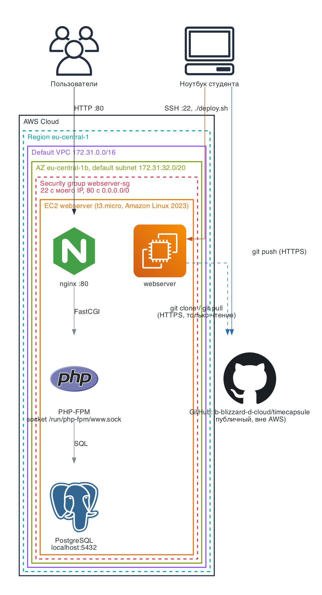

Рисунок 14.1. Схема развёртывания: пользователи по HTTP на nginx; AWS Cloud, регион `eu-central-1`, default VPC, зона `eu-central-1b`, подсеть, группа безопасности `webserver-sg`; на экземпляре nginx, PHP-FPM, PostgreSQL; GitHub вне AWS (`git clone` по HTTPS с сервера); ноутбук (`git push`, SSH-деплой).

Архитектурное решение: [ADR-0001](docs/adr/0001-deploy-method.md).

## Ответы на устные вопросы

1. **Путь запроса.** Браузер отправляет HTTP-запрос на порт 80; группа безопасности пропускает его к nginx. nginx отдаёт статические файлы из `public/` сам, а запросы к PHP передаёт в PHP-FPM через unix-сокет `/run/php-fpm/www.sock`. PHP-FPM выполняет скрипт приложения, который по `localhost:5432` обращается к PostgreSQL, получает данные и возвращает HTML nginx, а тот отправляет ответ браузеру.
2. **Чтение без записи.** Репозиторий публичный, поэтому сервер скачивает код по HTTPS без учётных данных, а для записи нужны права, которых у сервера нет. Это правильно: при взломе сервера злоумышленник не сможет изменить исходный код проекта и распространить его дальше. Источником истины остаётся репозиторий, куда пишет только разработчик.
3. **Удаление EC2.** Загруженные файлы лежат в `storage/uploads` на корневом томе EBS; при Terminate том удаляется вместе с экземпляром, если включён `DeleteOnTermination` (по умолчанию для корневого тома так). Остановка (Stop) файлы сохраняет. Поэтому для настоящей эксплуатации файлы выносят на отдельный том, снимки или в S3.
4. **Сходство с CI/CD.** Скрипт, как и конвейер CI/CD, выполняет одну и ту же последовательность шагов без участия человека по памяти: получить код, собрать зависимости, обновить схему базы, перезапустить службу. Недостаёт автоматического запуска по событию (push), автотестов до выпуска, проверки настоящей страницы после выпуска с автоматическим откатом, журнала выпусков и разграничения прав на запуск.

## Вывод

`[ЗАПОЛНИТЬ: 4-6 строк после завершения]`

## Источники

1. Методические материалы курса: задание к лабораторной работе №2, лекция 4, Hands-on 4.1-4.3.
2. Документация Amazon EC2 (User Guide for Linux Instances): статус-проверки, консольный вывод, пары ключей.
3. Документация nginx: `ngx_http_fastcgi_module`.
4. Документация PostgreSQL 16: `pg_hba.conf`, метод `scram-sha-256`.
