# Лабораторная работа №3. Облачные сети. Amazon VPC

| Поле | Значение |
| --- | --- |
| Студент | Metelska Daniela |
| Группа | I2402 |
| Специальность | Informatică |
| Номер `k` | 11 (`X = 11 % 30 = 11`, диапазон VPC `10.11.0.0/16`) |
| Уровень | продвинутый (Часть 1 и Часть 2, задания 1-14) |
| Вариант обслуживания | B: скрипты [`scripts/nat-up.sh`](../../scripts/nat-up.sh) и [`scripts/nat-down.sh`](../../scripts/nat-down.sh) |
| Репозиторий | https://github.com/b-blizzard-d-cloud/timecapsule (публичный) |
| ADR | [docs/adr/0002-database-placement.md](../adr/0002-database-placement.md) |
| Отчёт ЛР2 | [README.md](../../README.md) в корне репозитория (не изменялся) |

Номер аккаунта и домашний IP-адрес в отчёте скрыты. Пароли и содержимое `.env` в отчёт и репозиторий не попадают.

## Паспорт ресурсов

| Ресурс | Имя | Идентификатор / значение |
| --- | --- | --- |
| VPC | `timecapsule-dev-vpc` | `vpc-09b5d15d218dfd2c6`, `10.11.0.0/16`, без IPv6, DNS resolution и DNS hostnames включены |
| Подсети | `timecapsule-dev-public-a`, `-public-b`, `-private-a`, `-private-b` | `subnet-0591624a4d9f0f6f8`, `subnet-0e34fd13f8a564dfc`, `subnet-0e053281fc9cfdd24`, `subnet-0023c263be9bcba9d` |
| Internet Gateway | `timecapsule-dev-igw` | `igw-0453c5d9f1d6d1cd5`, `Attached` |
| Таблицы маршрутов | `timecapsule-dev-public-rt`, `timecapsule-dev-private-rt` | `rtb-060efaf8340a31ef7`, `rtb-082f34909fe2d1887` |
| Security Group | `timecapsule-dev-bastion-sg`, `-web-sg`, `-db-sg` | `sg-0fd8111db3b88cd7f`, `sg-0c62e802c88b0c479`, `sg-0428e2599d1d51746` |
| Экземпляры | `timecapsule-dev-bastion`, `-web` (Часть 1), `-db`, `-app` | `i-063e87e1fd36bc314`, `i-073d9129c9a2512eb`, `i-0d1d6c99133676ade`, `i-0619c747210170474` |
| Elastic IP | `timecapsule-dev-app-eip` | `eipalloc-0efca52903da1256e`, `63.182.6.9` |
| Приватная зона | `timecapsule.internal` | `Z00926962R00XHWVP0UUN`, запись `db` A `10.11.10.121`, TTL 60 |
| Образ | `timecapsule-dev-app-lab2` | создан и удалён (задание 12) |
| Теги на всех ресурсах | `Name`, `Project=timecapsule`, `Environment=dev`, `Owner=danametelska`, `Lab=lab3`, `Course=cloud-computing`, `Group=i2402` | диски экземпляров и снимок образа тоже |

Независимые проверки (`describe-*`, `resourcegroupstaggingapi`) сохранены в рабочей папке лабы, `logs/`.

## Как выполнялась работа

Ресурсы создавались командами AWS CLI под профилем студента (скрипты в рабочей папке лабы, повторяемые, с сохранением идентификаторов). Каждая настройка подтверждена независимой командой `describe-*`. Команды на серверах выполнялись в интерактивных сессиях SSH через bastion (`ProxyJump`), выводы воспроизведены без изменений. Консоль AWS использована для снимков экрана там, где задание требует показать именно консоль. Пароли пользователей PostgreSQL сгенерированы командой `openssl rand`, хранятся вне репозитория и не печатаются: на сервер они передаются через файл с правами 600 и читаются подстановкой `$(cat ...)`.

## Отклонения от задания и ограничения

1. Ресурсы созданы через AWS CLI, а не мастерами консоли. Параметры соответствуют заданию: тип `VPC only`, `t3.micro`, Amazon Linux 2023, User data из задания дословно, правила Security Group по таблице.
2. Файл `~/.ssh/config` ноутбука не изменялся (в нём записи для других проектов). Записи `bastion`, `web`, `db`, `app` лежат в отдельном файле, который подключается ключом `ssh -F`; содержимое записей соответствует заданию (`ProxyJump bastion`, приватный ключ остаётся на ноутбуке). В отчёте команды показаны как `ssh web`, `ssh db`.
3. В задании 6 строка `pg_hba.conf` дописана командой из задания, а в задании 10 заменена командой `sed` вместо редактирования в `nano`: результат тот же, и он выведен в рисунке 10.1.
4. Пароль пользователя `student` и нового пользователя `timecapsule` в командах не набирается: используется подстановка из файла (см. раздел "Как выполнялась работа").
5. Эксперимент с Network ACL (задание 7): телефон недоступен, поэтому вторым источником взят CloudShell региона `eu-central-1` (рисунок 7.5). Дополнительно показано, что из соседней подсети (с `bastion` на `web` по приватному адресу) блокировка не действует.
6. Скрипты `nat-up.sh` и `nat-down.sh` запускались с ноутбука (macOS, `bash` 3.2), а не в CloudShell или Git Bash; скрипты не содержат имени профиля и работают и там, и там.
7. Обновление пакетов на `db` (задание 13) завершилось сообщением `Nothing to do`: образ Amazon Linux 2023 уже содержал актуальные пакеты. NAT Gateway при этом создавался и удалялся по-настоящему (рисунки 13.5-13.7).
8. Тариф AWS Free plan; после работы экземпляры остановлены, а не удалены (кроме случаев, указанных в разделе "Итог").
9. Время в подписях терминальных снимков указано в UTC и соответствует моменту выполнения команды.

## Часть 1. Базовый уровень

### Задание 1. План адресов

Вычислено `X = 11 % 30 = 11`. В каждой подсети /24 AWS резервирует пять адресов: `.0` (сеть), `.1` (маршрутизатор VPC), `.2` (DNS), `.3` (резерв) и `.255` (широковещательный), поэтому экземплярам доступно 251 адрес.

| Подсеть | Зона доступности | Диапазон | Первый и последний адрес для экземпляров | Доступно экземплярам |
| --- | --- | --- | --- | --- |
| `public-a` | `eu-central-1a` | `10.11.0.0/24` | `10.11.0.4` - `10.11.0.254` | 251 |
| `public-b` | `eu-central-1b` | `10.11.1.0/24` | `10.11.1.4` - `10.11.1.254` | 251 |
| `private-a` | `eu-central-1a` | `10.11.10.0/24` | `10.11.10.4` - `10.11.10.254` | 251 |
| `private-b` | `eu-central-1b` | `10.11.11.0/24` | `10.11.11.4` - `10.11.11.254` | 251 |

Проверено: у пустой подсети `describe-subnets` возвращает `AvailableIpAddressCount = 251` (`private-b`); в остальных подсетях значение меньше на число занятых сетевых интерфейсов (серверы, шлюз NAT).

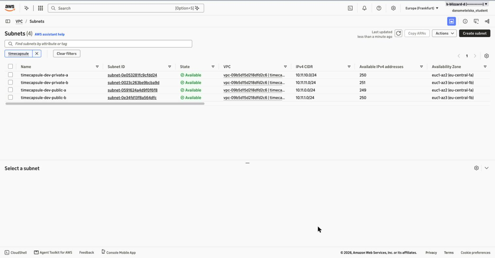

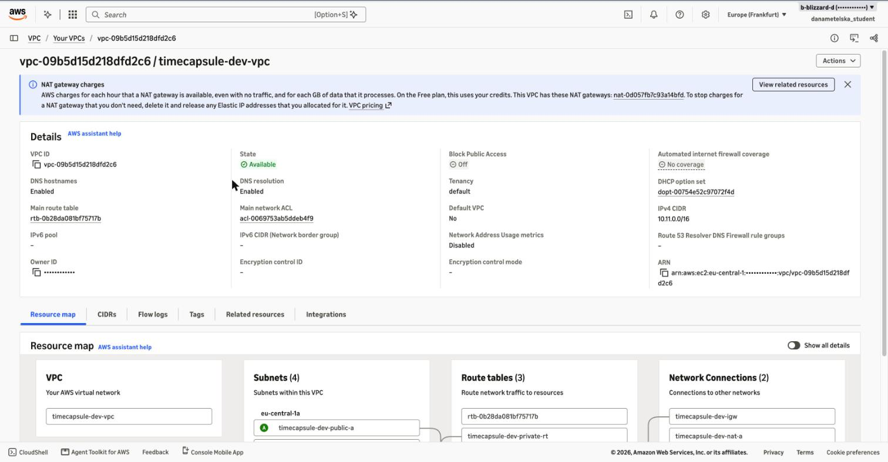

Рисунки 1c.1-1c.2. Консоль AWS: четыре подсети `timecapsule-dev-vpc` (зоны, CIDR, свободные адреса) и сведения о VPC (CIDR `10.11.0.0/16`, DNS hostnames и DNS resolution включены).

Рисунок 1.1. Список подсетей `timecapsule-dev-vpc` с зонами, диапазонами и числом доступных адресов; параметры VPC.

**Ответ.** В подсети из 256 адресов AWS занимает пять: `10.11.0.0` (адрес сети), `10.11.0.1` (маршрутизатор VPC), `10.11.0.2` (DNS-сервер Amazon), `10.11.0.3` (резерв на будущее) и `10.11.0.255` (широковещательный адрес, в VPC не используется, но зарезервирован). В `10.11.0.0/16` помещается 256 подсетей /24 (65 536 / 256), из которых четыре уже созданы, значит свободны ещё 252.

### Задание 2. VPC и подсети

Выполнено: создана VPC `timecapsule-dev-vpc` (`10.11.0.0/16`, без IPv6), включены `Enable DNS resolution` и `Enable DNS hostnames`, созданы четыре подсети с зонами и диапазонами из задания 1, на все ресурсы нанесены семь тегов. Проверено командами `describe-vpcs`, `describe-vpc-attribute`, `describe-subnets` (`logs/vpc.txt`, `logs/subnets.txt`).

**Ответ.** Подсеть `public-a` сразу после создания не является публичной. Публичной её делает маршрут `0.0.0.0/0` в Internet Gateway в связанной таблице маршрутов, а сразу после создания подсеть связана только с основной таблицей, где есть лишь локальный маршрут. Название подсети на её свойства не влияет.

### Задание 3. Internet Gateway и таблицы маршрутов

Выполнено: создан и подключён `timecapsule-dev-igw` (`Attached`); `public-rt` получила маршрут `0.0.0.0/0` на шлюз и связи с `public-a`, `public-b`; `private-rt` без дополнительных маршрутов связана с `private-a`, `private-b`; для `public-a` и `public-b` включено автоназначение публичного IPv4. Проверено командами `describe-internet-gateways`, `describe-route-tables`, `describe-subnets` (`MapPublicIpOnLaunch`).

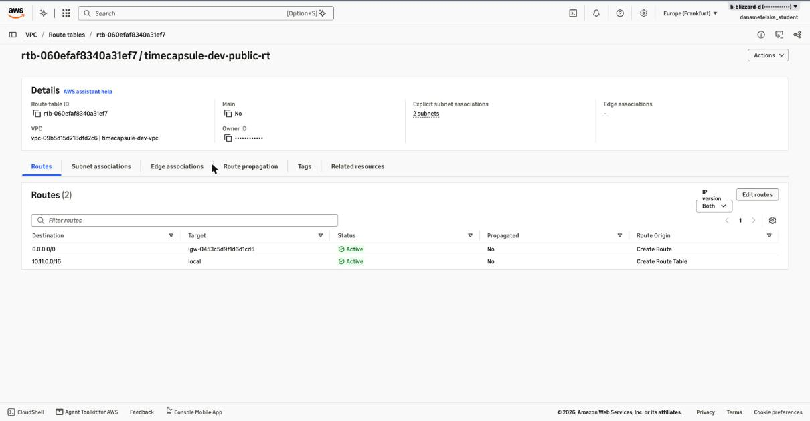

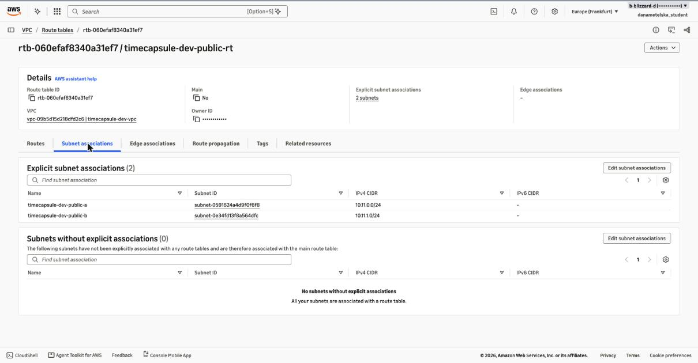

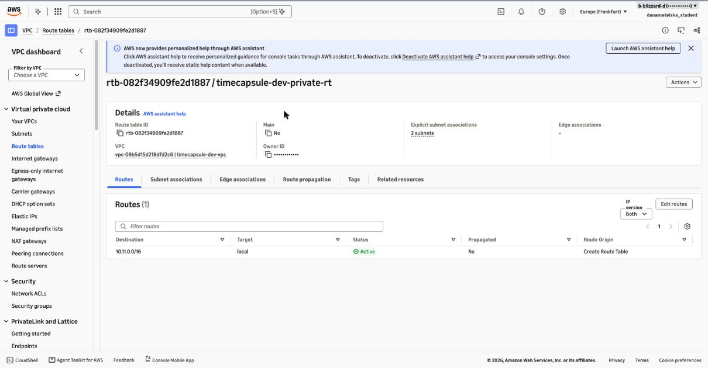

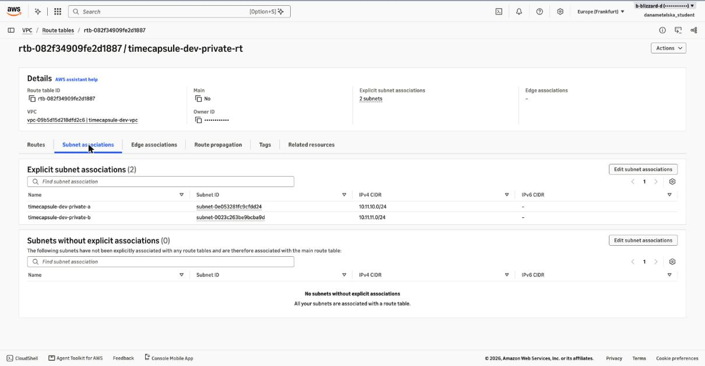

Рисунки 3c.1-3c.4. Консоль AWS: маршруты `public-rt` (локальный и `0.0.0.0/0` через Internet Gateway) и её привязки к `public-a`, `public-b`; маршруты `private-rt` (только локальный) и привязки к `private-a`, `private-b`.

Рисунок 3.1. Маршруты и связи с подсетями для `public-rt` и `private-rt`.

**Ответ.** В обеих таблицах есть маршрут `10.11.0.0/16` с целью `local`, который создаётся автоматически и нужен для связи серверов внутри VPC. Пакет к `8.8.8.8` из `private-a` не имеет подходящего маршрута, потому что в `private-rt` нет `0.0.0.0/0`, и будет отброшен (в сеть назначения он не уйдёт).

### Задание 4. Security Group

Выполнено: `timecapsule-dev-bastion-sg` (SSH с адреса администратора `/32`), `timecapsule-dev-web-sg` (HTTP с `0.0.0.0/0`, SSH от `bastion-sg`), `timecapsule-dev-db-sg` (5432 от `web-sg`, SSH от `bastion-sg`); у каждой заполнено описание и тег `Name`. Проверено `describe-security-groups` (`logs/security-groups.json`).

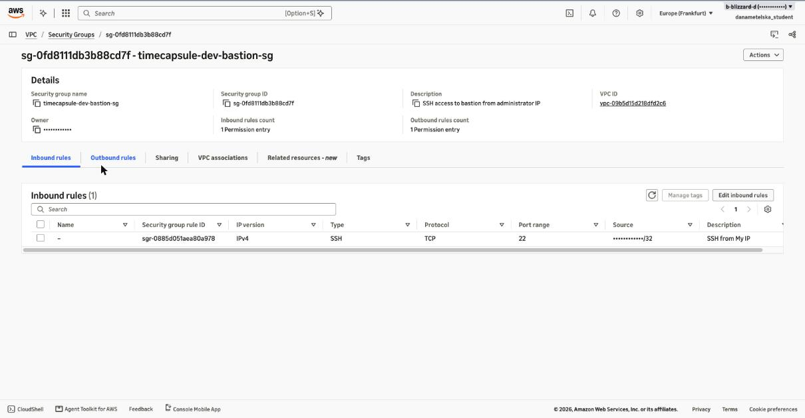

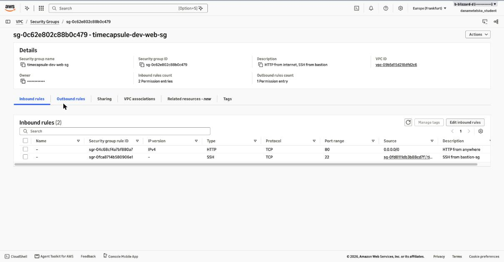

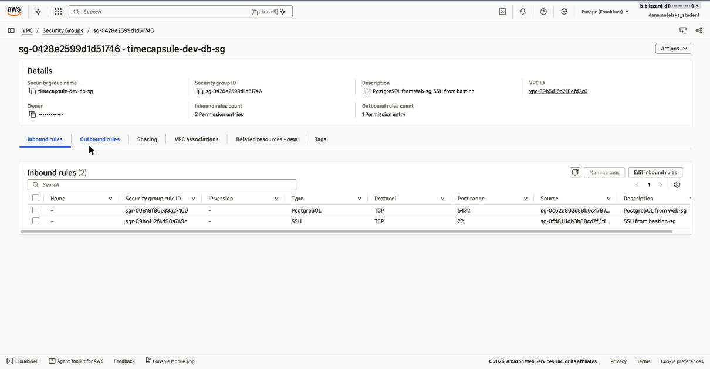

Рисунки 4c.1-4c.3. Консоль AWS: входящие правила `bastion-sg` (SSH с адреса администратора), `web-sg` (HTTP отовсюду, SSH из `bastion-sg`), `db-sg` (PostgreSQL из `web-sg`, SSH из `bastion-sg`).

Рисунок 4.1. Входящие правила трёх групп.

**Ответ.** Источник-группа привязывается к членству в группе, а не к адресу, поэтому правило остаётся верным при смене адреса сервера и при добавлении новых серверов в `web-sg`. Диапазон `10.11.0.0/16` пустил бы к базе любой сервер VPC, в том числе `bastion`, что нарушает принцип минимальных прав. Адрес конкретного сервера пришлось бы менять при его пересоздании.

### Задание 5. Экземпляры

Выполнено: запущены `timecapsule-dev-bastion` (`public-b`, публичный IP), `timecapsule-dev-web` (`public-a`, публичный IP, User data из задания) и `timecapsule-dev-db` (`private-a`, без публичного IP); Amazon Linux 2023, `t3.micro`, ключ `danametelska-keypair`; теги на экземплярах и дисках (`logs/instances.txt`, `logs/volume-tags.txt`). Настроен SSH через bastion (отдельный файл, см. отклонение 2).

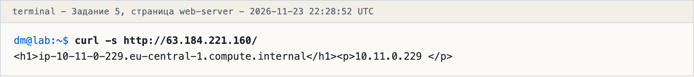

Рисунок 5.1. Страница `web-server`, полученная запросом `curl` по публичному IP: имя сервера и адрес `10.11.0.229` из `10.11.0.0/24`.

Рисунок 5c.1. Страница сервера `web` в браузере по публичному адресу: имя хоста и частный адрес `10.11.0.229`.

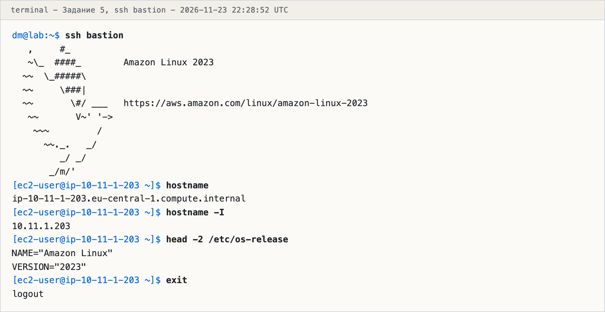

Рисунок 5.2. Вход `ssh bastion` (аналогично `t05-ssh-web.png`, `t05-ssh-db.png`: входы на `web` и `db` через bastion).

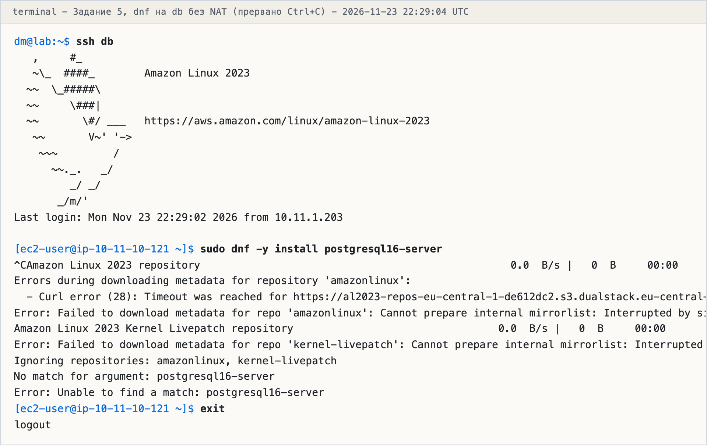

Рисунок 5.3. Установка `postgresql16-server` на `db` зависает и прервана `Ctrl+C` через 60 с; ошибка `Connection timed out` при загрузке метаданных.

**Ответ.** У `db-server` нет публичного адреса и маршрута `0.0.0.0/0` в `private-rt`, поэтому пакеты с репозитория `dnf` до него не доходят, а у `web-server` публичный адрес и маршрут в Internet Gateway есть. Чтобы это исправить, нужен NAT Gateway в публичной подсети и маршрут на него из `private-rt`: исходящие соединения `db-server` пойдут в интернет, а входящие извне по-прежнему невозможны.

### Задание 6. Временный NAT Gateway

Выполнено: выделен Elastic IP с именем `timecapsule-dev-nat-a-eip`, создан `timecapsule-dev-nat-a` (Zonal, `public-a`, Public) и маршрут `0.0.0.0/0` в `private-rt`; на `db` проверен адрес выхода, установлен `postgresql16-server`, настроен PostgreSQL (`initdb`, `listen_addresses = '*'`, строка `pg_hba.conf` для `10.11.0.0/24`, автозапуск, пользователь `student`, база `lab3`); шлюз удалён, Elastic IP освобождён. Маршрут `0.0.0.0/0` после удаления шлюза имеет состояние `Blackhole` и намеренно оставлен до снимка консоли.

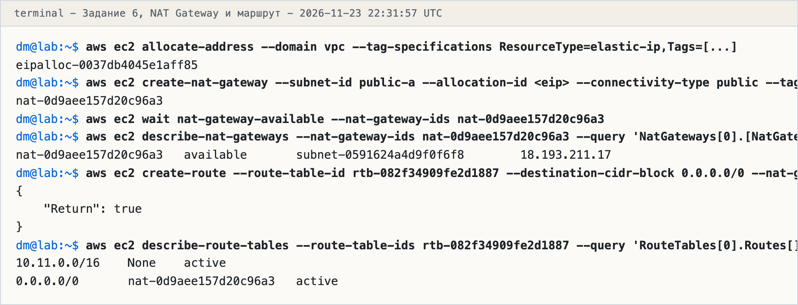

Рисунок 6.1. Создание адреса и шлюза, состояние `available`, маршрут в `private-rt`.

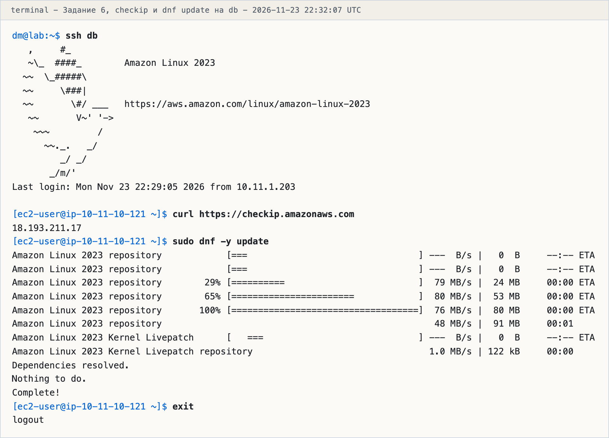

Рисунок 6.2. `curl https://checkip.amazonaws.com` на `db` возвращает `18.193.211.17`, адрес Elastic IP шлюза; далее `dnf update`.

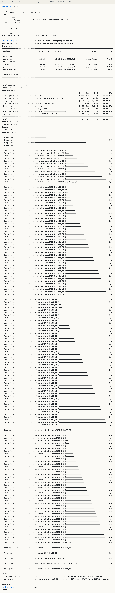

Рисунок 6.3. Установка `postgresql16-server` на `db` через NAT.

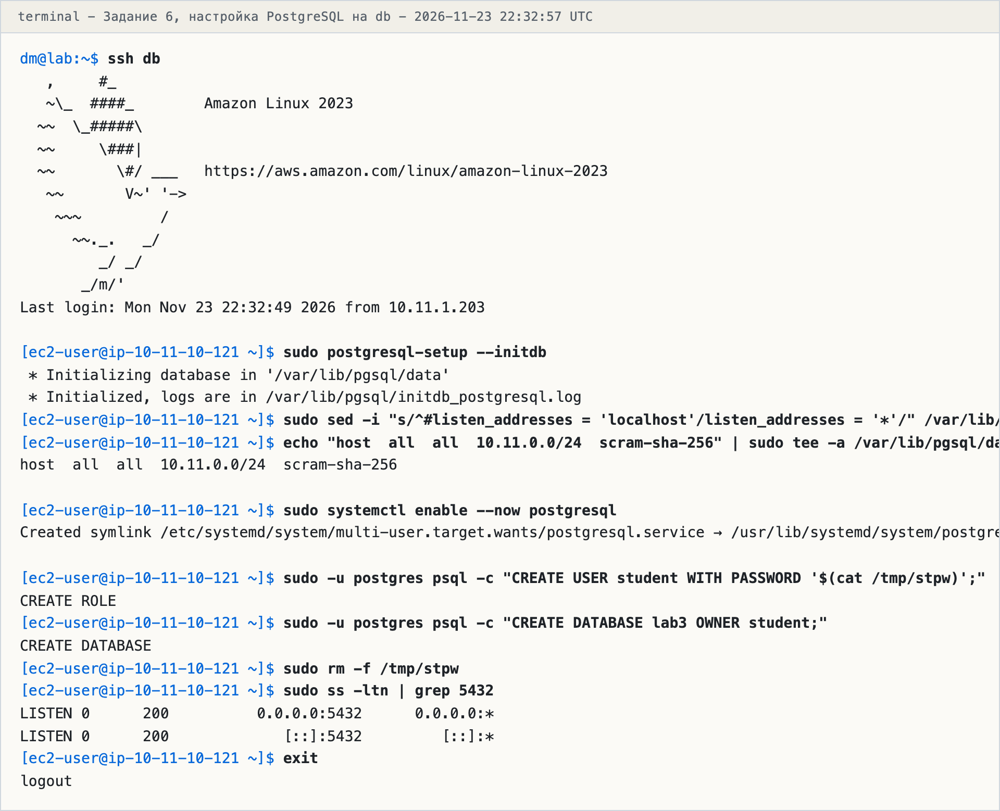

Рисунок 6.4. Настройка PostgreSQL на `db`; проверка конфигурации: `t06-pg-verify.png`.

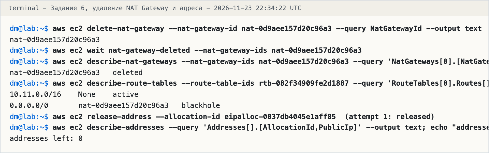

Рисунок 6.5. Удаление шлюза (`deleted`), маршрут в состоянии `blackhole`, освобождение адреса, `addresses left: 0`.

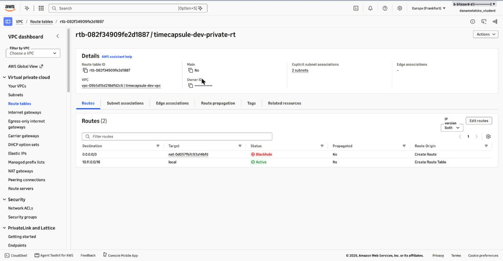

Рисунки 6c.1-6c.2. Консоль AWS: удалённые NAT Gateway в состоянии `Deleted` и маршрут `0.0.0.0/0` в `private-rt` со статусом `Blackhole` (цель удалена, маршрут остался; после снимка он удалён).

**Ответ (checkip).** Команда вернула `18.193.211.17`, то есть Elastic IP шлюза `timecapsule-dev-nat-a`. У `db-server` нет публичного адреса: исходящие пакеты идут через NAT Gateway, который заменяет приватный адрес источника своим внешним, поэтому наружу виден адрес шлюза общий для всей приватной подсети.

**Ответ (три механизма).** Отсутствие публичного IP и маршрута в Internet Gateway не даёт интернету найти сервер; `db-sg` на уровне сетевого интерфейса пропускает порт 5432 только от `web-sg`; `pg_hba.conf` на уровне PostgreSQL разрешает вход только заданным пользователям с заданных адресов и только с паролем. Ошибка в одном механизме не открывает базу, пока два остальных исправны; при ошибке сразу в двух снижается запас защиты, а при ошибке во всех трёх база оказывается открыта.

**Ответ (после удаления NAT).** PostgreSQL продолжает работать, потому что ему интернет нужен только для установки пакетов, а соединения от `web-server` идут внутри VPC по локальному маршруту. Для установки обновлений безопасности придётся снова создать NAT Gateway и маршрут, выполнить `dnf update`, затем всё удалить (в задании 13 это делается скриптами).

### Задание 7. Проверки

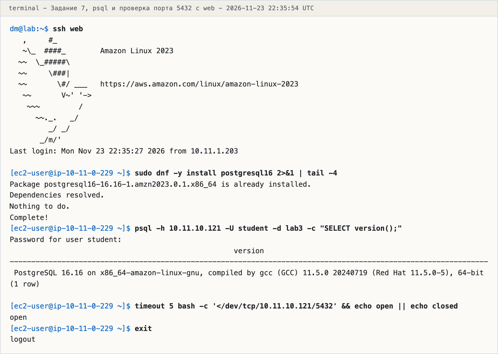

Рисунок 7.1. С `web` выполнен вход `psql` в `db` (пользователь `student`, база `lab3`), показана версия PostgreSQL 16.16; проверка порта: `open`.

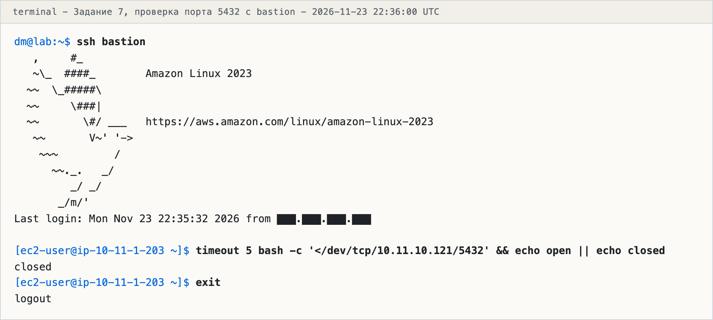

Рисунок 7.2. С `bastion` порт 5432 `closed`.

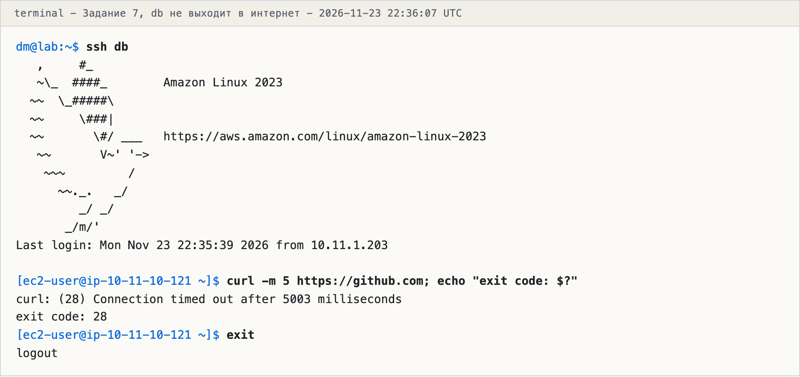

Рисунок 7.3. С `db`: `curl -m 5 https://github.com` завершается тайм-аутом (код 28).

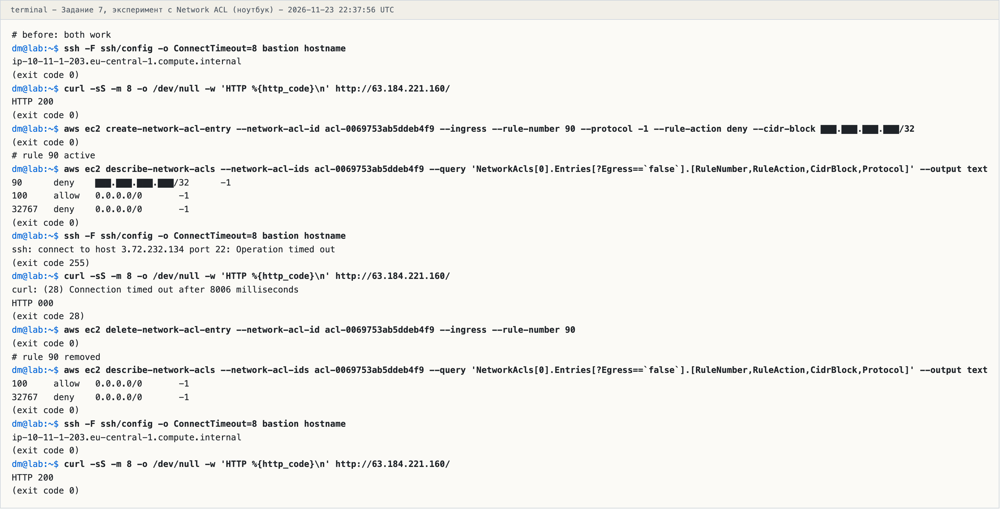

Рисунок 7.4. Эксперимент с Network ACL с ноутбука: до правила SSH и сайт работают; при правиле 90 `Deny` для адреса ноутбука оба недоступны (тайм-аут); после удаления правила снова работают.

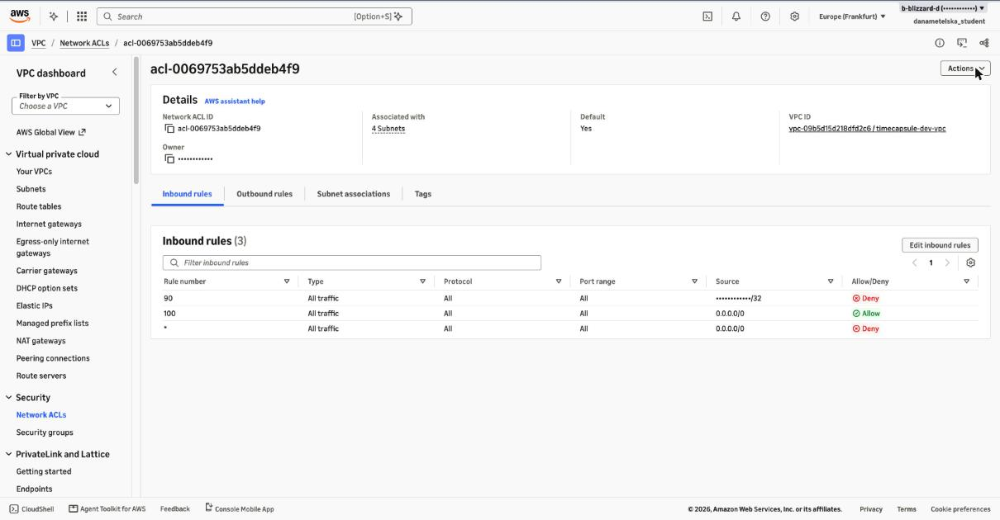

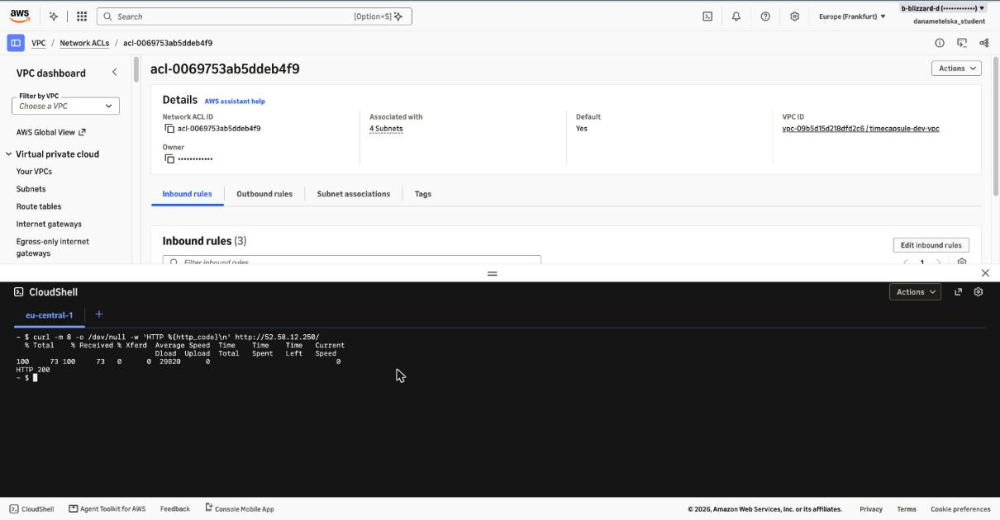

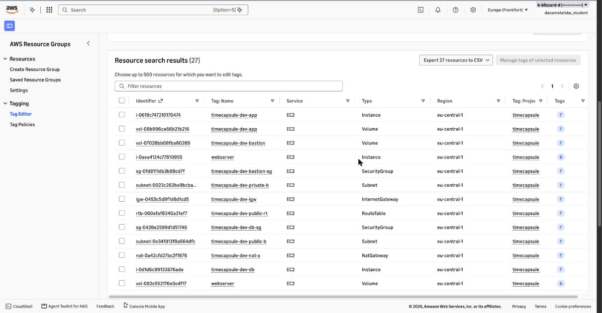

Рисунки 7c.1-7c.3. Консоль AWS: правило 90 (Deny для адреса ноутбука) в сетевом ACL; запрос из CloudShell (другой источник) к `web` проходит с кодом 200; Tag Editor с тегом `Project = timecapsule` (27 ресурсов).

Рисунок 7.5. Правило 90 в default Network ACL; CloudShell получает ответ 200 при действующем правиле; результат `Tag Editor` с тегом `Project = timecapsule`.

CLI-эквивалент `Tag Editor`: `aws resourcegroupstaggingapi get-resources --tag-filters Key=Project,Values=timecapsule` вернул 27 ресурсов (VPC, 4 подсети, IGW, 2 таблицы маршрутов, группы безопасности, экземпляры, диски, Elastic IP), список в `logs/tag-editor-cli.txt`. Группы и ресурсы без тега: основная таблица маршрутов, default Network ACL и default Security Group создаются AWS без пользовательских тегов и в работе не используются.

**Ответ (порт 5432).** `bastion` и `web-server` находятся в одной VPC, и маршрут между ними есть, но Security Group `db-sg` пропускает 5432 только от членов `web-sg`. `bastion` не входит в эту группу, поэтому его пакеты отбрасываются на сетевом интерфейсе базы, и порт выглядит закрытым.

**Ответ (изоляция).** Запрос с `db` не проходит, потому что в `private-rt` нет маршрута `0.0.0.0/0` и у сервера нет публичного адреса. Из интернета подключиться к порту 5432 нельзя: нет публичного адреса, нет маршрута от Internet Gateway к подсети, а `db-sg` и `pg_hba.conf` отбросили бы соединение, даже если бы оно дошло.

**Ответ (Network ACL).** Правило `Deny` для адреса ноутбука действует на границе подсети для всего входящего трафика, поэтому блокируются и SSH (порт 22), и HTTP (порт 80), хотя Security Group не менялись: NACL проверяется раньше. Другой источник (CloudShell, а также соседний сервер с приватным адресом) под правило не попадает и соединяется. Номер должен быть меньше 100, потому что правила проверяются по возрастанию номеров, и первое подходящее применяется: правило 100 `Allow all` сработало бы раньше, чем `Deny` с большим номером.

**Ответ (теги).** Все ресурсы проекта находятся поиском по тегу `Project = timecapsule` (или `Lab = lab3`), после чего их можно удалить списком. Тег `Owner` нужен, чтобы по ресурсу было видно, кто за него отвечает: аккаунт может быть общим, а ресурсы могут пережить проект, и без владельца неизвестно, у кого спрашивать разрешение на удаление.

Остановка трёх экземпляров выполняется в конце работы (раздел "Итог").

## Часть 2. Продвинутый уровень

### Задание 8. Перенос сервера ЛР2 в новую сеть

Выполнено: запущен `webserver` из ЛР2, приложение открыто (`/health`: `"db":"ok"`); создан образ `timecapsule-dev-app-lab2` (теги на образе и на снимке); из него в `public-a` с группой `web-sg` запущен `timecapsule-dev-app` без User data (`t3.micro`, ключ `danametelska-keypair`); в SSH-файл добавлена запись `app` с приватным адресом `10.11.0.98`.

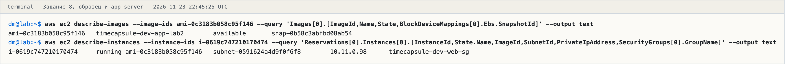

Рисунок 8.1. Образ `available`, идентификатор снимка; `app` в `public-a`, группа `timecapsule-dev-web-sg`, адрес `10.11.0.98`.

**Ответ.** Образ содержит снимок диска экземпляра: операционную систему, установленные nginx, PHP-FPM, PostgreSQL, код приложения, файл `.env`, загруженные файлы и саму базу данных. Без установки на `app-server` оказались приложение, настройки и данные ЛР2. База данных сейчас находится на диске `app-server` (локальный PostgreSQL), позднее (задание 12) данные переезжают на `db-server`.

Завершение `web-server` Части 1 (`Terminate`) отложено до снимков консоли, см. раздел "Итог".

### Задание 9. Elastic IP

Выполнено: выделен `timecapsule-dev-app-eip` (тег `Name` и остальные теги), привязан к `app`, `APP_URL` в `.env` заменён на `http://63.182.6.9`, после правки восстановлены группа `apache` и права 640 (команда `sed -i` пересоздаёт файл), PHP-FPM перезагружен.

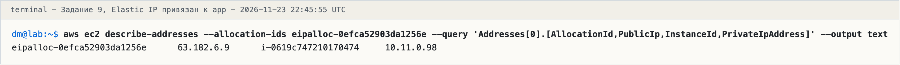

Рисунок 9.1. Адрес `63.182.6.9`, привязанный к `i-0619c747210170474`.

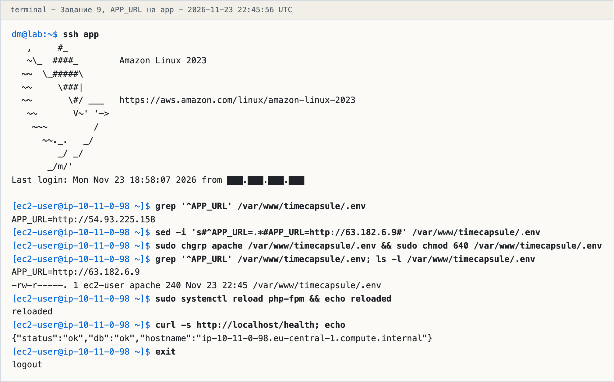

Рисунок 9.2. Замена `APP_URL`, права на `.env`, `reload php-fpm`, `/health` на сервере.

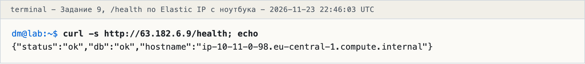

Рисунок 9.3. `/health` по Elastic IP с ноутбука.

Рисунок 9c.1. Приложение в браузере по Elastic IP `app`, вход выполнен под пользователем ЛР2.

**Ответ.** Пользователи и `APP_URL` обращаются к `app` по публичному адресу, и он не должен меняться, а `bastion` нужен только администратору, который каждый раз берёт его новый адрес из консоли или CLI. Пока сервер остановлен, Elastic IP стоит $0,005 в час: адрес остаётся выделенным, а AWS берёт плату за занятый публичный IPv4. Когда появится балансировщик нагрузки, клиенты станут обращаться к его DNS-имени, и Elastic IP на сервере приложения не понадобится.

### Задание 10. База данных приложения на `db-server`

Выполнено: на `db` создан пользователь `timecapsule` с новым паролем и база `timecapsule`; строка `pg_hba.conf` заменена на `host timecapsule timecapsule 10.11.0.0/24 scram-sha-256`; PostgreSQL перезапущен (`active`). Проверено: прежняя пара `student` / `lab3` отклоняется сообщением `no pg_hba.conf entry`.

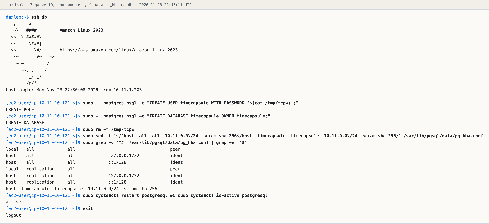

Рисунок 10.1. Создание пользователя и базы, содержимое `pg_hba.conf`, перезапуск.

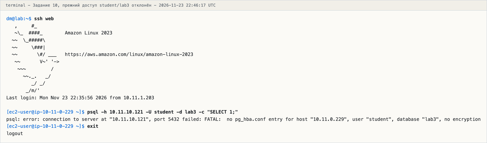

Рисунок 10.2. Вход `student` в `lab3` с `web` отклонён.

**Ответ.** Закрытый порт 5432 защищает только один слой, а пароль защищает вход после того, как соединение установлено: при ошибке в правиле Security Group, при взломе другого сервера VPC или при утечке ключа к базе мог бы подключиться любой, кто угадает слабый пароль. Новый пароль также исключает повторное использование пароля из ЛР2, который мог попасть в журналы и снимки.

### Задание 11. Приватная зона Route 53

Выполнено: создана приватная зона `timecapsule.internal` (Private, VPC `timecapsule-dev-vpc`, теги через `change-tags-for-resource`), запись `db` A `10.11.10.121`, TTL 60; запись проверена через `list-resource-record-sets` и дождались завершения изменения (`INSYNC`); перед первой проверкой выдержана пауза 90 секунд.

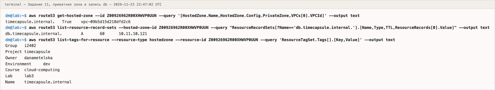

Рисунок 11.1. Зона (приватная, VPC `vpc-09b5d15d218dfd2c6`), запись `db`, теги.

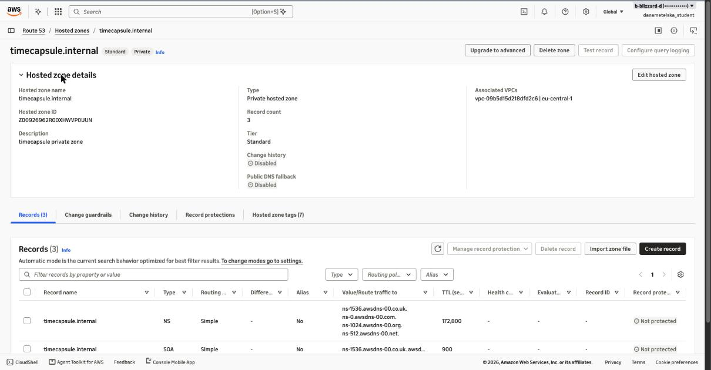

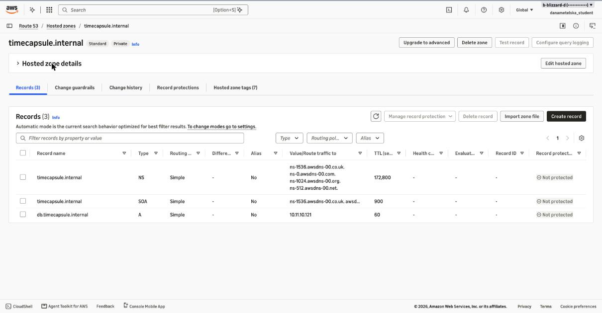

Рисунки 11c.1-11c.2. Консоль AWS: приватная зона `timecapsule.internal` (связана с `timecapsule-dev-vpc`) и запись `db` типа A со значением `10.11.10.121`, TTL 60.

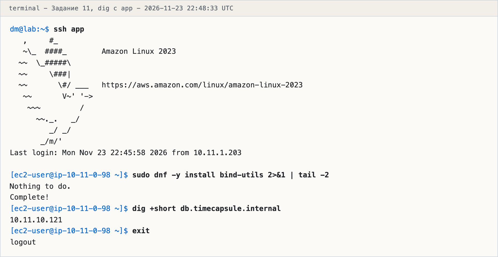

Рисунок 11.2. `dig +short db.timecapsule.internal` с `app` возвращает `10.11.10.121`.

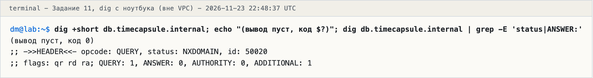

Рисунок 11.3. С ноутбука ответа нет (`status: NXDOMAIN`).

**Ответ.** Приватная зона связана с VPC `timecapsule-dev-vpc` и отвечает только на запросы DNS-резолвера VPC (адрес `.2`), который доступен серверам внутри сети. Ноутбук обращается к публичным DNS-серверам, где зоны `timecapsule.internal` нет. При пересоздании `db-server` с другим адресом нужно изменить значение записи `db` в зоне; `.env` приложения менять не придётся.

### Задание 12. Перенос данных и переключение приложения

Выполнено: на `app` сохранена локальная база (`pg_dump`, файл 8033 байта), загружена в `db.timecapsule.internal` (`psql -f`: `COPY 2`, `COPY 1`, `COPY 3`), в `.env` заменены `DB_HOST` и `DB_PASSWORD` (после правки восстановлены группа `apache` и права 640), PHP-FPM перезагружен, локальный PostgreSQL отключён (`inactive`). Проверено: `/health` отвечает `"db":"ok"`, в новой базе 2 капсулы. После проверки образ `timecapsule-dev-app-lab2` отменён (`deregister`), его снимок удалён (образов и снимков 0).

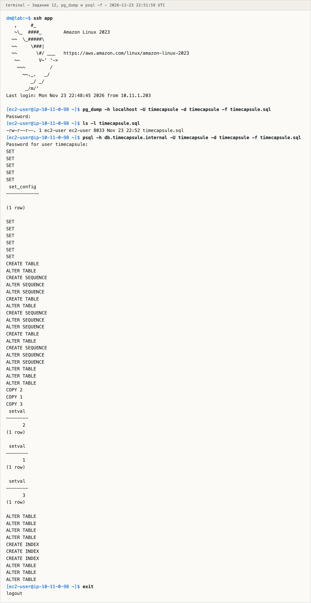

Рисунок 12.1. `pg_dump` и `psql -f` по приватному имени.

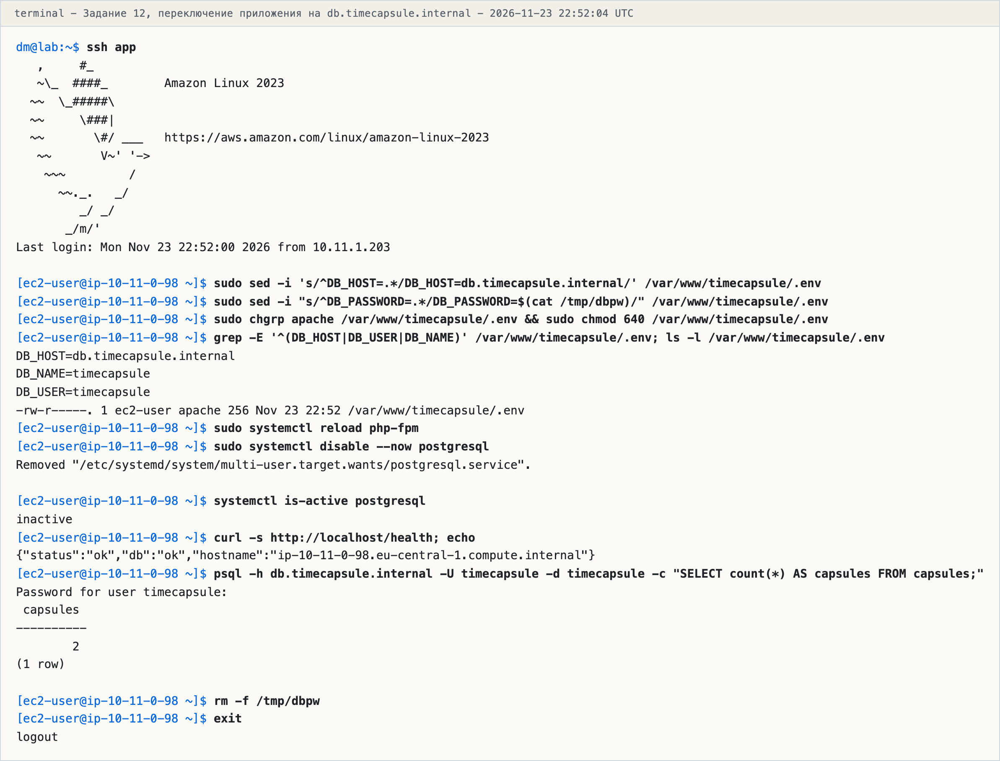

Рисунок 12.2. Переключение `.env`, остановка локальной базы, `/health`, число капсул в новой базе.

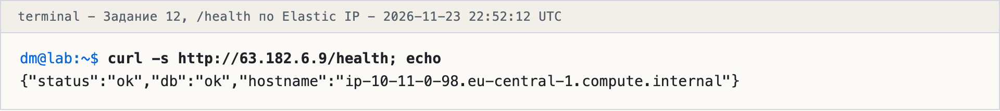

Рисунок 12.3. `/health` по Elastic IP с ноутбука.

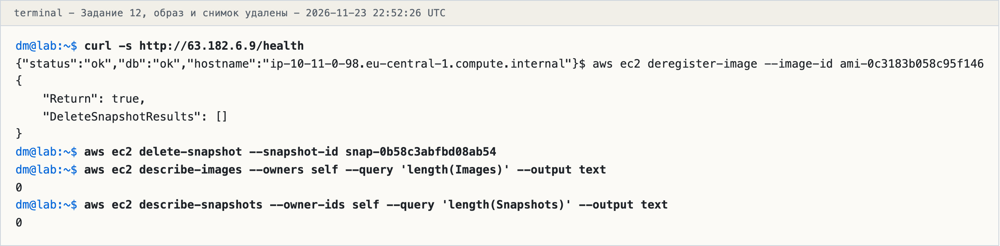

Рисунок 12.4. Образ и снимок удалены.

Рисунок 12c.1. Капсулы ЛР2 на странице приложения после переключения на `db.timecapsule.internal`.

**Ответ.** Загруженные файлы лежат на диске `app-server` в `/var/www/timecapsule/storage/uploads`, то есть переехали вместе с образом, а не с базой. При удалении `app-server` (Terminate) его диск удаляется вместе с файлами, и они пропадают безвозвратно, если не сделана копия; в базе при этом остаются записи о файлах. Поэтому следующая работа выносит файлы в S3.

### Задание 13. Деплой и обслуживание

**Новая версия.** В подвал добавлена строка "LR3", изменение отправлено в репозиторий (коммит `feat(layout): mark footer with LR3`), выпуск выполнен командой `ssh app ./deploy.sh` через bastion; в `ops/deploy.sh` ничего не менялось.

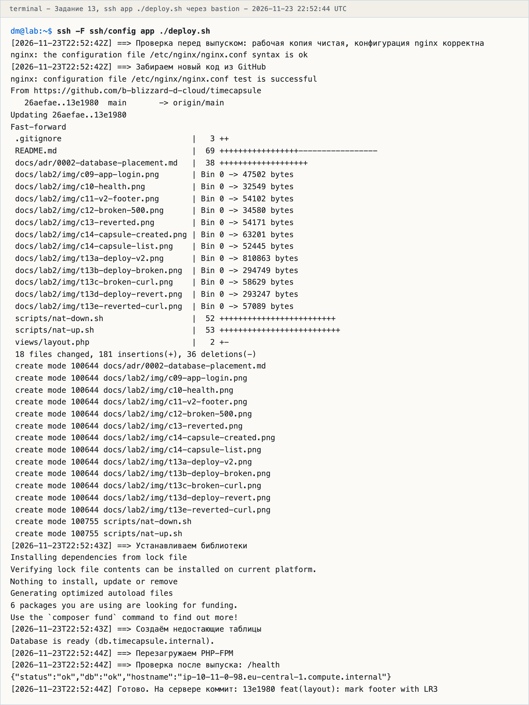

Рисунок 13.1. Вывод `deploy.sh` (`git pull`, `composer install`, `init-db`, `reload`, `/health`, итоговый коммит `13e1980`).

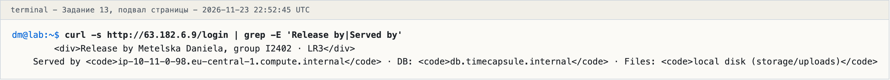

Рисунок 13.2. Подвал страницы содержит "LR3", `DB: db.timecapsule.internal`.

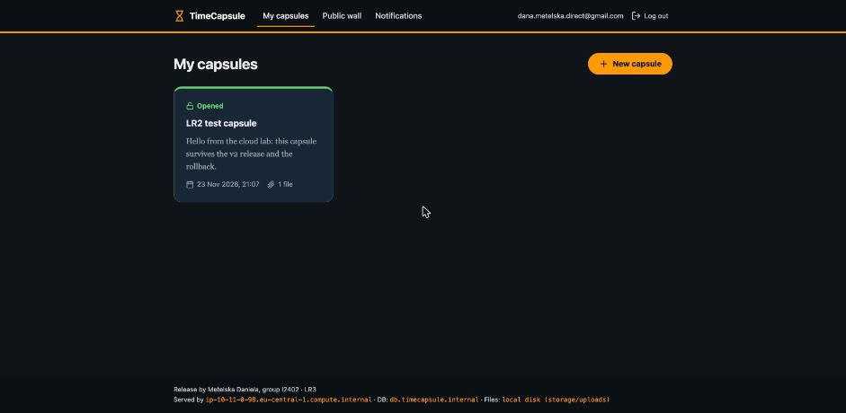

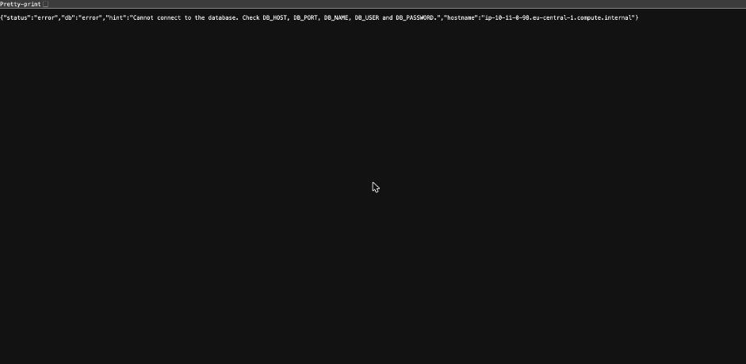

Рисунки 13c.1-13c.2. Подвал страницы с отметкой LR3 и ответ `/health` при остановленной базе данных (`"db":"error"`).

**Ответ.** Скрипт обращается к приложению по локальным путям на самом сервере (`/var/www/timecapsule`, `git pull`, `composer`), а не к адресам сети. Через bastion идёт только транспорт SSH, который описан в `~/.ssh/config`, поэтому изменились лишь параметры подключения, но не команды выпуска.

**Отказ базы.** Остановлен `db`; `/health` и главная страница ответили кодом 500 через 5,1 с (приложение ждёт соединения около пяти секунд); `db` запущен снова, приложение ожило без изменений на `app` (`/health` 200, главная 302 на страницу входа). Приватный адрес `db` до остановки и после: `10.11.10.121`.

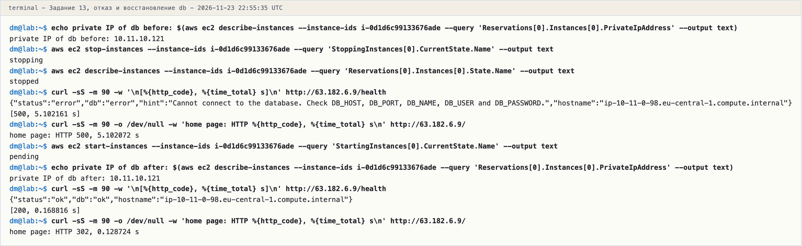

Рисунок 13.3. Отказ и восстановление базы.

[СКРИНШОТ: `c13-health-db-down.png` (`/health` в браузере при остановленной базе)]

**Ответ.** `/health` показал `"status":"error","db":"error"` с подсказкой проверить параметры подключения, потому что приложение не смогло подключиться к остановленной базе. Приватный адрес `db-server` не изменился, так как он принадлежит сетевому интерфейсу в подсети и сохраняется между остановкой и запуском; поэтому имя `db.timecapsule.internal` и `.env` остались верными.

**Обновление пакетов (вариант B).** Скрипты `scripts/nat-up.sh` и `scripts/nat-down.sh` созданы и запущены; между ними на `db` выполнен `dnf -y update`.

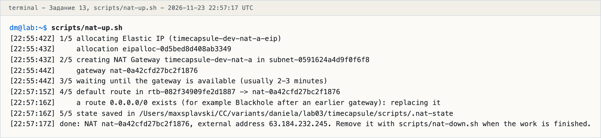

Рисунок 13.4. Вывод `nat-up.sh`: адрес, шлюз, ожидание, маршрут (существующий Blackhole-маршрут заменён), файл состояния.

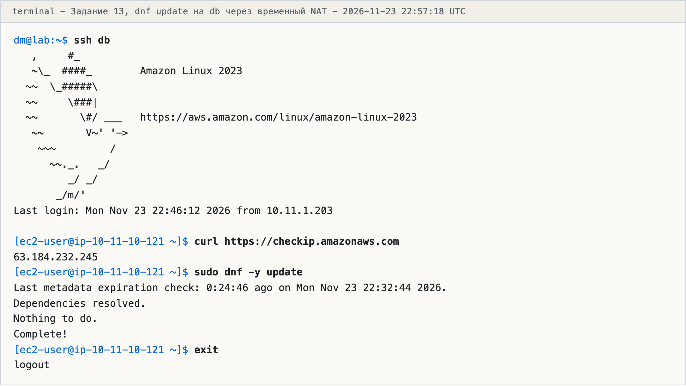

Рисунок 13.5. `checkip` (адрес нового шлюза `63.184.232.245`) и `dnf -y update` на `db`.

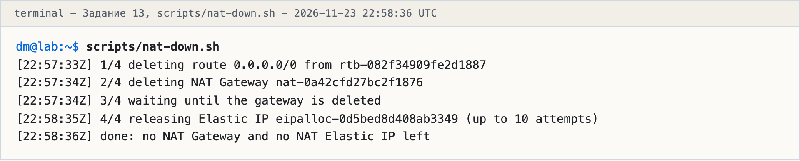

Рисунок 13.6. Вывод `nat-down.sh`: маршрут, шлюз, ожидание `deleted`, освобождение адреса.

**Ответ.** Адрес Elastic IP занят, пока им пользуется NAT Gateway, и AWS не позволит его освободить, пока шлюз не перейдёт в состояние `deleted` (команда вернёт ошибку `InvalidIPAddress.InUse`). Поэтому скрипт ждёт `nat-gateway-deleted` и при необходимости повторяет освобождение до десяти раз с паузой 15 секунд.

### Задание 14. Архитектура и решение

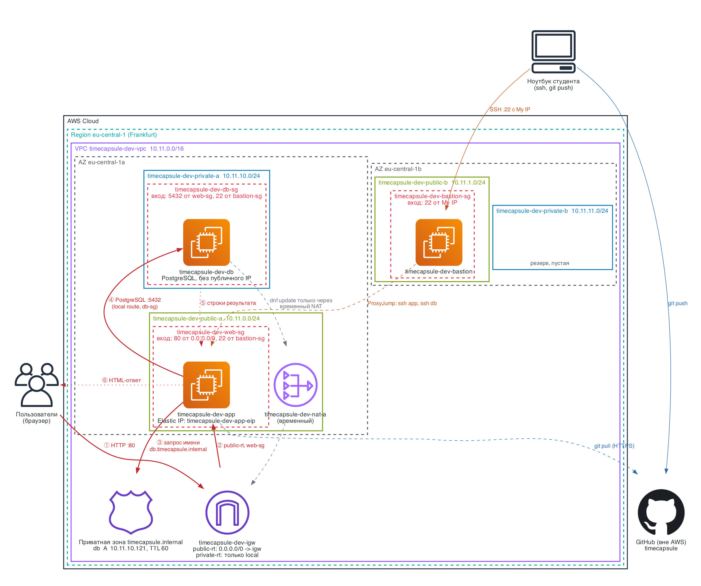

Рисунок 14.1. Схема: пользователи, ноутбук и GitHub вне AWS; `timecapsule-dev-vpc`, две зоны, четыре подсети, Internet Gateway, три сервера с группами безопасности, приватная зона Route 53, временный NAT Gateway пунктиром. Путь запроса: ① браузер -> IGW; ② IGW -> `app` (`public-rt`, `web-sg`); ③ `app` запрашивает имя `db.timecapsule.internal`; ④ `app` -> `db`, порт 5432 (локальный маршрут, `db-sg`); ⑤ строки результата возвращаются в `app`; ⑥ HTML-ответ пользователю.

Решение о размещении базы данных записано в [ADR-0002](../adr/0002-database-placement.md): отдельный сервер в приватной подсети (53 балла из 65 против 38 и 43).

## Итог

Состояние после работы указано в `logs/` рабочей папки и в разделе ниже; на момент сдачи серверы `bastion`, `app`, `db` остановлены, `web` и LR2 `webserver` завершены, NAT Gateway нет, платным остаётся Elastic IP `app`, диски EBS и приватная зона Route 53.

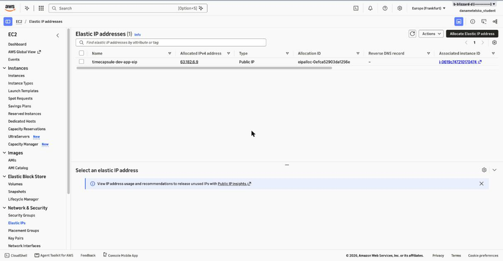

Рисунки 14c.1-14c.2. Консоль AWS: единственный Elastic IP (`timecapsule-dev-app-eip`) и NAT Gateway без состояния `Available` (только `Deleted`).

Рисунок 15.1. `Elastic IPs` (только адрес `app`) и `NAT gateways` (без `Available`).

## Ответы на устные вопросы

1. **Путь запроса.** Браузер обращается к Elastic IP `app`; запрос идёт в Internet Gateway, по `public-rt` (маршрут `0.0.0.0/0` на шлюз) в `public-a`; Network ACL подсети пропускает его, `web-sg` разрешает порт 80, nginx передаёт запрос PHP-FPM. Приложение спрашивает у резолвера VPC адрес `db.timecapsule.internal`, получает `10.11.10.121` и по локальному маршруту обращается к порту 5432; Network ACL `private-a` и `db-sg` (источник `web-sg`) пропускают, `pg_hba.conf` проверяет пользователя и пароль. Ответ возвращается тем же путём, так как Security Group отслеживают соединения.
2. **Что нужно знающему IP.** Знания приватного адреса недостаточно: нужен маршрут в приватную подсеть (то есть доступ из самой VPC, например через `bastion`), сетевой доступ от члена `web-sg` или с адреса `10.11.0.0/24`, а затем имя пользователя `timecapsule`, база `timecapsule` и пароль. Из интернета путь отсутствует.
3. **Временный NAT.** Плюс: оплата только за часы работы (центы за обновление против около $1,25 в сутки), нет постоянного выхода в интернет и меньшая поверхность атаки. Минусы: перед каждым обновлением шлюз нужно создавать и удалять (поэтому написаны скрипты), легко забыть удалить, маршрут после удаления остаётся `Blackhole`, пока его не уберут, а Elastic IP нужно освобождать отдельно.
4. **Отказ зоны `eu-central-1a`.** Сейчас `app` и `db` находятся только в зоне `a`, поэтому при её отказе недоступно всё. Не хватает второго сервера приложения в `public-b` (или `private-b`), балансировщика нагрузки перед ним, реплики базы или управляемой базы в двух зонах, а также автоматического замещения серверов (Auto Scaling) и хранения файлов вне диска сервера.

## Вывод

Собрана сеть из VPC, четырёх подсетей в двух зонах, Internet Gateway, двух таблиц маршрутов и трёх групп безопасности; все ресурсы названы и помечены семью тегами. База данных вынесена в приватную подсеть без публичного адреса, к ней открыт только порт 5432 от `web-sg`, а вход ограничен `pg_hba.conf`. Приложение ЛР2 перенесено через образ, получило постоянный адрес и находит базу по имени `db.timecapsule.internal`. Обновления базы выполняются через временный NAT Gateway скриптами `nat-up.sh` и `nat-down.sh`. Ограничением остаётся одна зона доступности и хранение файлов на диске сервера.

## Источники

1. Задание лабораторной работы №3 курса "Cloud Computing", лекция 5 и Hands-on 5.1.
2. Amazon VPC User Guide: подсети (зарезервированные адреса), таблицы маршрутов, NAT gateways, Network ACLs.
3. Amazon Route 53 Developer Guide: private hosted zones.
4. PostgreSQL 16 documentation: `pg_hba.conf`, `pg_dump`.
