# Лабораторная работа №4. Облачные хранилища. Amazon S3

| Поле | Значение |
| --- | --- |
| Студент | Metelska Daniela |
| Группа | I2402 |
| Специальность | Informatică |
| Уровень | продвинутый (Часть 1 и Часть 2, задания 1-14) |
| Репозиторий | https://github.com/b-blizzard-d-cloud/timecapsule (публичный) |
| ADR | [docs/adr/0003-attachment-storage.md](../adr/0003-attachment-storage.md) |
| Схема | [docs/lab4/diagram.png](diagram.png) |

Номер аккаунта и домашний IP-адрес в отчёте скрыты. Подписанные ссылки приведены с обрезанной подписью. Снимки консоли AWS получены в реальной консоли; страницы ошибок S3 в формате XML Chrome не снимает, они показаны рисунками терминала.

## Паспорт ресурсов

| Ресурс | Имя | Значение |
| --- | --- | --- |
| Бакет S3 | `timecapsule-dev-uploads-danametelska` | `eu-central-1`, General purpose, ACLs disabled (`BucketOwnerEnforced`), Block all public access (4 из 4), SSE-S3 (`AES256`), версионирование включено |
| Политика бакета | `DenyInsecureTransport` | запрет `s3:*` при `aws:SecureTransport=false` |
| Правило жизненного цикла | `timecapsule-dev-noncurrent` | создаётся в консоли (см. задание 5) |
| Политика IAM | `timecapsule-dev-app-s3` | версия `v1` (с `ListBucket`), версия `v2` по умолчанию (без `ListBucket`) |
| Роль для проверки | `timecapsule-dev-s3-tester` | доверие: этот аккаунт; политика: только `timecapsule-dev-app-s3` |
| Роль сервера | `timecapsule-dev-app-role` + профиль экземпляра с тем же именем | доверие: `ec2.amazonaws.com`; привязана к `timecapsule-dev-app` (`i-0619c747210170474`) |
| Теги на всех ресурсах | `Name`, `Project=timecapsule`, `Environment=dev`, `Owner=danametelska`, `Lab=lab4`, `Course=cloud-computing`, `Group=i2402` | бакет, политика, обе роли и профиль экземпляра |

## Как выполнялась работа

Ресурсы создавались командами AWS CLI под профилем студента; каждая настройка подтверждена независимой командой `get-*` / `describe-*`. Команды заданий выполнялись на ноутбуке (части 1 и 2) и на `app` через SSH; выводы воспроизведены без изменений, подписи подписанных ссылок обрезаны. Консоль AWS используется там, где задание требует показать именно консоль (папки и свойства объекта, версии, правило жизненного цикла).

## Отклонения от задания и ограничения

1. Бакет, папки, загрузка файлов, включение версионирования, политики и роли созданы через AWS CLI, а не мастерами консоли; параметры соответствуют заданию. Версионирование включено сразу после заданий 1-3 (объекты, загруженные до включения, имеют `VersionId = null`, см. задание 4), потому что от него зависят проверки Части 2.
2. Вместо CloudShell команды выполнялись на ноутбуке под тем же IAM-пользователем `danametelska_student`: права и вывод те же. Снимки CloudShell добавляются отдельно (см. `CONSOLE_TODO.md` рабочей папки).
3. Путь приложения на сервере: `/var/www/timecapsule`, без `current/` (так развёрнуто в ЛР2; в задании указан `current/`).
4. Картинка в задании 1: `danametelska-lab4.jpg` (1280x720, сгенерирована), PDF: `lab4-doc.pdf`.
5. Команда `aws s3 sync --dryrun` без `sudo` отработала: файлы в `storage/uploads` читаются всеми (права `rw-r--r--`), поэтому ошибка чтения, описанная в задании, не воспроизвелась; реальная синхронизация выполнена под `sudo`, как требует задание.
6. Первый запуск `deploy.sh` завершился ошибкой `cannot create directory at 'storage/logs'`: каталог `storage` принадлежит `apache`, а `git pull` выполняется от `ec2-user`. Исправлено коммитом `92290cc`: `ops/deploy.sh` перед `git pull` создаёт `storage/logs` с владельцем `ec2-user` и группой `apache`.
7. Из репозитория удалён `storage/uploads/.gitkeep` (локальная папка больше не используется); подвал страницы теперь помечен `LR4`.
8. Проверка модуля хранения без входа в приложение выполнена скриптом на `app` под ролью (пароль пользователя агент не вводит); проверка в браузере выполняется пользователем (см. задание 12).
9. Free plan: бесплатные лимиты S3 покрывают работу; платных ресурсов Части 2 кроме запущенных на время работы `bastion`, `app`, `db` нет.

## Часть 1. Базовый уровень

### Задание 1. Бакет и объекты

**Что сделано.** Создан бакет `timecapsule-dev-uploads-danametelska` в `eu-central-1` (General purpose, ACLs disabled, Block all public access, SSE-S3, теги), версионирование выключено. Созданы папки `uploads/`, `backups/`; в `uploads/` загружены `danametelska-lab4.jpg` и `lab4-doc.pdf`, в `backups/` файл `backup.txt`.

**Как проверено.** Командами `get-public-access-block`, `get-bucket-encryption`, `get-bucket-ownership-controls`, `get-bucket-tagging`, `get-bucket-versioning` (выводы сохранены в `logs/01-bucket-describe.txt` рабочей папки); `head-object` картинки показан в задании 2.

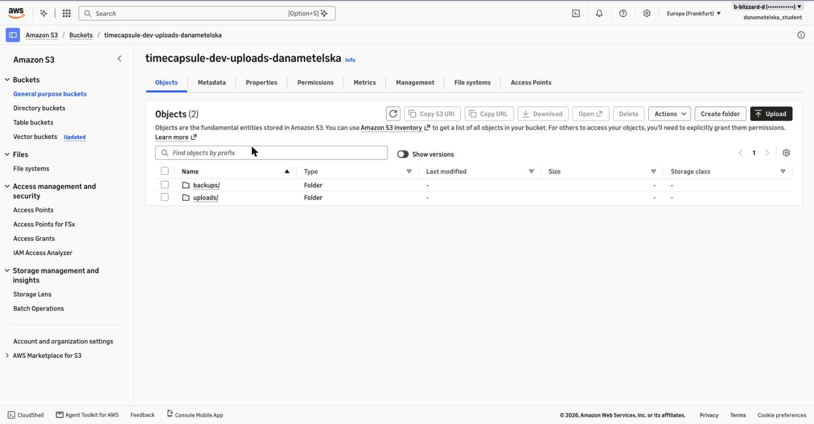

Консоль S3: в бакете две папки, `backups/` и `uploads/`.

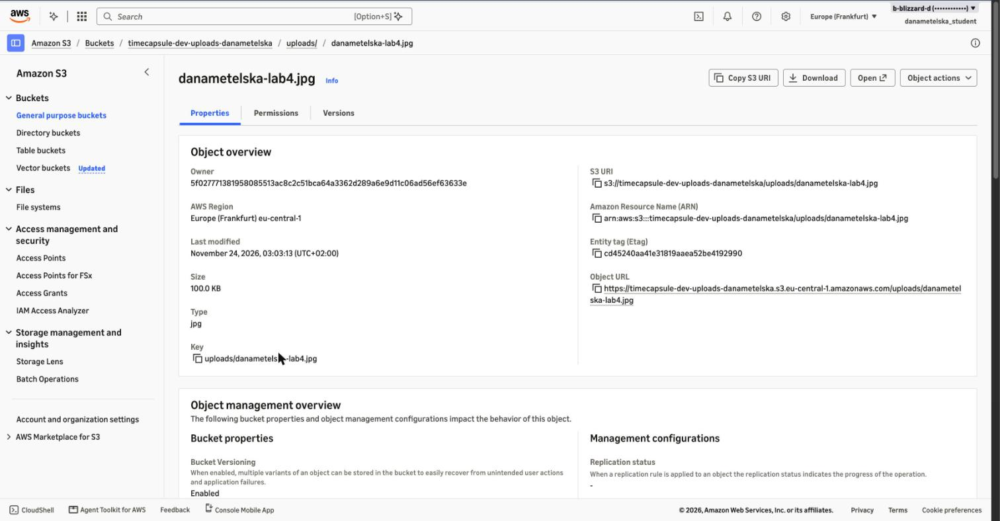

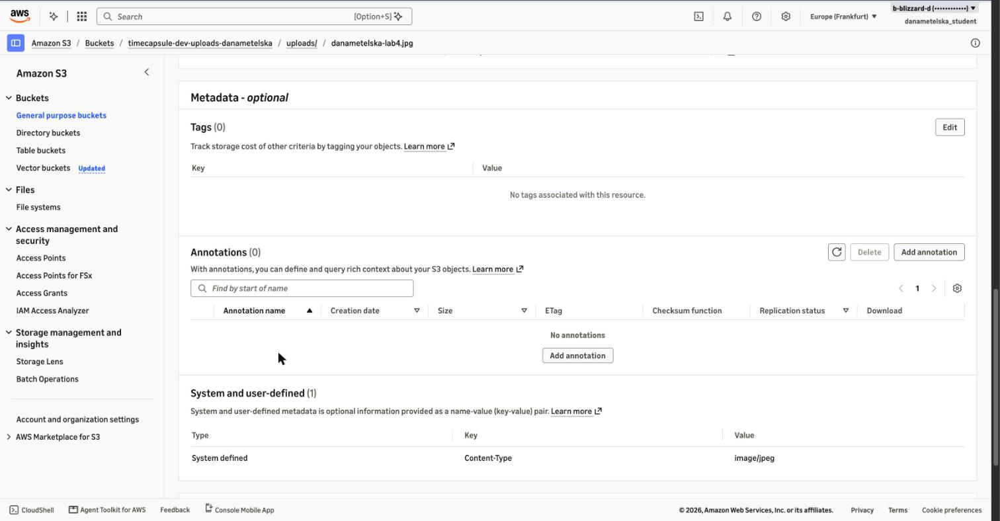

Свойства картинки: ключ `uploads/danametelska-lab4.jpg`, `Etag`, `Object URL`; ниже `Content-Type` = `image/jpeg`.

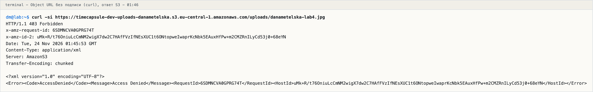

`Object URL` без подписи возвращает `AccessDenied` (HTTP 403). Chrome не показывает XML-страницу ошибки в снимке, поэтому ответ снят запросом `curl` к тому же адресу.

**Ответ.** Ключ картинки: `uploads/danametelska-lab4.jpg`. `Object URL` не открывается, так как бакет закрыт Block Public Access, а адрес без подписи делает анонимный запрос; права владельца действуют только для подписанных запросов. Кнопка `Create folder` создаёт пустой объект с ключом, заканчивающимся на `/` (`uploads/`), а папок в S3 нет: есть только ключи с общим префиксом.

### Задание 2. Объекты из командной строки

**Что сделано.** Команды задания: `cp`, `sync`, три варианта `ls`, `head-object`, скачивание и удаление `report-2.txt`.

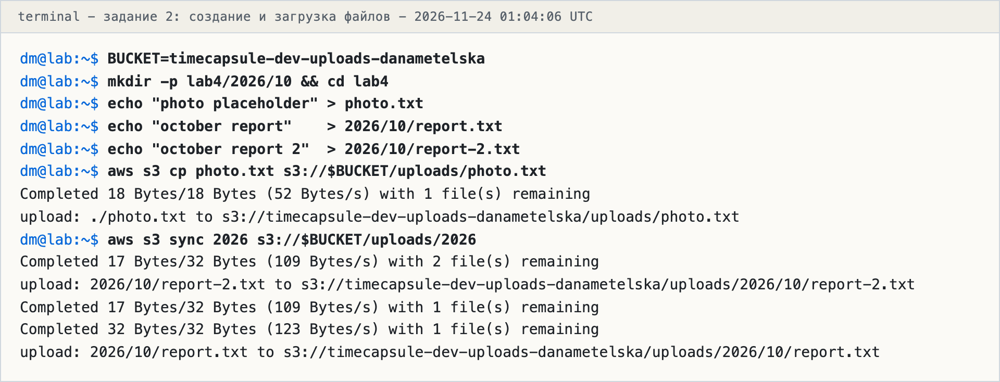

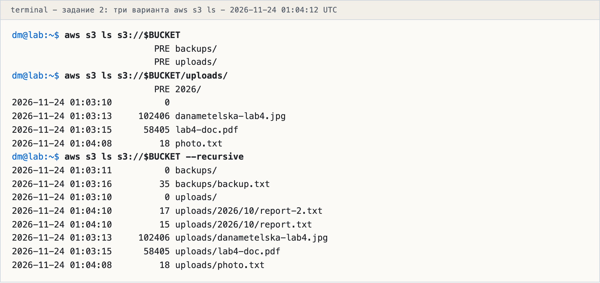

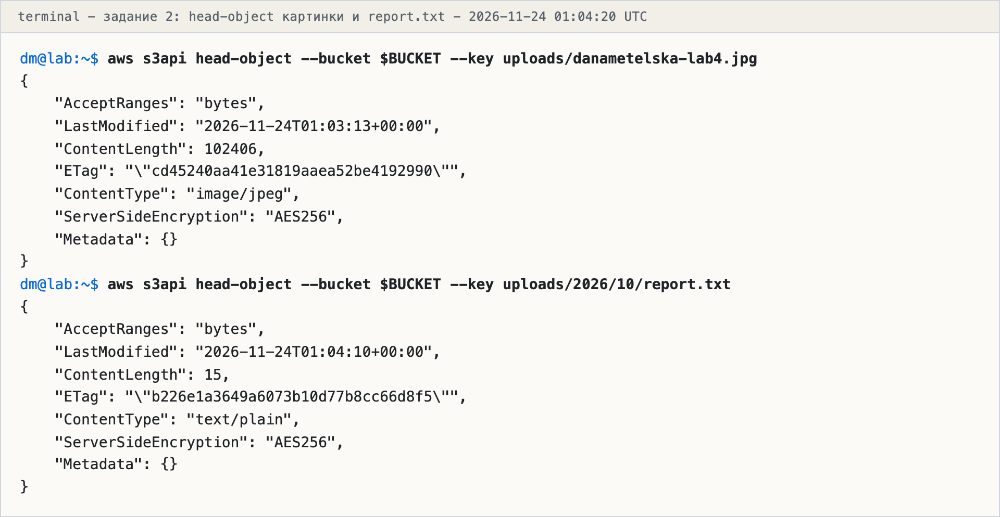

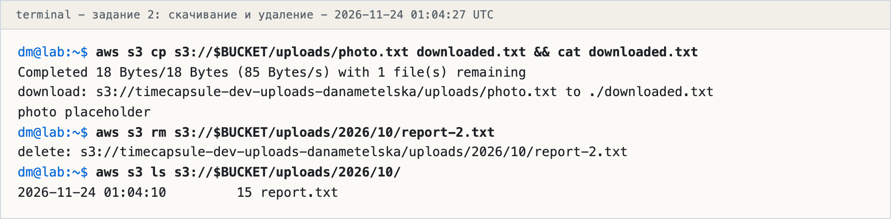

**Как проверено.** Повторный `aws s3 ls s3://$BUCKET/uploads/2026/10/` показывает только `report.txt`.

**Ответ.** Команда `ls` без `--recursive` группирует ключи по разделителю `/` и показывает общие префиксы как `PRE`, а с `--recursive` выводит полные ключи всех объектов. `report.txt` получил `Content-Type: text/plain`: CLI определяет тип по расширению файла (`.txt`), если тип не задан явно.

### Задание 3. Политика бакета: только HTTPS

**Что сделано.** Добавлена политика `DenyInsecureTransport` (`Effect: Deny`, `Principal: "*"`, `Action: "s3:*"`, `Resource`: бакет и `/*`, `Condition: Bool aws:SecureTransport=false`). Файл: [bucket-policy.json](bucket-policy.json).

**Как проверено.** `get-bucket-policy` и две команды задания (рисунок ниже): запрос по HTTPS проходит, запрос на `http://` получает `AccessDenied` с пометкой `explicit deny in a resource-based policy`.

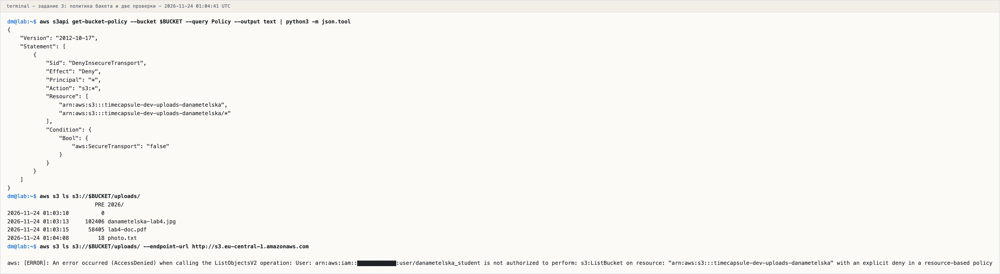

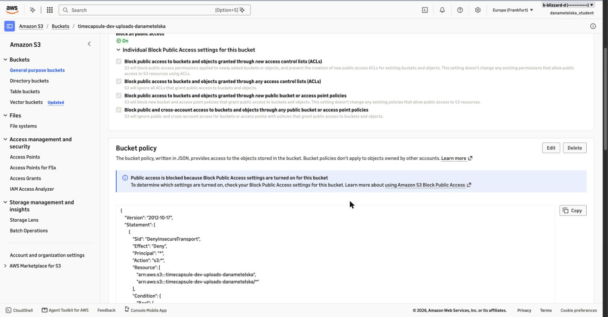

Вкладка `Permissions`: Block public access включён (4 из 4), в политике бакета оператор `DenyInsecureTransport`.

**Ответ.** Явный запрет в политике бакета сильнее любого разрешения, поэтому права администратора не помогают: условие `aws:SecureTransport=false` истинно для запроса по `http://`. Block Public Access блокирует политики, которые открывают доступ публично (`Allow` для `"*"`), а эта политика только запрещает, поэтому сохранилась без ошибок.

### Задание 4. Версионирование

**Что сделано.** Версионирование включено; загруженные ранее объекты имеют `VersionId = null`. Файл `notes.txt` с текстом `v1` загружен в `uploads/` (`VersionId` реальный). Дальнейшие шаги выполнены в консоли: загрузка `v2`, удаление (маркер), удаление маркера (`notes.txt` вернулся с `v2`), удаление версии `v2`.

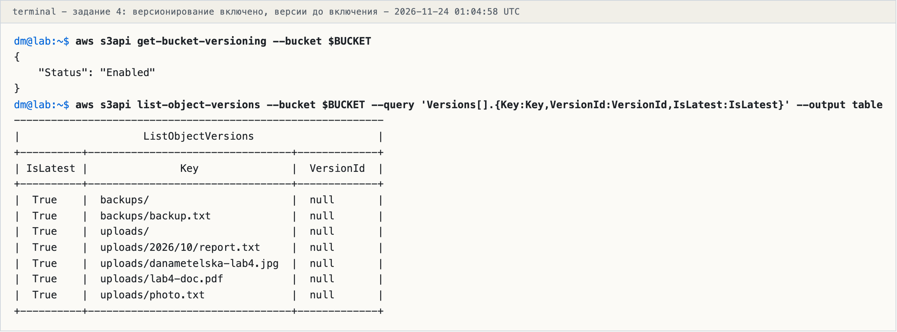

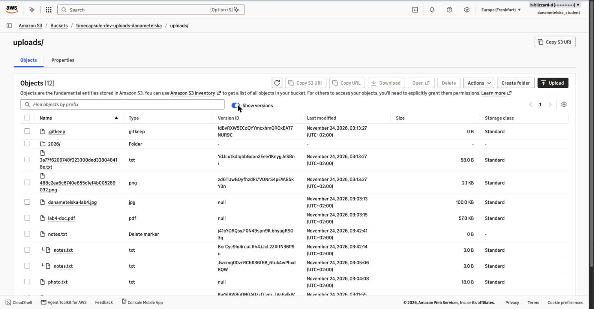

`Show versions`: у `notes.txt` маркер удаления (`Delete marker`) и две версии, `v2` и `v1`; у `danametelska-lab4.jpg`, `lab4-doc.pdf`, `photo.txt` `Version ID` = `null` (загружены до включения версионирования).

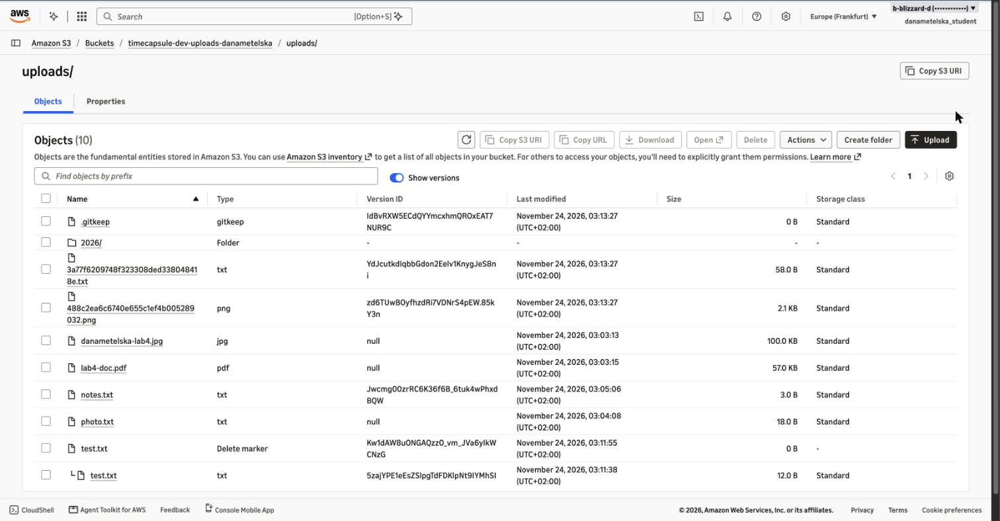

После удаления маркера и версии `v2` у `notes.txt` осталась одна версия, `v1`.

**Как проверено.** `get-bucket-versioning` -> `Enabled`; `list-object-versions` после шагов консоли:

```
$ aws s3api list-object-versions --bucket $BUCKET --prefix uploads/notes.txt
Versions:       Jwcmg00zrRC6K36f6B_6tuk4wPhxdBQW  IsLatest=true  Size=3
DeleteMarkers:  нет
$ aws s3 cp s3://$BUCKET/uploads/notes.txt -
v1
```

**Ответ.** Удаление без указания версии (шаг 2) создаёт маркер удаления: объект исчезает из списка, но обе версии сохраняются, и удаление маркера (шаг 4) возвращает `v2`. Удаление конкретной версии (шаг 5) окончательно, вернуть `v2` после него нельзя. Поэтому приложению разрешено только первое (`s3:DeleteObject`), а `s3:DeleteObjectVersion` в политике нет.

### Задание 5. Правило жизненного цикла

**Что сделано.** Правило `timecapsule-dev-noncurrent` создано в консоли: префикс `uploads/`; неактуальные версии переходят в Standard-IA через 30 дней; неактуальные версии удаляются через 90 дней, `Number of newer versions to retain` = 2; незавершённые многочастные загрузки удаляются через 7 дней.

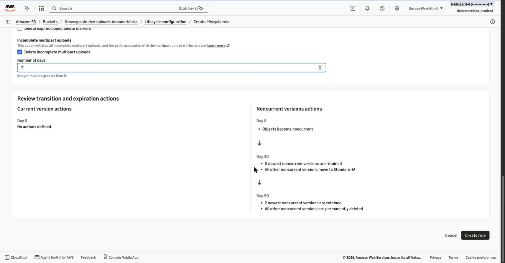

Блок `Review transition and expiration actions` перед нажатием `Create rule`.

**Как проверено.**

```
$ aws s3api get-bucket-lifecycle-configuration --bucket $BUCKET
Rules:
  ID: timecapsule-dev-noncurrent, Status: Enabled, Filter: Prefix uploads/
  NoncurrentVersionTransitions: 30 дней -> STANDARD_IA
  NoncurrentVersionExpiration: 90 дней, NewerNoncurrentVersions: 2
  AbortIncompleteMultipartUpload: 7 дней
```

**Как проверено.** `aws s3api get-bucket-lifecycle-configuration` (вывод вставляется после создания правила).

**Ответ.** Для файла, перезаписанного 10 раз за неделю, правило ничего не делает в течение 30 дней: девять неактуальных версий будут переведены в Standard-IA, когда каждой исполнится 30 дней с момента, как она стала неактуальной. Через 90 дней удаляются неактуальные версии, кроме двух самых новых. Маленькие файлы в Standard-IA не попадут, так как класс берёт минимум 128 КиБ на объект, а переходы объектов меньшего размера по умолчанию не выполняются. Незавершённая загрузка частями это начатая, но не завершённая и не отменённая многочастная загрузка; загруженные части хранятся скрыто и оплачиваются как обычные данные, пока их не удалить.

### Задание 6. Подписанные URL

**Что сделано.** Ссылка из CLI на `uploads/photo.txt` на 120 секунд открыта (HTTP 200), затем `photo.txt` в адресе заменён на `notes.txt` (ошибка), и через 125 секунд исходная ссылка открыта повторно (ошибка).

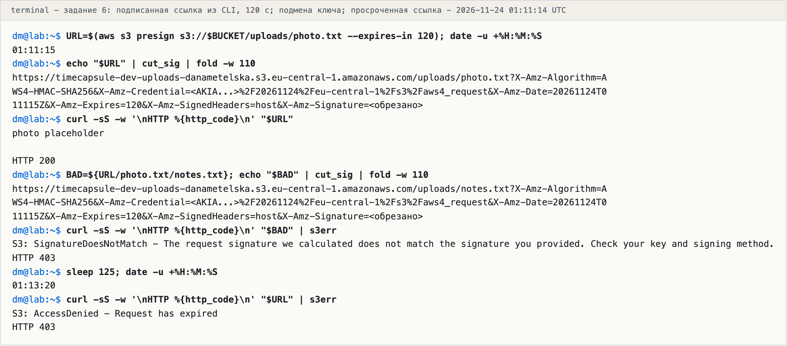

Подписанная ссылка из консоли (`Share with a presigned URL`) не снималась: она дублирует команды CLI выше.

**Как проверено.** Ответы S3 в рисунке: `SignatureDoesNotMatch` (HTTP 403) и `AccessDenied: Request has expired` (HTTP 403).

**Ответ.** В шаге 3 S3 вернул `SignatureDoesNotMatch`, в шаге 4 `AccessDenied` с сообщением `Request has expired`. Подпись вычисляется от ключа, метода, срока и других параметров, поэтому смена ключа делает подпись недействительной, а получить другой файл можно только имея ключ подписи. Команда `aws s3 presign` к S3 не обращалась: адрес и подпись вычислены локально из учётных данных, объект проверяется только при открытии ссылки.

Временные файлы удалены: `rm -rf lab4` (рабочая папка проверки), бакет сохранён.

## Часть 2. Продвинутый уровень

### Задание 7. Политика приложения

**Что сделано.** Создана политика `timecapsule-dev-app-s3` (теги) с двумя утверждениями: `ListUploadsPrefix` (`s3:ListBucket` на бакет с условием `StringLike s3:prefix ["uploads/*"]`) и `ObjectsUnderUploads` (`s3:GetObject`, `s3:PutObject`, `s3:DeleteObject` на `.../uploads/*`). Звёздочек в `Action` и `Resource` нет. Файл: [app-policy-v1.json](app-policy-v1.json).

**Как проверено.** `get-policy-version` (рисунок в задании 8).

**Ответ.** `s3:ListBucket` относится к бакету, потому что перечисляет его содержимое, а `s3:GetObject` к объектам, поэтому ARN бакета не содержит `/*`, а ARN объектов содержит. Если перепутать ARN, правило перестанет совпадать с запросом: например, `ListBucket` на `.../uploads/*` не разрешит ничего (запрос идёт к ресурсу-бакету), а `GetObject` на ARN бакета не разрешит чтение объектов; оба случая заканчиваются неявным запретом.

### Задание 8. Проверка прав через тестовую роль

**Что сделано.** Создана роль `timecapsule-dev-s3-tester` (доверие: этот аккаунт; политика только `timecapsule-dev-app-s3`; теги). Роль принята командой `assume-role`; `get-caller-identity` показывает `assumed-role/timecapsule-dev-s3-tester/lab4`. Колонка "Ожидаю" заполнена и закоммитена до выполнения команд ([expected-permissions.md](expected-permissions.md), коммит `c4a8f0e`).

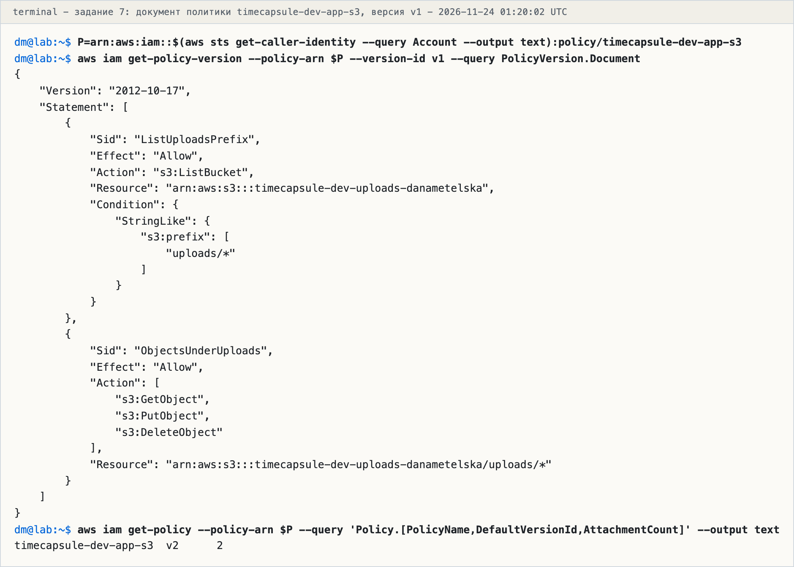

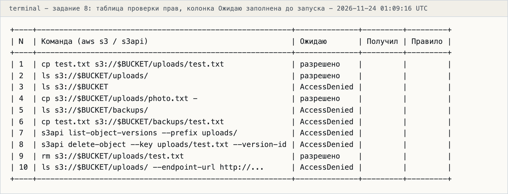

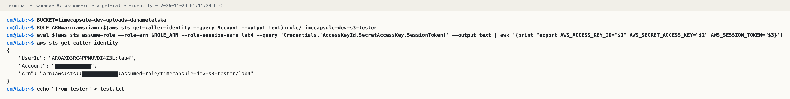

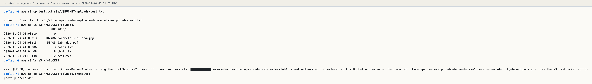

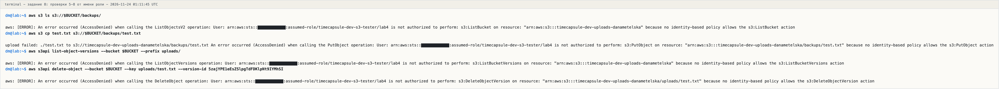

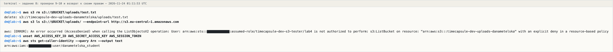

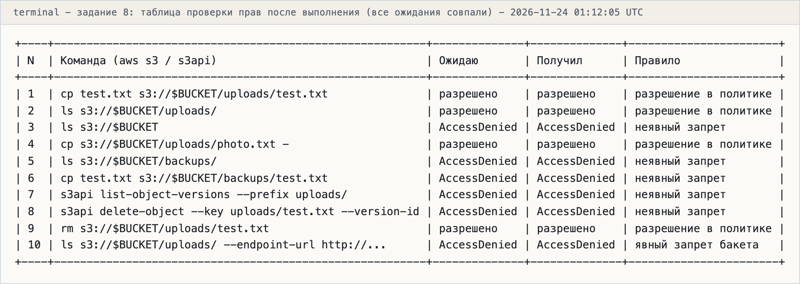

Заполненная таблица (политика `v1`, бакет с `DenyInsecureTransport`):

| № | Команда | Ожидаю | Получил | Какое правило сработало |
| --- | --- | --- | --- | --- |
| 1 | `aws s3 cp test.txt s3://$BUCKET/uploads/test.txt` | разрешено | разрешено | разрешение в политике приложения |
| 2 | `aws s3 ls s3://$BUCKET/uploads/` | разрешено | разрешено | разрешение в политике приложения |
| 3 | `aws s3 ls s3://$BUCKET` | AccessDenied | AccessDenied | неявный запрет |
| 4 | `aws s3 cp s3://$BUCKET/uploads/photo.txt -` | разрешено | разрешено | разрешение в политике приложения |
| 5 | `aws s3 ls s3://$BUCKET/backups/` | AccessDenied | AccessDenied | неявный запрет |
| 6 | `aws s3 cp test.txt s3://$BUCKET/backups/test.txt` | AccessDenied | AccessDenied | неявный запрет |
| 7 | `aws s3api list-object-versions --bucket $BUCKET --prefix uploads/` | AccessDenied | AccessDenied | неявный запрет (нужен `s3:ListBucketVersions`) |
| 8 | `aws s3api delete-object ... --version-id <VersionId>` | AccessDenied | AccessDenied | неявный запрет (нужен `s3:DeleteObjectVersion`) |
| 9 | `aws s3 rm s3://$BUCKET/uploads/test.txt` | разрешено | разрешено | разрешение в политике приложения |
| 10 | `aws s3 ls s3://$BUCKET/uploads/ --endpoint-url http://...` | AccessDenied | AccessDenied | явный запрет в политике бакета |

Несовпадений между ожиданием и результатом нет. `VersionId` для команды 8 найден командой `list-object-versions` под профилем администратора (аналог `Show versions` в консоли). После проверки `unset AWS_ACCESS_KEY_ID AWS_SECRET_ACCESS_KEY AWS_SESSION_TOKEN`, `get-caller-identity` снова показывает пользователя `danametelska_student`.

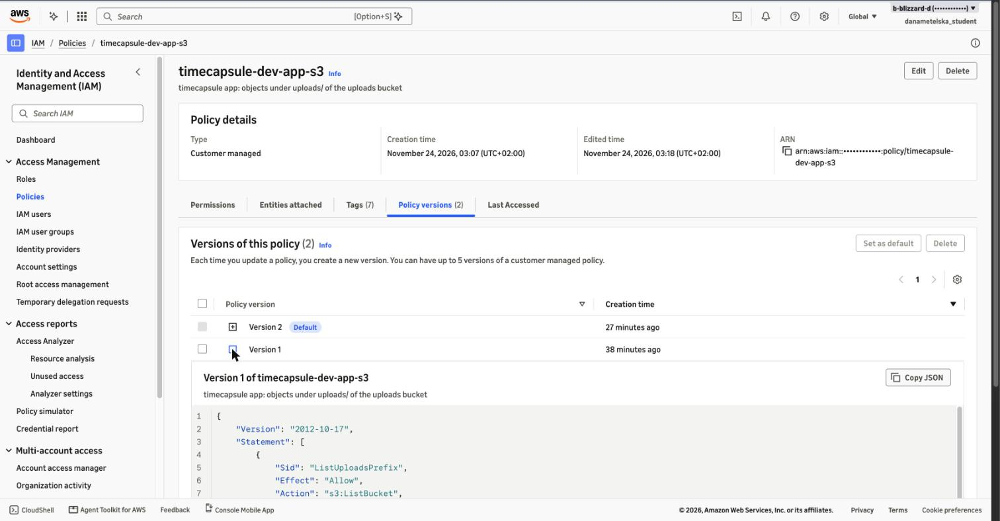

IAM, политика `timecapsule-dev-app-s3`: две версии, `v2` по умолчанию, `v1` раскрыта (`ListUploadsPrefix`).

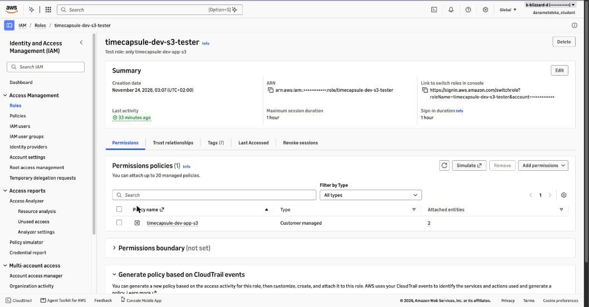

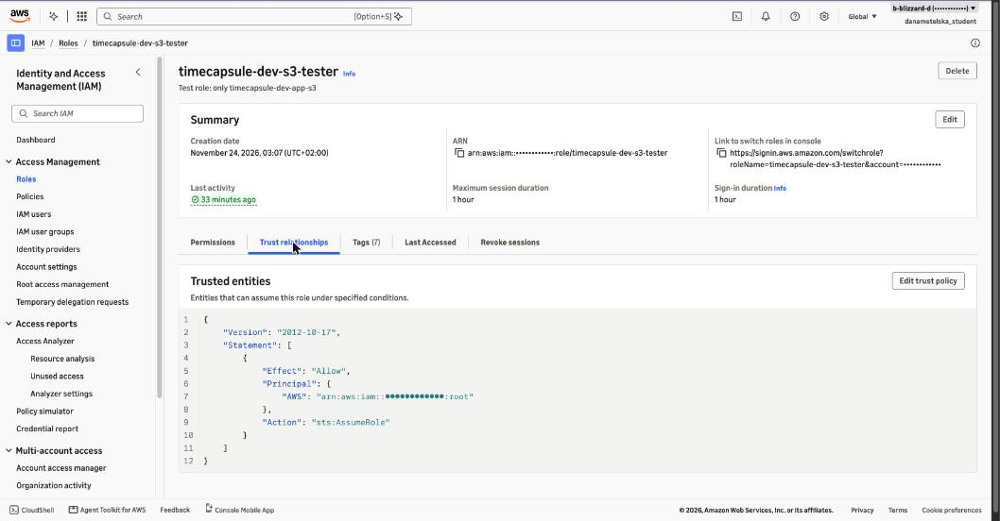

Роль `timecapsule-dev-s3-tester`: прикреплена только `timecapsule-dev-app-s3`; доверие (`Trust relationships`) выдано аккаунту.

CloudShell не использовался: команды задания выполнены в терминале ноутбука.

**Ответ.** Политика доверия определяет, кто может принять роль (здесь любой участник этого аккаунта с правом `sts:AssumeRole`), а политика прав определяет, что роль может делать после этого. Команда 9 не удалила данные: в версионируемом бакете она создала маркер удаления, а версия `test.txt` осталась и восстанавливается удалением маркера. Злоумышленник с учётными данными приложения не может уничтожить файлы безвозвратно, потому что для удаления версии нужен `s3:DeleteObjectVersion`, которого в политике нет (команда 8); при `"s3:*"` он мог бы удалить версии и маркеры, и восстановление стало бы невозможным.

### Задание 9. Роль сервера

**Что сделано.** Создана роль `timecapsule-dev-app-role` (доверие `ec2.amazonaws.com`, политика только `timecapsule-dev-app-s3`, теги) и профиль экземпляра с тем же именем; профиль привязан к `timecapsule-dev-app` без перезапуска. На сервере `BUCKET` записан в `~/.bashrc`.

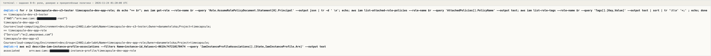

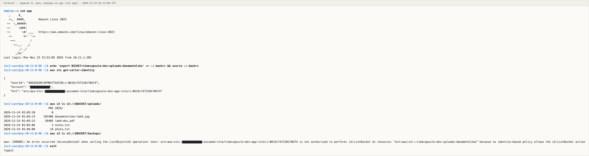

**Как проверено.** `describe-iam-instance-profile-associations` -> `associated`; `get-caller-identity` на сервере показывает `assumed-role/timecapsule-dev-app-role/i-0619c747210170474`; `ls uploads/` успешен, `ls backups/` даёт `AccessDenied`.

**Ответ.** CLI получил учётные данные из сервиса метаданных экземпляра (IMDS), который выдаёт временные ключи роли, привязанной через профиль экземпляра. Политика доверия этой роли разрешает принять её сервису `ec2.amazonaws.com` (экземпляру), а у тестовой роли доверие выдано аккаунту. Временные ключи сами меняются и истекают, их нет ни в файлах, ни в репозитории, а ключ в `.env` долгоживущий и может утечь вместе с репозиторием или резервной копией.

### Задание 10. Перенос существующих файлов

**Что сделано.** На `app` из `/var/www/timecapsule` выполнены `sync --dryrun`, `sudo aws s3 sync` и повторный `--dryrun` (пустой вывод), проверен `Content-Type` перенесённого `.png`.

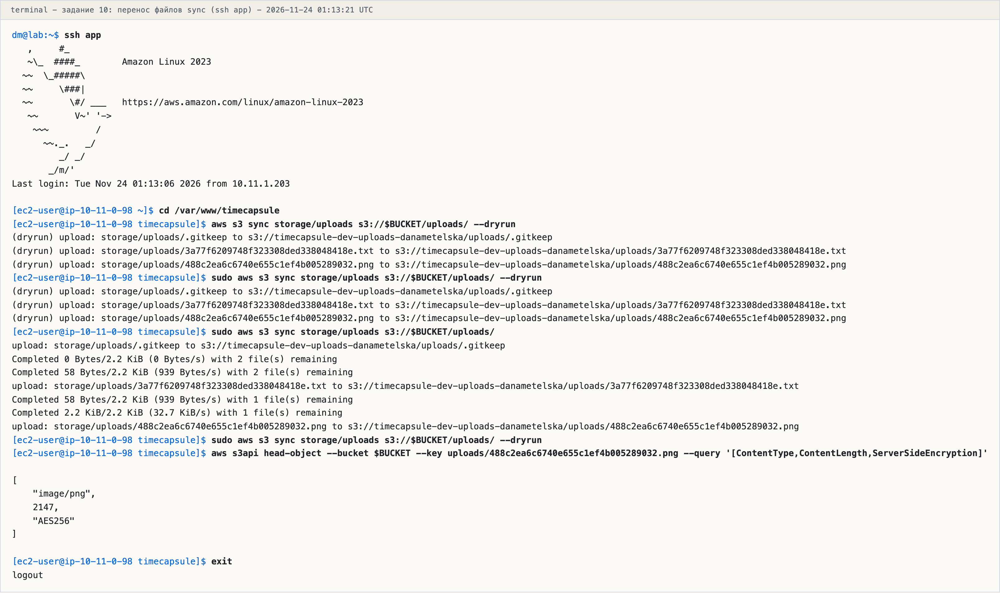

**Как проверено.** Повторный `--dryrun` не выводит ничего; `head-object` показывает `image/png`, `AES256`.

**Ответ.** Прав политики приложения хватило: `sync` использовал `s3:ListBucket` (список объектов бакета с префиксом `uploads/`, чтобы определить, чего ещё нет) и `s3:PutObject` (копирование); `s3:GetObject` для загрузки в бакет не нужен.

### Задание 11. Модуль хранения на S3

**Что сделано.** Добавлен `aws/aws-sdk-php` (`composer.json`, `composer.lock`; команда выполнена на `app` во временной копии), в `.env.example` и `.env` на сервере добавлены `S3_BUCKET` и `AWS_REGION`, ключей доступа нет. Переписан `src/storage.php`: `storage_save()` (`putObject` с `SourceFile`, ключ `uploads/<32 hex>.<расширение>`, `ContentType` через `mime_content_type`), `storage_delete()` (`deleteObject`), `storage_stream()` (302 на подписанный URL, `STORAGE_LINK_TTL = 300`, `ResponseContentType`, `ResponseContentDisposition` с исходным именем); клиент создаётся один раз в `s3_client()` (`static`); ошибки AWS логируются в `storage/logs/storage.log`, пользователь видит страницу 502. Проверка прав на капсулу осталась в `capsules_file()` до вызова `storage_stream()`. В подвале (`views/layout.php`): `Files: S3 <имя бакета>`.

**Изменения в репозитории.** [feat(storage)](https://github.com/b-blizzard-d-cloud/timecapsule/commit/a6ff475), [chore(deps)](https://github.com/b-blizzard-d-cloud/timecapsule/commit/e81f34a), [feat(layout)](https://github.com/b-blizzard-d-cloud/timecapsule/commit/6003b33), [fix(deploy)](https://github.com/b-blizzard-d-cloud/timecapsule/commit/92290cc), [chore(storage)](https://github.com/b-blizzard-d-cloud/timecapsule/commit/89b1080).

### Задание 12. Деплой и проверка

**Что сделано.** Выпуск командой `~/deploy.sh` (с `composer install` и перезагрузкой PHP-FPM); `.env` на сервере дополнен. Модуль хранения проверен на `app` под ролью без входа в приложение: загрузка, `Content-Type`, 302 на подписанный URL (внутренний вызов `storage_stream()`), скачивание по ссылке с заголовками, удаление и ответ `404` с `x-amz-delete-marker: true` после удаления.

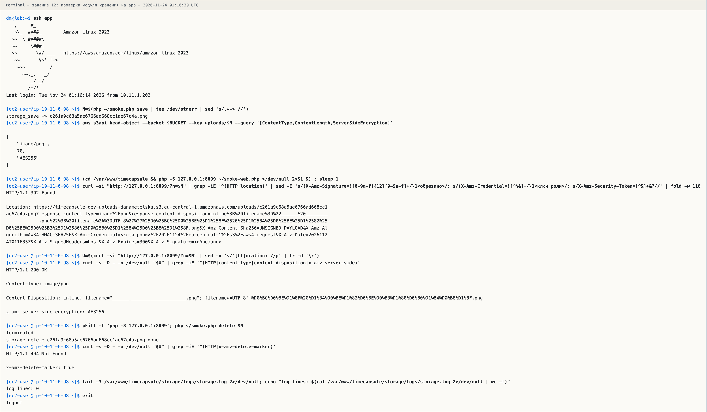

Проверка пользователем в браузере (вход под пользователем ЛР2; пароль вводит пользователь):

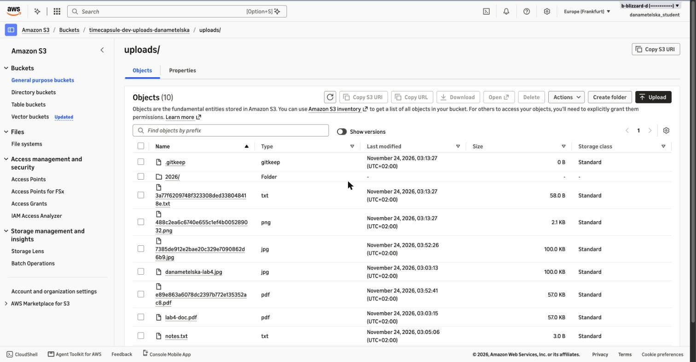

Два новых объекта с именами из 32 шестнадцатеричных символов: `7385de91...jpg` (`image/jpeg`, 100 КБ) и `e89e863a...pdf` (`application/pdf`, 57 КБ); `Content-Type` проверен командой `head-object`.

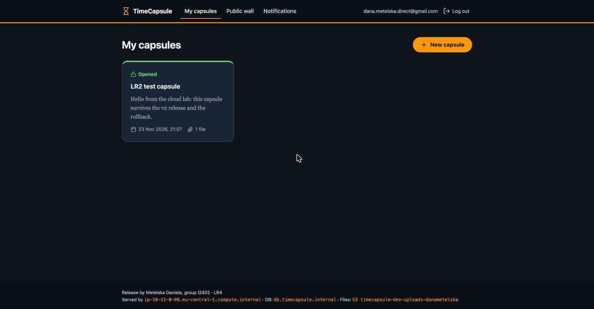

Подвал приложения: `Files: S3 timecapsule-dev-uploads-danametelska`, `LR4`.

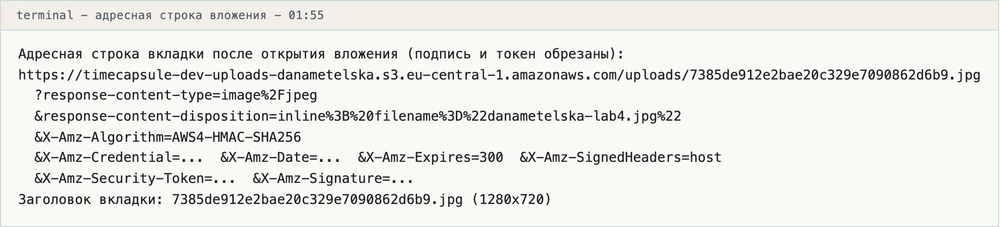

Адрес вкладки после открытия вложения (кнопка перенаправляет на подписанную ссылку S3, срок 300 секунд; подпись и токен обрезаны). Панель адреса браузера в снимок не попадает, поэтому адрес выведен текстом.

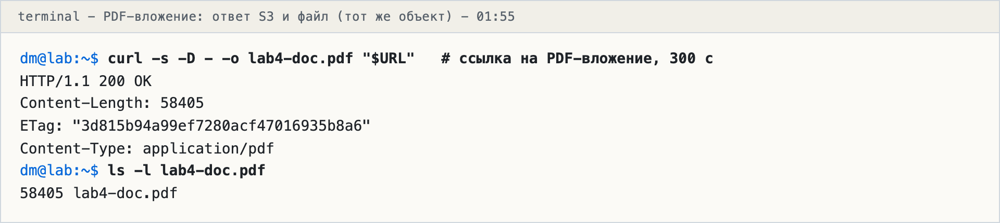

Кнопка `Download lab4-doc.pdf` нажата, но Chrome не завершил сохранение файла (загрузка с `http://`-страницы остановлена на проверке браузера). Содержимое проверено запросом подписанной ссылки на тот же объект: HTTP 200, `application/pdf`, 58405 байт, файл совпал с исходным `lab4-doc.pdf`.

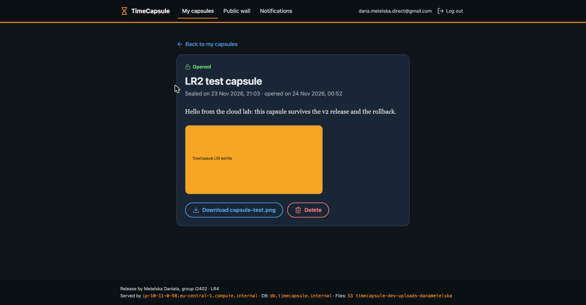

Капсула ЛР2 `LR2 test capsule`: вложение `capsule-test.png` открывается из S3 (объект перенесён в `uploads/` на шаге 10).

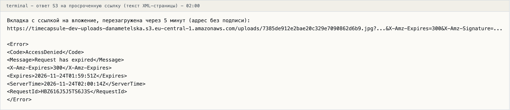

Та же вкладка, перезагруженная через 5 минут: `AccessDenied`, `Request has expired` (срок до 01:59:51Z, время сервера 02:00:14Z). Текст страницы ошибки сохранён как рисунок, потому что Chrome не снимает XML.

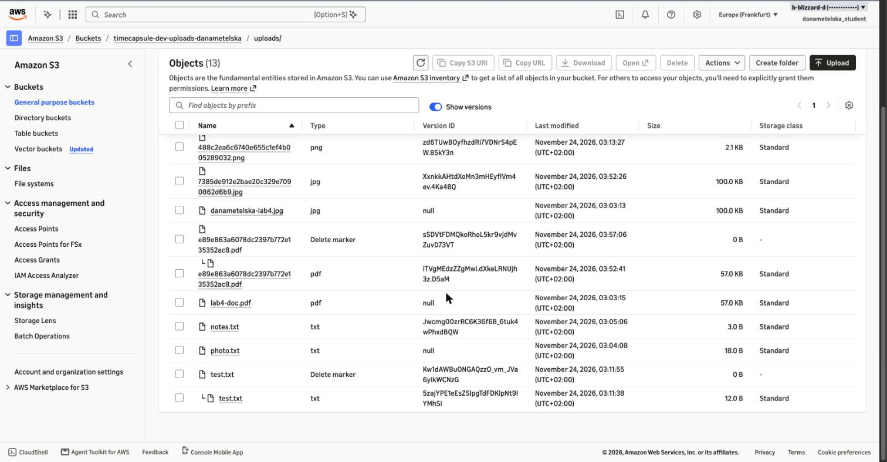

После удаления капсулы `LR4 PDF capsule` объект `e89e863a...pdf` в `Show versions`: маркер удаления (03:57:06) над сохранённой версией (03:52:41).

**Ответ.** Пересланную ссылку не нужно отзывать, потому что она сама перестаёт работать через 300 секунд, а подпись нельзя продлить или перенести на другой объект. После удаления капсулы в бакете остаются версия объекта и маркер удаления; версию окончательно удалит правило жизненного цикла для неактуальных версий через 90 дней (кроме двух самых новых).

### Задание 13. Сервер без состояния

**Что сделано.** `storage/uploads` перемещена в `~/uploads-backup`; здоровье приложения и сохранение/удаление объекта (проверочный скрипт) работают. Создана версия `v2` политики `timecapsule-dev-app-s3` без `s3:ListBucket`; на сервере `aws s3 ls s3://$BUCKET/uploads/` даёт `AccessDenied`, сохранение и подпись ссылки работают. Запрос несуществующего объекта выполнен на сервере и под пользователем.

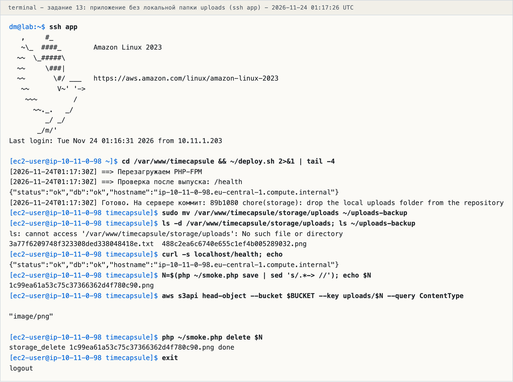

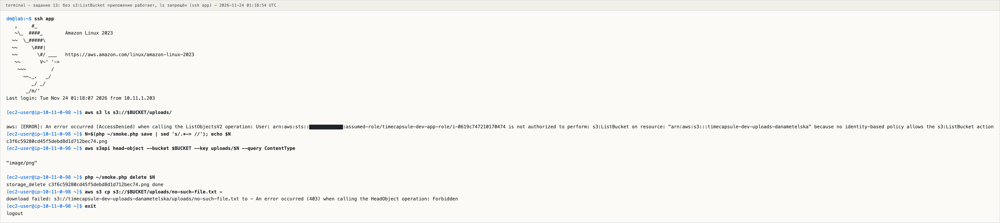

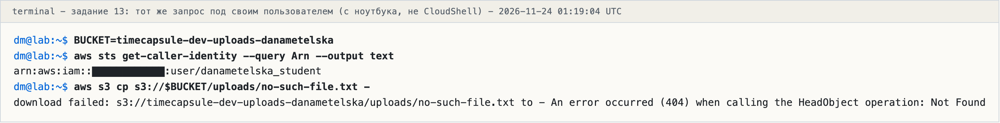

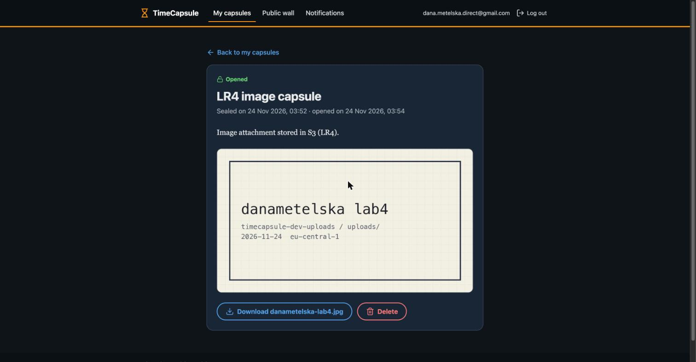

Капсула `LR4 image capsule` с картинкой из S3 создана и открыта в приложении при перемещённой `storage/uploads`.

Запрос несуществующего объекта под своим пользователем выполнен в терминале ноутбука (рисунок выше); CloudShell не использовался.

Копия `~/uploads-backup` удалена командой `sudo rm -rf ~/uploads-backup` после проверки в браузере.

**Как проверено.** Версии политики: `list-policy-versions` (`v2` по умолчанию, `v1` сохранена).

**Ответ.** Сервер получил `403 Forbidden`, а пользователь `404 Not Found`, потому что при отсутствии `s3:ListBucket` S3 не раскрывает, есть ли в бакете такой ключ: иначе обладатель только права на чтение мог бы перебором выяснять имена объектов. Для замены `app` новым сервером достаточно запустить экземпляр с профилем `timecapsule-dev-app-role`, тем же `.env` (`S3_BUCKET`, `AWS_REGION`, доступ к базе) и выпустить код; вложения лежат в S3, база на отдельном сервере.

### Задание 14. Архитектура и решение

Схема ЛР3 дополнена бакетом S3 вне VPC (внутри региона), ролью сервера `timecapsule-dev-app-role`, стрелкой ⑦ (`PutObject`, `DeleteObject` от приложения), ⑧ (302 с подписанным URL) и ⑨ (скачивание браузером минуя сервер).

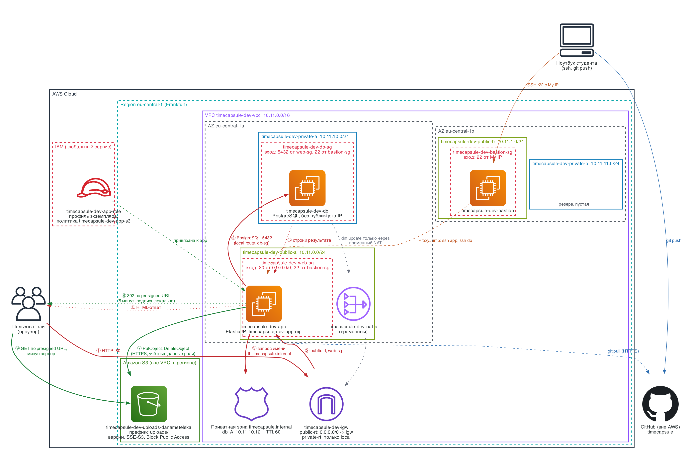

Решение записано в [ADR-0003](../adr/0003-attachment-storage.md): матрица EBS / EFS / S3 (96 баллов у S3 из 100).

## Завершение работы

`bastion`, `app`, `db` остановлены; бакет, политика и роли сохранены; временный `test.txt` удаляется в CloudShell (`rm -f ~/test.txt`), локальная рабочая папка проверки удалена.

## Ответы на устные вопросы

1. **Путь скачивания.** Пользователь открывает ссылку приложения; PHP определяет пользователя и проверяет его права на капсулу (права пользователя проверяются только в приложении), затем подписывает URL учётными данными роли сервера и отвечает 302. Браузер обращается к S3 по подписанному URL; S3 проверяет подпись, срок и права роли (права роли проверяются здесь), после чего отдаёт файл с заданными заголовками.
2. **Что не пускает постороннего.** Бакет закрыт Block Public Access и не имеет публичной политики, поэтому прямой `Object URL` получает `AccessDenied`. Подписанная ссылка привязана к ключу и сроку 300 секунд, а политика бакета требует HTTPS.
3. **Почему не открытый бакет.** Открытый бакет отдаёт любой файл любому, кто знает или подобрал адрес, и проверка прав на капсулу и срок открытия (`open_at`) были бы обойдены. Подписанная ссылка выдаётся только после проверки в приложении и сама истекает.
4. **Отказ региона.** Нужен второй бакет в другом регионе с межрегиональной репликацией (CRR; требуется версионирование, уже включено), а также второй экземпляр приложения и база в этом регионе, адрес которого подставляется в `S3_BUCKET` и `AWS_REGION` (с точкой входа через Route 53 с проверкой работоспособности).

## Вывод

Вложения капсул перенесены с диска сервера в закрытый версионируемый бакет S3 с шифрованием, запретом HTTP и правилом жизненного цикла; приложение работает с ним через роль сервера с минимальной политикой. Права проверены через тестовую роль: десять из десяти результатов совпали с ожиданиями, записанными до запуска. Пользователи скачивают файлы напрямую из S3 по ссылке на 5 минут, сервер стал заменяемым. Ограничения: один регион и один сервер приложения.

## Источники

1. Задание лабораторной работы №4 курса "Cloud Computing".
2. Amazon S3 User Guide: Versioning, Lifecycle, Presigned URLs, Bucket policies, Block Public Access.
3. AWS IAM User Guide: policy evaluation logic, roles for EC2 (instance profiles).
4. AWS SDK for PHP: `S3Client::createPresignedRequest`.
