# Лабораторная работа №5. Облачные базы данных. Amazon RDS

| Поле | Значение |
| --- | --- |
| Студент | Metelska Daniela |
| Группа | I2402 |
| Специальность | Informatică |
| Уровень | продвинутый (Часть 1 и Часть 2, задания 1-12) |
| Репозиторий | https://github.com/b-blizzard-d-cloud/timecapsule (публичный) |
| ADR | [docs/adr/0004-database-hosting.md](../adr/0004-database-hosting.md) |
| Схема | [docs/lab5/diagram.png](diagram.png) |
| Предыдущие отчёты | [ЛР2](../../README.md), [ЛР3](../lab3/README.md), [ЛР4](../lab4/README.md) |

Номер аккаунта, домашний IP и пароли в отчёте скрыты. Пароли `dbadmin` сгенерированы RDS (`Auto generate password`), хранятся локально в файле с правами 600 и в `~/.pgpass` серверов; в репозиторий не попадают. Снимки консоли получены в реальной консоли AWS; команды `psql`, `dig`, `curl` и `aws` выполнены по-настоящему и отрисованы в нейтральное окно терминала.

## Паспорт ресурсов

| Ресурс | Имя | Значение |
| --- | --- | --- |
| Группа подсетей (Часть 1) | `lab5-db-subnets` | `private-a` (1a), `private-b` (1b) |
| SG клиента (Часть 1) | `lab5-app-client-sg` | вход: SSH только от `timecapsule-dev-bastion-sg` |
| SG базы (Часть 1) | `lab5-rds-sg` | вход: TCP 5432 только от `lab5-app-client-sg` |
| Клиент (Часть 1) | `lab5-client` | t3.micro, AL2023, `public-b`, `psql` 18.7 |
| Учебная база | `lab5-db` | PostgreSQL 18.3-R2, `db.t4g.micro`, gp3 20 ГиБ, 1a, копии 1 день, шифрование, защита от удаления |
| Реплика / копия | `lab5-db-replica`, `lab5-db-restore` | 1b / 1a, удалены |
| SG базы приложения | `timecapsule-dev-rds-sg` | вход: 5432 от `timecapsule-dev-web-sg` |
| Группа подсетей | `timecapsule-dev-db-subnets` | `private-a`, `private-b` |
| База приложения | `timecapsule-dev-rds` | PostgreSQL 16.15-R1, `db.t4g.micro`, gp3 20 ГиБ, 1a, endpoint `timecapsule-dev-rds.czco4w84kkvz.eu-central-1.rds.amazonaws.com` |
| Политика / роль | `timecapsule-dev-rds-stop`, `timecapsule-dev-scheduler-role` | `rds:StopDBInstance` только на `timecapsule-dev-rds`; доверие `scheduler.amazonaws.com` |
| Расписание | `timecapsule-dev-rds-nightly-stop` | `cron(0 23 * * ? *)`, `Europe/Chisinau` |
| Теги | `Name`, `Project=timecapsule`, `Environment=dev`, `Owner=danametelska`, `Lab=lab5`, `Course=cloud-computing`, `Group=i2402` | все ресурсы ЛР5 (расписанию теги не нужны) |

## Как выполнялась работа

Сеть (группы безопасности, группы подсетей), сервер `lab5-client`, политика и роль расписания созданы командами AWS CLI, каждая настройка подтверждена независимой командой `describe-*` / `get-*`. Базы данных, реплика, восстановление и расписание созданы в консоли AWS (формы показаны на снимках). Команды заданий выполнялись на ноутбуке через `bastion` (ProxyJump) на `lab5-client` и `app`.

## Отклонения от задания и ограничения

1. Free plan: доступен только шаблон `Free tier` (соответствует `Sandbox` задания), срок хранения копий не более 1 дня вместо 7, не более двух экземпляров RDS одновременно. Базу приложения созданы только после удаления всех учебных баз.
2. Шаблон `Free tier` вместо `Sandbox`. Версия PostgreSQL для учебной базы 18.3-R2: это последняя версия в списке консоли (команда `describe-db-engine-versions` показывает и 18.4-18.6, но консоль их не предлагала). Ошибка срока хранения копий 7 дней не воспроизводилась: на форме сразу выбран 1 день. Расширенный мониторинг (Enhanced monitoring) выключен: он требует отдельной роли, а на реплике по умолчанию был включён и снят вручную. График `ReplicaLag` в разделе Monitoring консоли RDS оставался пустым, поэтому снимок метрики взят из CloudWatch (Metrics).
3. Группы безопасности, группы подсетей, `lab5-client`, политика и роль расписания созданы через CLI до консольной части; параметры соответствуют заданию.
4. Путь приложения на сервере `/var/www/timecapsule` (без `current/`).
5. Вместо `web-server` используется `lab5-client` (учебный сервер задания 3) и `app` (Часть 2).
6. `dig` с ноутбука для endpoint учебной базы вернул тот же приватный адрес `10.11.10.14`, что и на сервере внутри VPC (публичный DNS RDS отдаёт приватный адрес для базы без публичного доступа). Это согласуется с тем, что с ноутбука база недоступна: адрес не маршрутизируется из интернета.
7. Часовой пояс: форма восстановления на момент времени показывает время в UTC+2 (Кишинёв), поэтому момент 13:23:00 UTC введён как 15:23.
8. Остановка по расписанию проверена тестовым `cron(5 16 * * ? *)` (создано 15:59, сработало 16:05); после этого выражение заменено на `cron(0 23 * * ? *)`.

## Часть 1. Базовый уровень

### Задание 1. Размещение и доступ к базе

**Что сделано.** Создана группа подсетей `lab5-db-subnets` (две приватные подсети), SG `lab5-app-client-sg` и SG `lab5-rds-sg` с единственным правилом входа TCP 5432 от SG клиента.

**Как проверено.** `describe-security-groups`, `describe-db-subnet-groups`.

Рисунок 1.1. SG клиента: вход SSH только от SG bastion, теги.

Рисунок 1.2. SG базы: 5432 только от SG клиента, CIDR-правил нет.

Рисунок 1.3. Группа подсетей `lab5-db-subnets`: подсети в зонах 1a и 1b.

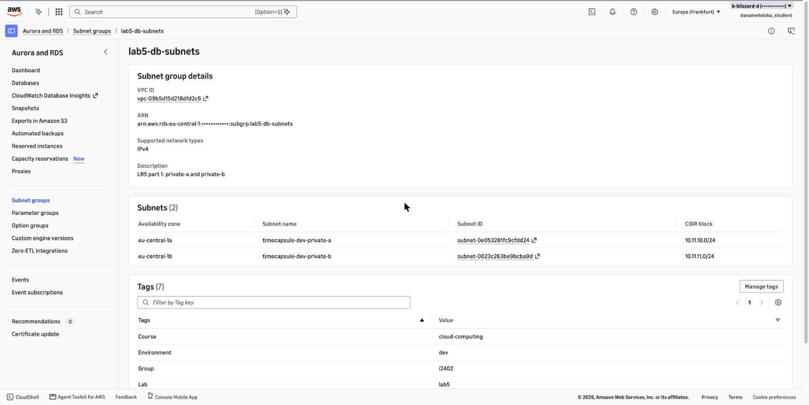

Рисунок 1.4. Консоль RDS: группа подсетей `lab5-db-subnets`, две приватные подсети в зонах 1a и 1b.

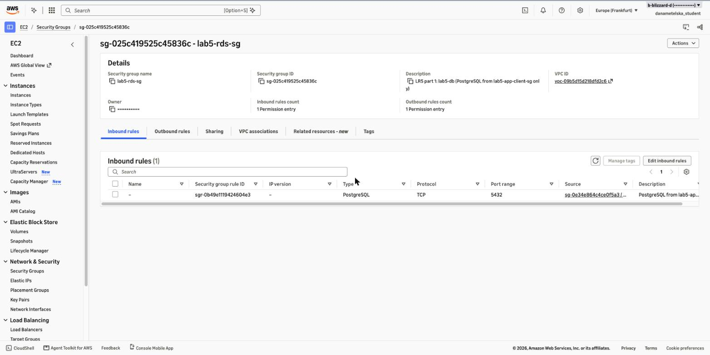

Рисунок 1.5. Консоль EC2: `lab5-rds-sg`, единственное правило входа PostgreSQL 5432 с источником в виде группы безопасности.

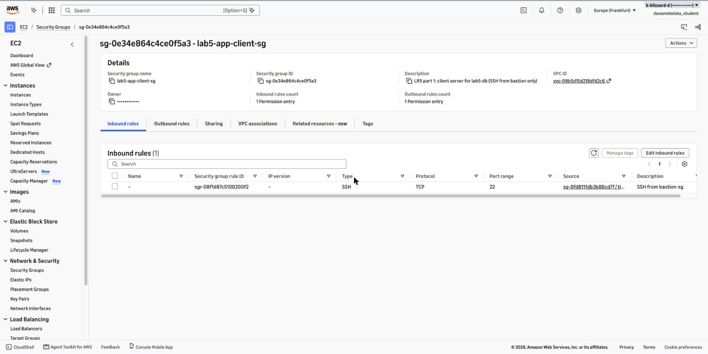

Рисунок 1.6. Консоль EC2: `lab5-app-client-sg`, вход только SSH от группы `bastion`.

**Ответ.** В правиле базы источником указана группа безопасности клиента, а не IP-адрес: адрес сервера меняется при пересоздании, а принадлежность к группе нет, и любой новый сервер с этой группой получит доступ без правки правила. Так же закрыт доступ всем остальным, включая сам bastion (проверено в задании 3). Группа подсетей требует минимум две подсети в разных зонах: RDS должен иметь возможность разместить резервный экземпляр или восстановить базу в другой зоне, даже если сейчас используется одна.

### Задание 2. База RDS

Шаблон `Free tier` выбран при `Full configuration`; `Standard create` в интерфейсе называется так.

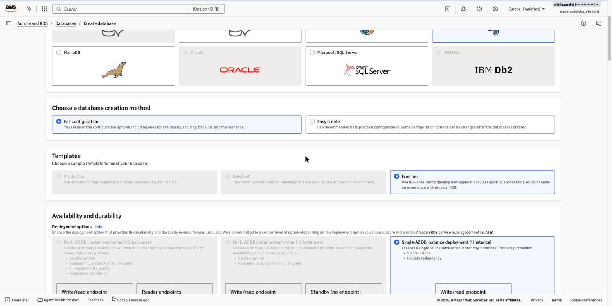

Рисунок 2.1. Движок PostgreSQL, полная конфигурация, шаблон `Free tier`, одна зона.

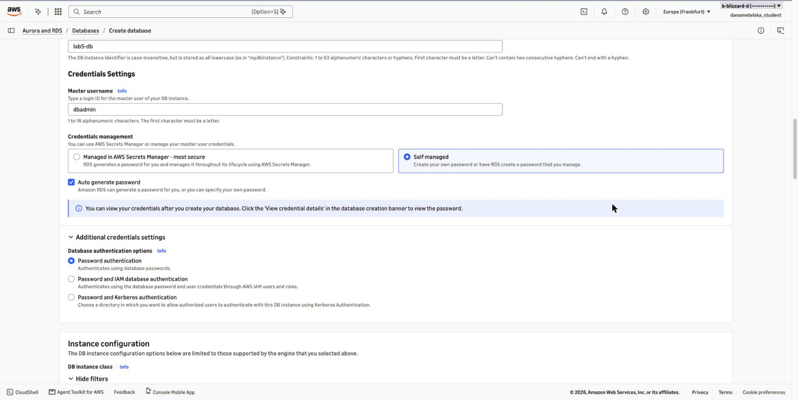

Рисунок 2.2. Идентификатор `lab5-db`, пользователь `dbadmin`, пароль генерирует RDS (`Auto generate password`). Версия PostgreSQL 18.3-R2.

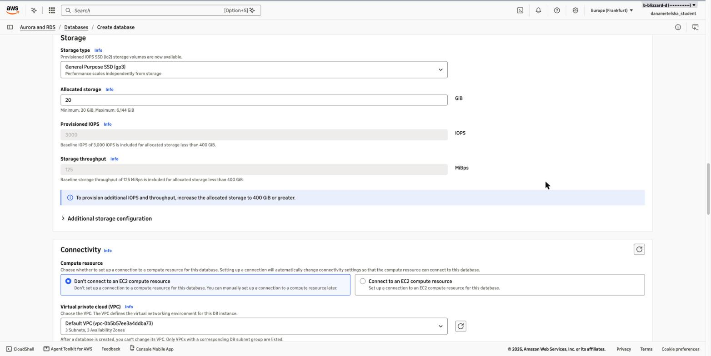

Рисунок 2.3. Класс `db.t4g.micro`, `gp3` 20 ГиБ; автоматическое увеличение хранилища снято на следующем шаге формы.

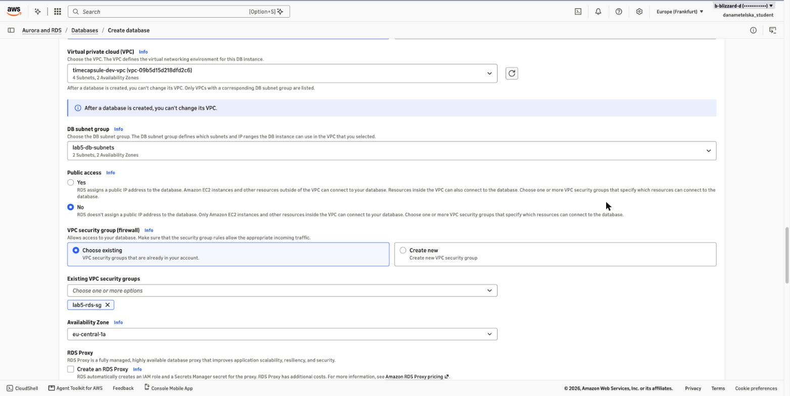

Рисунок 2.4. Сеть: VPC `timecapsule-dev-vpc`, группа подсетей `lab5-db-subnets`, без публичного доступа, группа безопасности только `lab5-rds-sg` (`default` убрана), зона `eu-central-1a`.

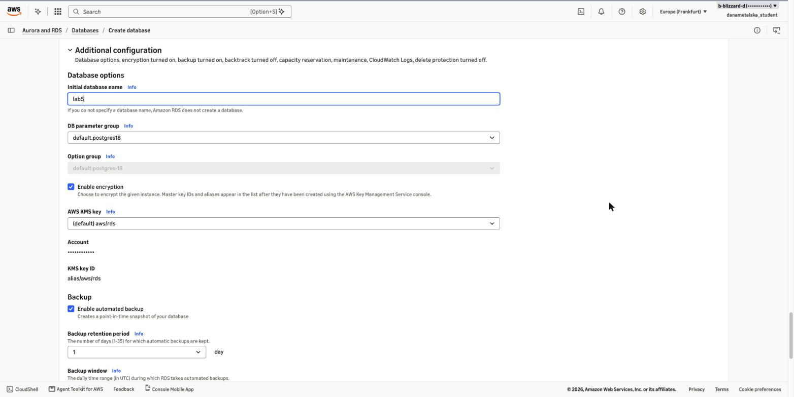

Рисунок 2.5. Дополнительные параметры: начальная база `lab5`, шифрование включено, копии 1 день.

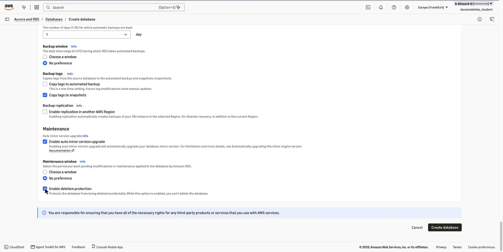

Рисунок 2.6. Защита от удаления включена, окно обслуживания без предпочтений.

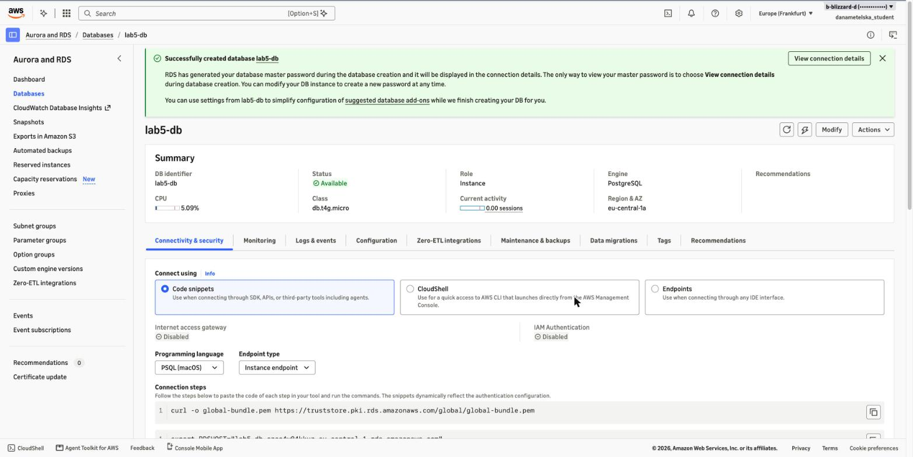

Рисунок 2.7. База в статусе `Available`, зона `eu-central-1a`.

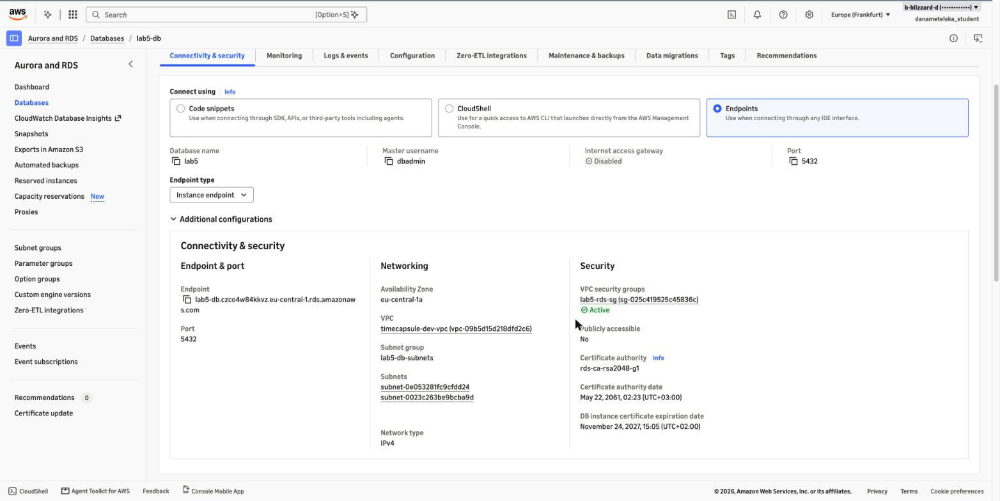

Рисунок 2.8. `Connectivity & security`: endpoint, группа `lab5-rds-sg`, `Publicly accessible: No`. Пароль показан один раз в окне `View connection details`, сохранён кнопкой копирования в локальный файл с правами 600.

**Ответ.** Доступ проверен с двух сторон: с `lab5-client` подключение проходит, а с bastion, который в группу клиента не входит, соединение с портом 5432 не устанавливается за 5 секунд (рисунки 3.2 и 3.4). Зона `1a` выбрана явно, чтобы позже сравнивать с репликой в `1b` и чтобы база и сервер приложения находились рядом (меньше задержка и межзонный трафик). Защита от удаления нужна, чтобы команда `delete-db-instance` или случайный щелчок не удалили базу: сначала надо осознанно снять защиту, что и сделано при завершении Части 1.

### Задание 3. Подключение к базе

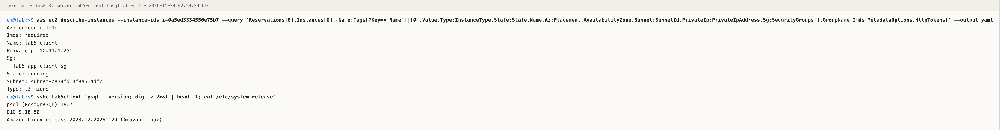

Рисунок 3.1. Сервер `lab5-client`: `public-b`, SG `lab5-app-client-sg`, IMDSv2 обязателен, `psql` 18.7.

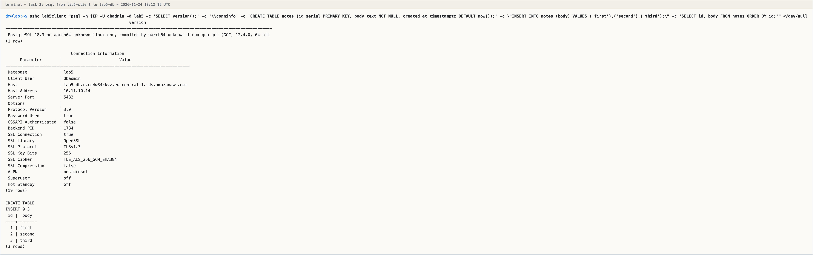

Рисунок 3.2. Подключение с `lab5-client`: `SELECT version()` (PostgreSQL 18.3), `\conninfo` (TLSv1.3), таблица `notes` и три строки.

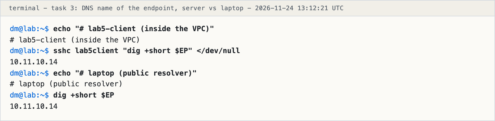

Рисунок 3.3. Адрес endpoint учебной базы на сервере и на ноутбуке: оба раза приватный `10.11.10.14`.

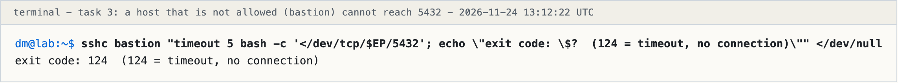

Рисунок 3.4. С bastion соединение с портом 5432 не устанавливается (код 124, таймаут).

### Задание 4. Реплика для чтения

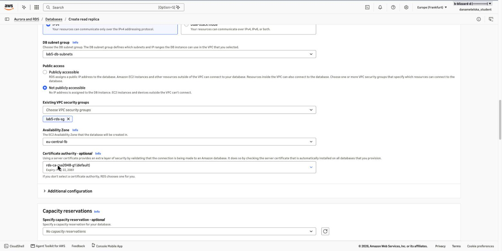

Рисунок 4.1. Форма реплики `lab5-db-replica`: `eu-central-1b`, не публичная, группа `lab5-rds-sg` (расширенный мониторинг снят).

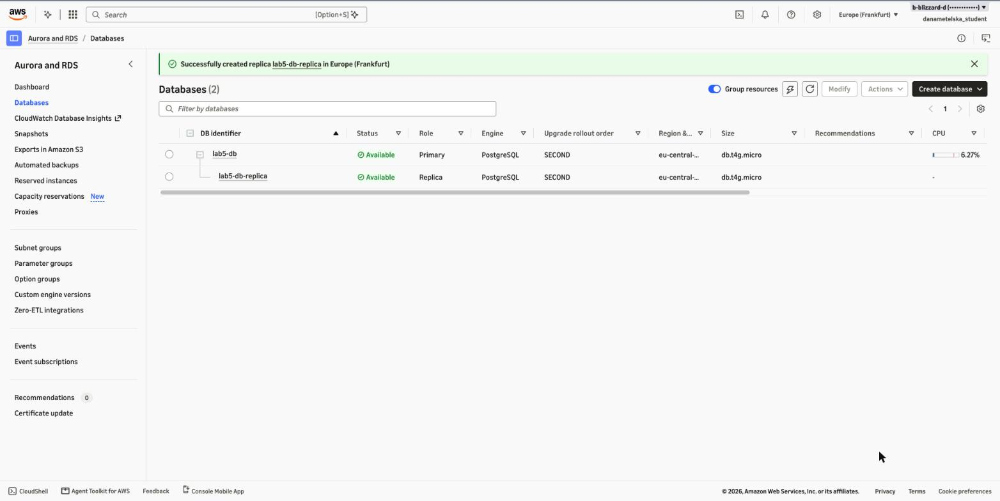

Рисунок 4.2. Основная база (`Primary`) и реплика (`Replica`) в статусе `Available`; на этом этапе работают два экземпляра RDS, то есть весь лимит Free plan.

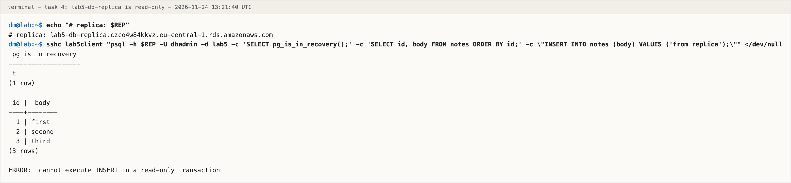

Рисунок 4.3. На реплике `pg_is_in_recovery()` равно `t`, три строки читаются, `INSERT` отклонён: `cannot execute INSERT in a read-only transaction`.

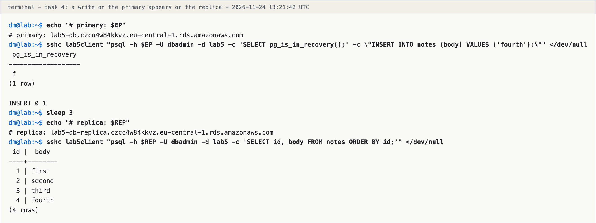

Рисунок 4.4. На основной базе `pg_is_in_recovery()` равно `f`, добавлена строка `fourth`, через 3 секунды она видна на реплике.

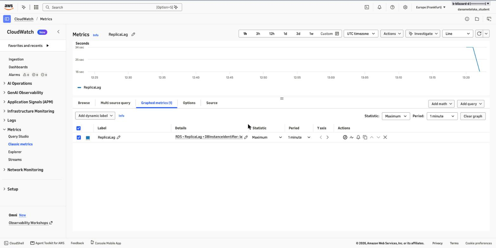

Рисунок 4.5. Метрика `ReplicaLag` в CloudWatch для `lab5-db-replica`: 16-34 секунды (метрика PostgreSQL растёт и без записей, поэтому не ноль).

**Ответ.** `INSERT` на реплике отклоняется потому, что реплика PostgreSQL находится в режиме восстановления и принимает только чтение; запись возможна лишь на основной базе, откуда изменения приходят асинхронно с задержкой в десятки секунд. Реплика для чтения и Multi-AZ решают разные задачи: реплика разгружает чтения и может быть повышена вручную, но асинхронна и имеет свой endpoint; резервный экземпляр Multi-AZ недоступен для чтения и нужен для автоматического переключения при отказе зоны без смены адреса.

### Задание 5. Восстановление после ошибки

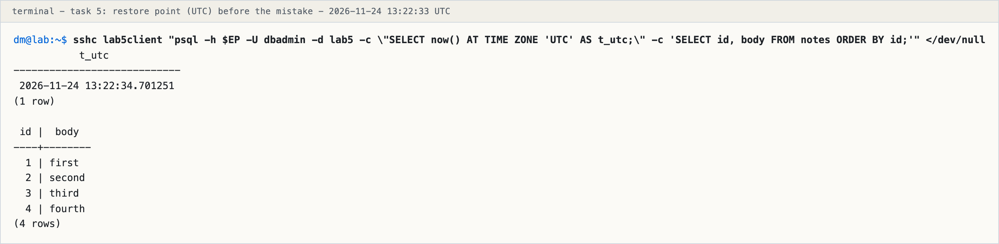

Рисунок 5.1. Точка восстановления: 13:22:34 UTC, в таблице четыре строки.

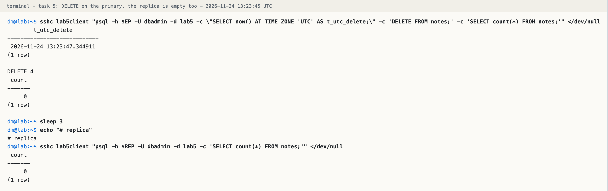

Рисунок 5.2. `DELETE FROM notes` в 13:23:47 UTC; на реплике таблица тоже пуста.

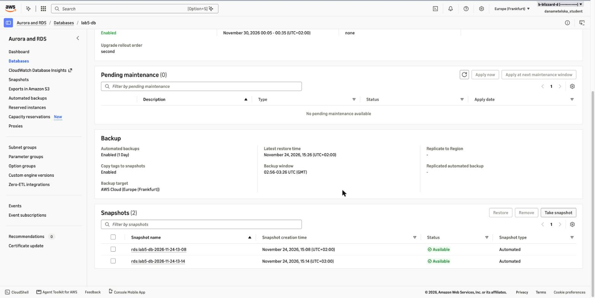

Рисунок 5.3. Раздел `Maintenance & backups` основной базы: `Latest restore time` 15:26 (UTC+2), то есть 13:26 UTC, позже точки 13:22:34. Реплика к этому моменту удалена (`delete me`, без снимка).

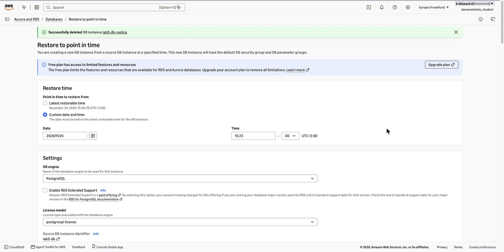

Рисунок 5.4. Форма восстановления: `Custom date and time` 2026/11/24 15:23:00 (UTC+2) = 13:23:00 UTC, между точкой и `DELETE`.

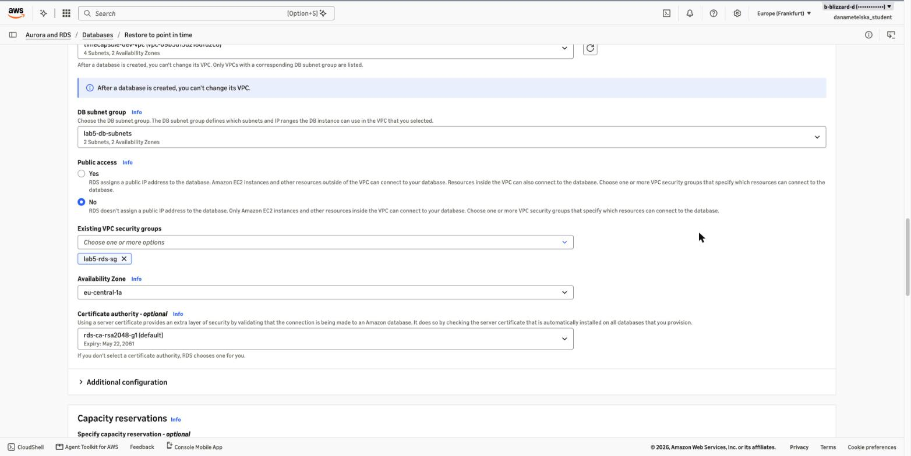

Рисунок 5.5. Параметры новой базы `lab5-db-restore`: `lab5-db-subnets`, без публичного доступа, `lab5-rds-sg`, зона 1a, защита от удаления выключена.

Рисунок 5.6. `lab5-db-restore` в статусе `Available`.

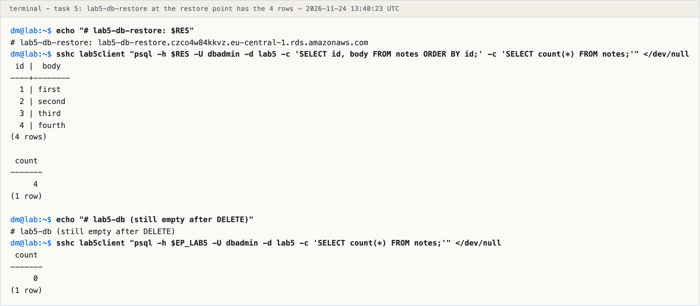

Рисунок 5.7. В восстановленной базе четыре строки; в исходной `lab5-db` таблица по-прежнему пуста.

**Ответ.** Реплика не спасла данные, потому что репликация копирует и удаление: `DELETE` на основной базе через секунды выполнился и на реплике. Восстановление на момент времени создаёт новый экземпляр с другим endpoint из снимка и журнала транзакций, а не откатывает существующую базу: готовые копии нельзя перемотать назад, поэтому данные нужно прочитать из новой базы и перенести или переключить приложение на неё.

### Завершение Части 1

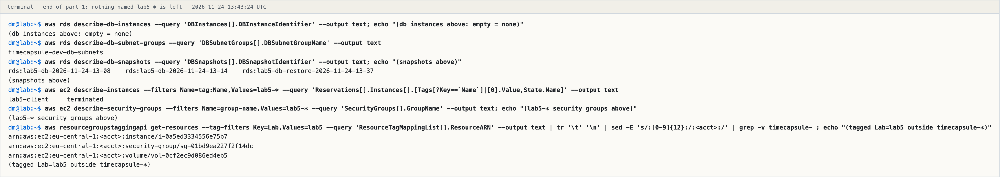

Рисунок 5.8. После удаления `lab5-db-restore` и `lab5-db` (без финальных снимков), группы подсетей, `lab5-rds-sg`, сервера `lab5-client` (`terminated`) и `lab5-app-client-sg`: экземпляров RDS нет, групп безопасности `lab5-*` нет. Автоматические снимки удалённых баз AWS убирает с задержкой; ресурсов с тегом `Lab=lab5` вне `timecapsule-*` не осталось, кроме завершённого сервера.

## Часть 2. Продвинутый уровень

### Задание 6. База приложения

Рисунок 6.1. SG `timecapsule-dev-rds-sg` (5432 от `timecapsule-dev-web-sg`) и группа подсетей `timecapsule-dev-db-subnets`.

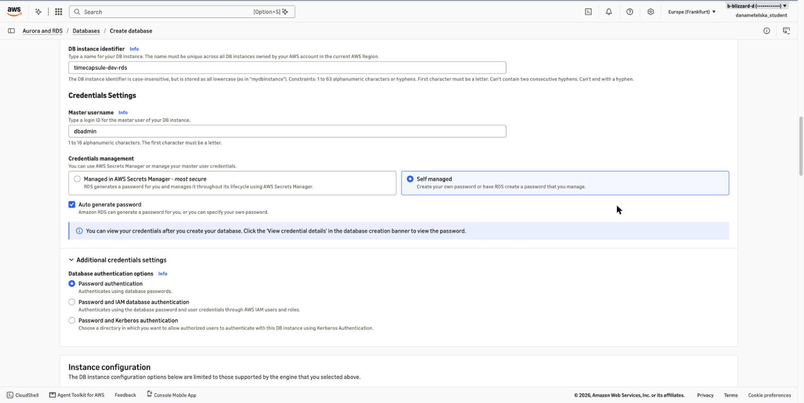

Рисунок 6.2. Форма `timecapsule-dev-rds`: PostgreSQL 16.15-R1 (последняя версия ветки 16, как у `pg_dump` на сервере приложения; в задании названа 16.14), `dbadmin`, автогенерация пароля.

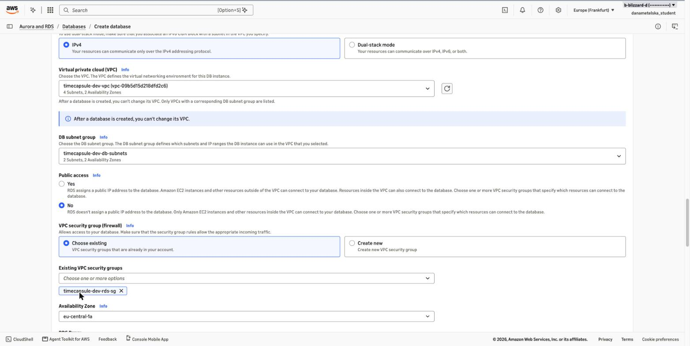

Рисунок 6.3. Сеть: VPC проекта, `timecapsule-dev-db-subnets`, без публичного доступа, `timecapsule-dev-rds-sg`, зона 1a.

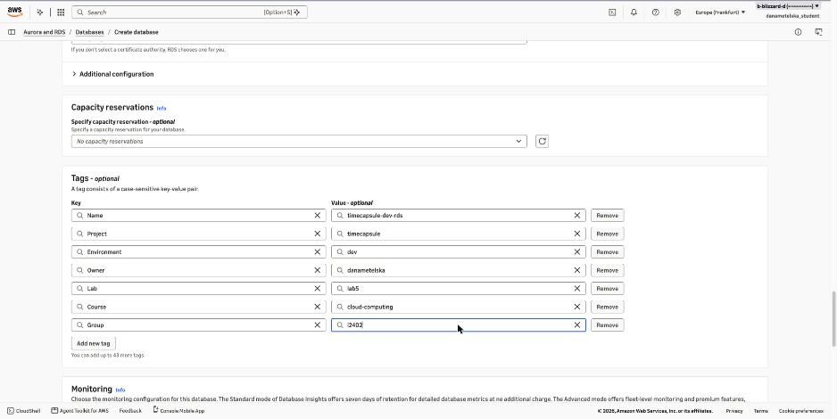

Рисунок 6.4. Теги: `Name`, `Project`, `Environment`, `Owner`, `Lab`, `Course`, `Group`.

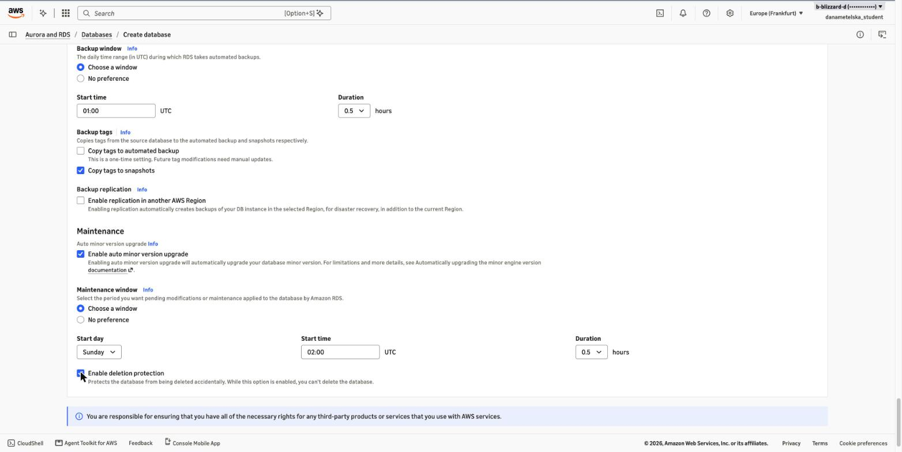

Рисунок 6.5. Окно копий 01:00-01:30 UTC, окно обслуживания `sun:02:00-02:30`, защита от удаления; начальная база не задана.

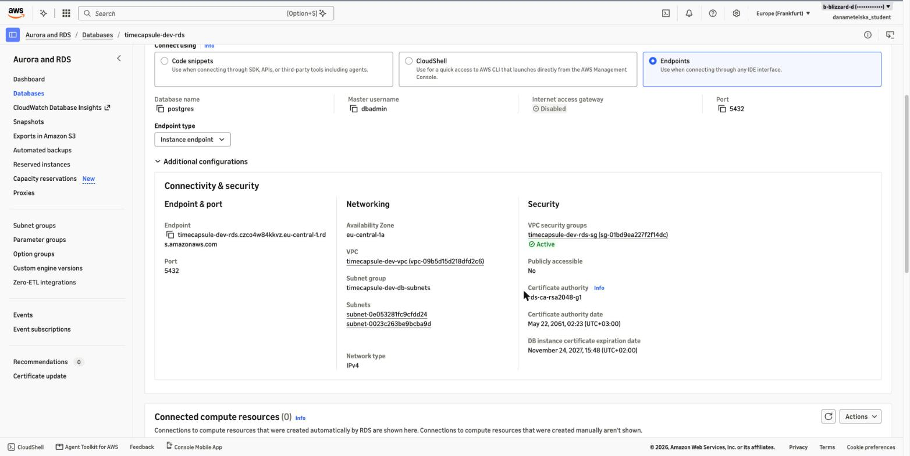

Рисунок 6.6. `Connectivity & security` готовой базы.

**Ответ.** Для рабочей системы нужно включить Multi-AZ (другая зона и автоматическое переключение), увеличить срок хранения копий до 7-35 дней, использовать более мощный класс экземпляра не из пакета burstable, хранить пароль в Secrets Manager с ротацией и вынести настройки логов и мониторинга в CloudWatch. Остановку по расписанию для рабочей базы использовать нельзя.

### Задание 7. Ночная остановка базы

Рисунок 7.1. Политика `timecapsule-dev-rds-stop` (только `rds:StopDBInstance` на одну базу) и роль с доверием `scheduler.amazonaws.com`.

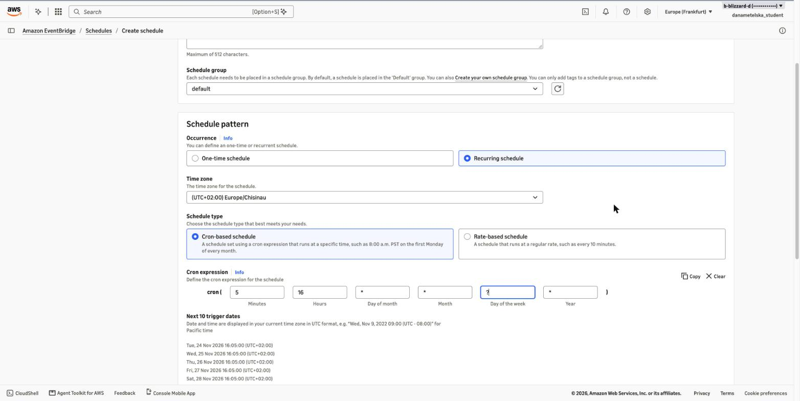

Рисунок 7.2. Расписание `timecapsule-dev-rds-nightly-stop`: повторяющееся, `cron`, часовой пояс `Europe/Chisinau`, тестовое время `5 16 * * ? *`.

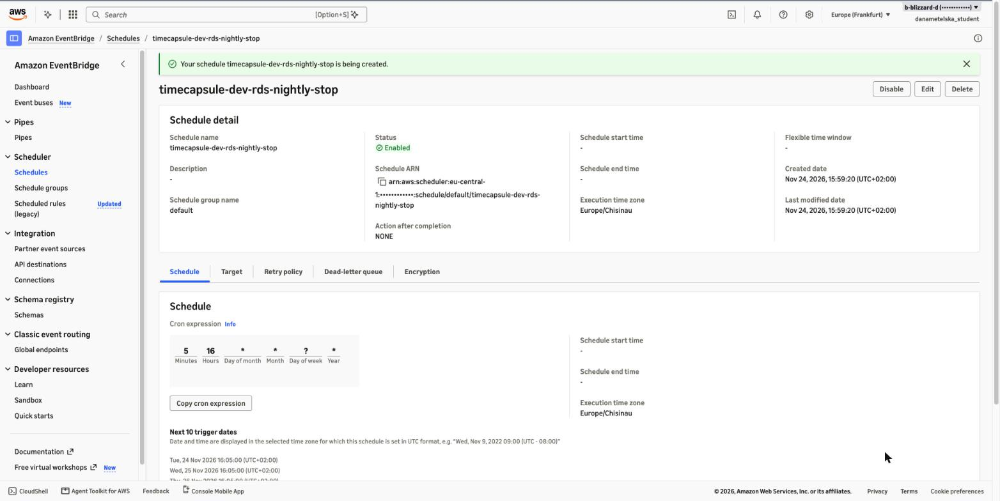

Рисунок 7.3. Расписание создано (цель `rds:StopDBInstance`, `DbInstanceIdentifier=timecapsule-dev-rds`, роль `timecapsule-dev-scheduler-role`, окно времени выключено).

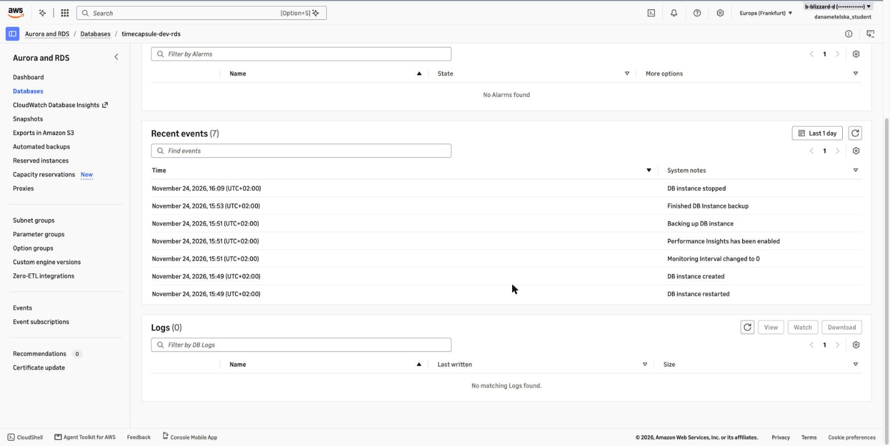

Рисунок 7.4. `Logs & events`: `DB instance stopped` в 16:09 (UTC+2); остановка по расписанию 16:05.

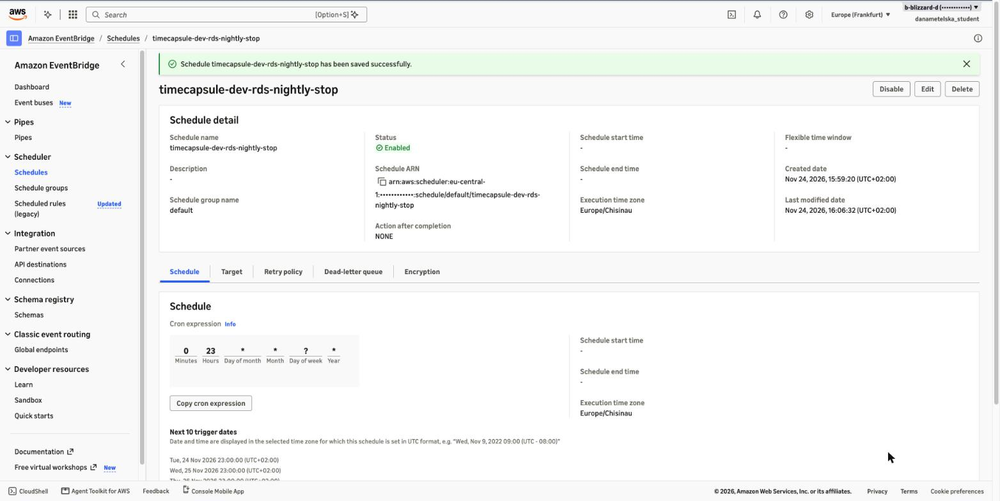

Рисунок 7.5. Расписание после правки: `cron(0 23 * * ? *)`, следующий запуск 23:00 по Кишинёву.

Лог CloudTrail этого запуска показан в задании 11.

**Ответ.** Расписанию нужна роль, потому что Scheduler вызывает API от её имени; своя роль с единственным правом `rds:StopDBInstance` на одну базу ограничивает ущерб, если расписание будет изменено или роль использована неправильно. Ограничение одной базой следует принципу наименьших привилегий: расписанию незачем останавливать или удалять другие базы аккаунта.

### Задание 8. Пользователь и база данных

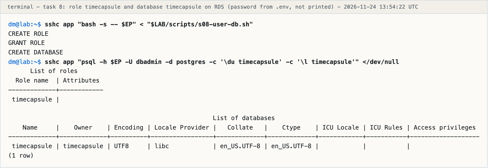

Рисунок 8.1. Скрипт `files/s08-user-db.sh`: роль `timecapsule`, база `timecapsule` (владелец роль), пароль берётся из `.env` и не выводится.

**Ответ.** Приложение работает от обычной роли с правами только на свою базу, а не от `dbadmin`: при ошибке или взломе приложения злоумышленник не получит управление всем сервером PostgreSQL, не сможет создавать роли и базы. Пароль `dbadmin` остаётся только у администратора.

### Задание 9. Перенос данных

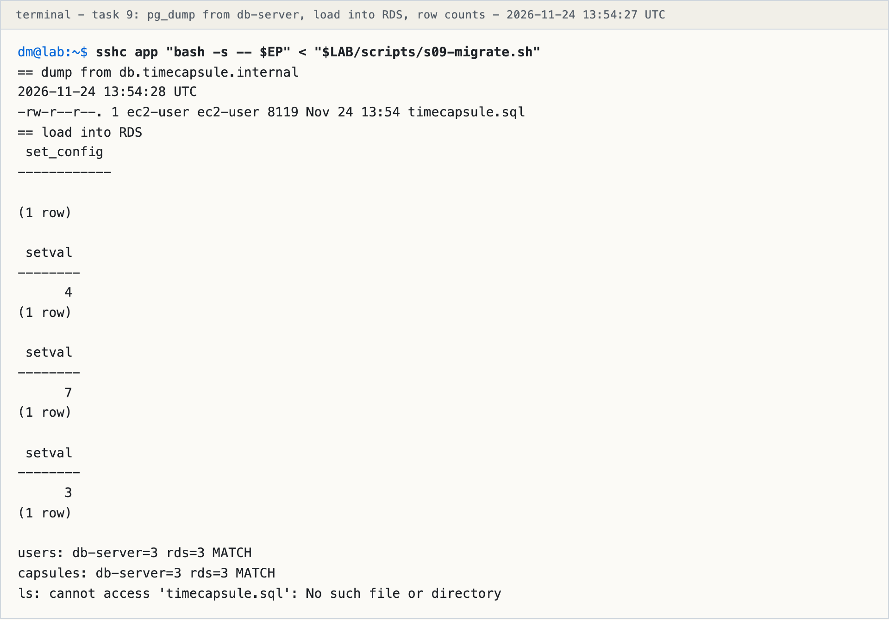

Рисунок 9.1. Дамп `pg_dump` с `db-server`, загрузка в RDS, счётчики `users` 3 = 3 и `capsules` 3 = 3, файл дампа удалён. Скрипт `files/s09-migrate.sh`.

### Задание 10. Переключение приложения

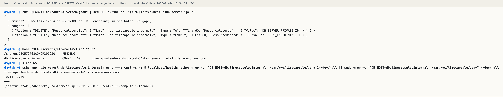

Рисунок 10.1. Одна пачка изменений Route 53 (`DELETE` записи A и `CREATE` CNAME, TTL 60), затем `dig` на `app` возвращает endpoint RDS, `/health` отвечает `ok`, `DB_HOST` в `.env` прежний.

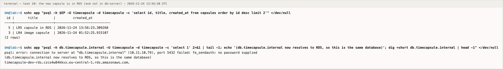

Рисунок 10.2. Капсула «LR5 capsule in RDS» создана в приложении после переключения и найдена в RDS.

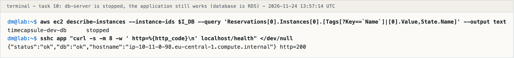

Рисунок 10.3. `db-server` остановлен, приложение продолжает отвечать (`/health` 200).

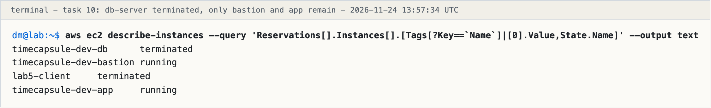

Рисунок 10.4. `db-server` удалён (`terminated`), остались `bastion` и `app`.

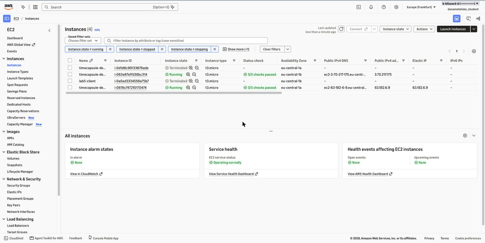

Рисунок 10.5. Консоль EC2: серверы без работающего `db-server`.

**Ответ.** `DB_HOST` не менялся, потому что приложение обращается к имени `db.timecapsule.internal`, а переключение выполнено заменой записи в DNS: приложение и его настройки остались прежними, исключено окно между удалением и созданием записей. К AWS перешли обновления СУБД и ОС в окне обслуживания, ежедневные копии и восстановление на момент времени, замена оборудования и мониторинг; за схемой, пользователями, паролями и сетевыми правилами по-прежнему отвечает владелец проекта.

### Задание 11. Обслуживание базы

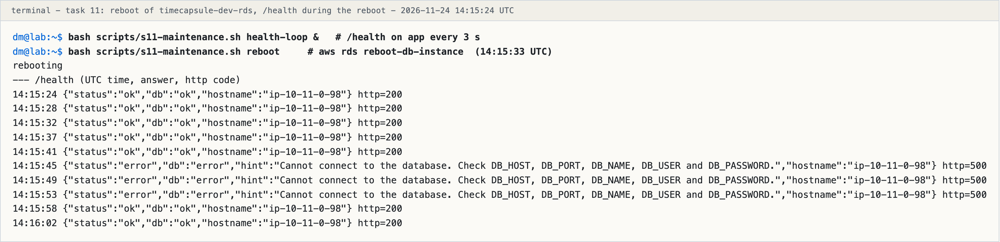

Рисунок 11.1. Перезагрузка `timecapsule-dev-rds`: `/health` отвечает 500 около 12 секунд (14:15:45-14:15:53 UTC), затем снова 200.

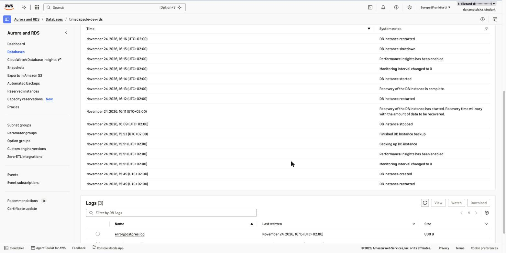

Рисунок 11.2. `Logs & events`: события остановки, запуска, перезагрузки (`DB instance shutdown`, `DB instance restarted`).

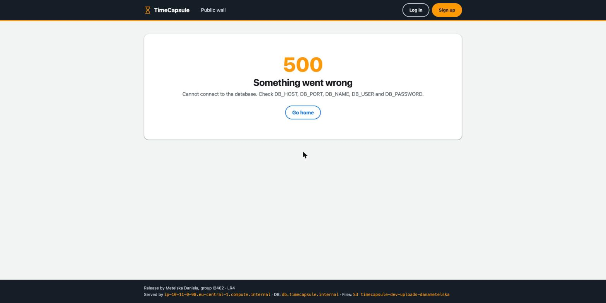

Рисунок 11.3. Страница приложения при остановленной базе: ошибка 500 «Cannot connect to the database».

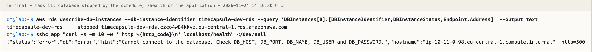

Рисунок 11.4. База `stopped`, `/health` отвечает `status: error`, http 500.

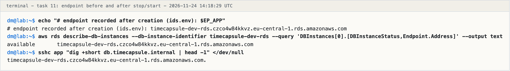

Рисунок 11.5. После запуска endpoint тот же, `db.timecapsule.internal` указывает на него.

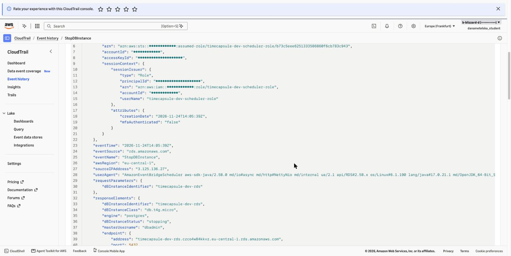

Рисунок 11.6. CloudTrail: `StopDBInstance` в 16:05:39 выполнен ролью `timecapsule-dev-scheduler-role` (ключи и номер аккаунта скрыты).

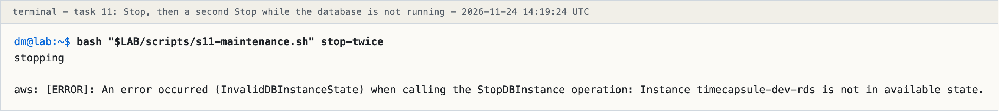

Рисунок 11.7. Повторный `stop-db-instance` отклонён: `InvalidDBInstanceState`.

**Ответ.** При перезагрузке `/health` вернул 500 примерно на 12 секунд, пока база была недоступна, затем приложение восстановилось без вмешательства. Endpoint после остановки и запуска не изменился, поэтому запись CNAME править не нужно. Если расписание попытается остановить базу, которая уже останавливается или остановлена, API вернёт `InvalidDBInstanceState`: расписание завершится ошибкой, а база останется в нужном состоянии; в следующую ночь попытка повторится.

### Задание 12. Архитектура и решение

Рисунок 12.1. Схема ЛР5. Путь запроса: ① браузер -> IGW; ② SG `web-sg` -> `app`; ③ запрос имени `db.timecapsule.internal`; ④ CNAME на endpoint RDS; ⑤ PostgreSQL :5432 по TLS, `rds-sg` пускает только `web-sg`.

Решение: [ADR-0004](../adr/0004-database-hosting.md).

## Ответы на устные вопросы

1. Путь запроса. Браузер обращается к Elastic IP через Internet Gateway, группа `web-sg` пропускает HTTP на `app`; приложение запрашивает `db.timecapsule.internal`, приватная зона Route 53 отвечает CNAME на endpoint RDS, затем TCP 5432 по TLS, где `rds-sg` пропускает только `web-sg`. Проверки: `dig`, `/health`, запись и чтение капсулы.
2. Репликация и копирование. Реплика асинхронно повторяет все изменения, включая ошибочные, поэтому не заменяет копию; копии и восстановление на момент времени возвращают базу в прошлое. Реплика нужна для чтения и переключения, копия для восстановления.
3. Отказ зоны 1a и цена. База в одной зоне недоступна, пока зона не вернётся, или пока её не восстановят из копии в другой зоне; Multi-AZ переключается автоматически, но стоит примерно вдвое дороже и недоступен на Free plan.
4. Автозапуск через 7 дней. AWS сам запускает остановленную базу через 7 дней для обслуживания; поэтому расписание останавливает её каждую ночь, а долго ненужную базу лучше удалить с финальным снимком.

## Вывод

Учебная база `lab5-db` создана в консоли по всем параметрам задания, к ней подключились с клиента внутри VPC, создали реплику, убедились в доступе только на чтение и увидели, что репликация копирует ошибочное удаление. Восстановление на момент времени вернуло четыре строки в новую базу `lab5-db-restore`. Все учебные ресурсы удалены до создания базы приложения. База приложения `timecapsule-dev-rds` создана в консоли, данные перенесены `pg_dump` со сверкой счётчиков, приложение переключено заменой записи DNS без изменения `DB_HOST`, а `db-server` удалён. Ночная остановка настроена через EventBridge Scheduler с собственной ролью и проверена: тестовый запуск остановил базу, CloudTrail показал роль расписания. Основные ограничения Free plan: один день копий, шаблон `Free tier`, не более двух экземпляров RDS, версия базы приложения 16.15-R1 вместо названной в задании 16.14.

## Источники

- Задание ЛР5 курса cloud-computing.
- Документация AWS: Amazon RDS User Guide (PostgreSQL, read replicas, PITR), EventBridge Scheduler User Guide.
