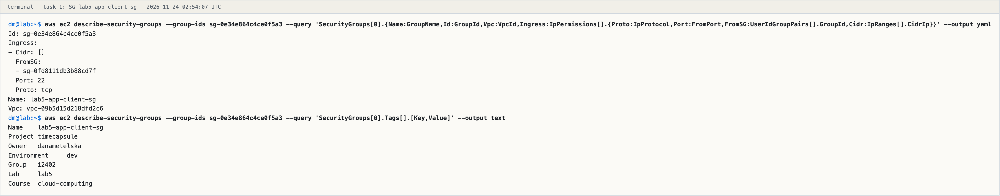
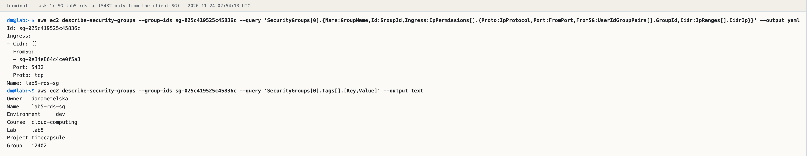
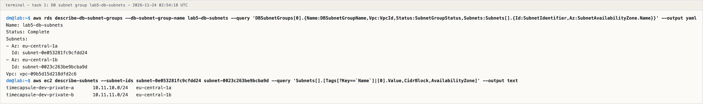
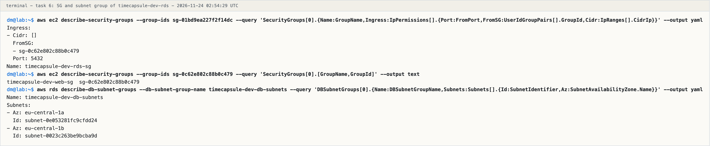
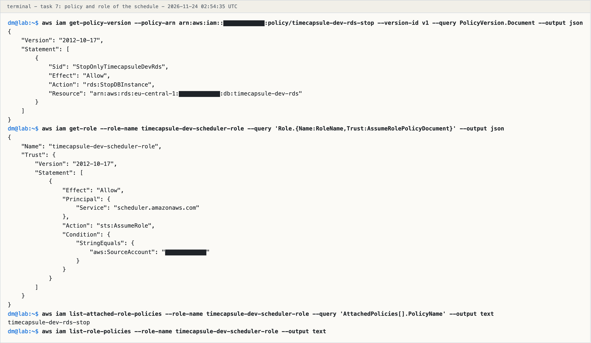

# Лабораторная работа №5. Облачные базы данных. Amazon RDS

| Поле | Значение |
| --- | --- |
| Студент | Metelska Daniela |
| Группа | I2402 |
| Специальность | Informatică |
| Уровень | продвинутый (Часть 1 и Часть 2, задания 1-12) |
| Репозиторий | https://github.com/b-blizzard-d-cloud/timecapsule (публичный) |
| ADR | [docs/adr/0004-database-hosting.md](../adr/0004-database-hosting.md) |
| Схема | [docs/lab5/diagram.png](diagram.png) |
| Предыдущие отчёты | [ЛР2](../../README.md), [ЛР3](../lab3/README.md), [ЛР4](../lab4/README.md) |

Номер аккаунта, домашний IP и пароли в отчёте скрыты. Пароли `dbadmin` сгенерированы RDS (`Auto generate password`), хранятся локально в файле с правами 600 и в `~/.pgpass` серверов; в репозиторий не попадают. Снимки консоли получены в реальной консоли AWS; команды `psql`, `dig`, `curl` и `aws` выполнены по-настоящему и отрисованы в нейтральное окно терминала.

## Паспорт ресурсов

| Ресурс | Имя | Значение |
| --- | --- | --- |
| Группа подсетей (Часть 1) | `lab5-db-subnets` | `private-a` (1a), `private-b` (1b) |
| SG клиента (Часть 1) | `lab5-app-client-sg` | вход: SSH только от `timecapsule-dev-bastion-sg` |
| SG базы (Часть 1) | `lab5-rds-sg` | вход: TCP 5432 только от `lab5-app-client-sg` |
| Клиент (Часть 1) | `lab5-client` | t3.micro, AL2023, `public-b`, `psql` 18.7 |
| Учебная база | `lab5-db` | PostgreSQL [ЗАПОЛНИТЬ версию], `db.t4g.micro`, gp3 20 ГиБ, 1a |
| Реплика / копия | `lab5-db-replica`, `lab5-db-restore` | 1b / 1a, удалены |
| SG базы приложения | `timecapsule-dev-rds-sg` | вход: 5432 от `timecapsule-dev-web-sg` |
| Группа подсетей | `timecapsule-dev-db-subnets` | `private-a`, `private-b` |
| База приложения | `timecapsule-dev-rds` | PostgreSQL 16.14, `db.t4g.micro`, gp3 20 ГиБ, 1a, endpoint [ЗАПОЛНИТЬ] |
| Политика / роль | `timecapsule-dev-rds-stop`, `timecapsule-dev-scheduler-role` | `rds:StopDBInstance` только на `timecapsule-dev-rds`; доверие `scheduler.amazonaws.com` |
| Расписание | `timecapsule-dev-rds-nightly-stop` | `cron(0 23 * * ? *)`, `Europe/Chisinau` |
| Теги | `Name`, `Project=timecapsule`, `Environment=dev`, `Owner=danametelska`, `Lab=lab5`, `Course=cloud-computing`, `Group=i2402` | все ресурсы ЛР5 (расписанию теги не нужны) |

## Как выполнялась работа

Сеть (группы безопасности, группы подсетей), сервер `lab5-client`, политика и роль расписания созданы командами AWS CLI, каждая настройка подтверждена независимой командой `describe-*` / `get-*`. Базы данных, реплика, восстановление и расписание созданы в консоли AWS (формы показаны на снимках). Команды заданий выполнялись на ноутбуке через `bastion` (ProxyJump) на `lab5-client` и `app`.

## Отклонения от задания и ограничения

1. Free plan: доступен только шаблон `Free tier` (соответствует `Sandbox` задания), срок хранения копий не более 1 дня вместо 7, не более двух экземпляров RDS одновременно. Базу приложения созданы только после удаления всех учебных баз.
2. Шаблон `Free tier` вместо `Sandbox`; [ЗАПОЛНИТЬ после консоли: фактические сообщения].
3. Группы безопасности, группы подсетей, `lab5-client`, политика и роль расписания созданы через CLI до консольной части; параметры соответствуют заданию.
4. Путь приложения на сервере `/var/www/timecapsule` (без `current/`).
5. Вместо `web-server` используется `lab5-client` (учебный сервер задания 3) и `app` (Часть 2).
6. [ЗАПОЛНИТЬ: результат `dig` с ноутбука для endpoint, если он отличается от ожидаемого].

## Часть 1. Базовый уровень

### Задание 1. Размещение и доступ к базе

**Что сделано.** Создана группа подсетей `lab5-db-subnets` (две приватные подсети), SG `lab5-app-client-sg` и SG `lab5-rds-sg` с единственным правилом входа TCP 5432 от SG клиента.

**Как проверено.** `describe-security-groups`, `describe-db-subnet-groups`.

Рисунок 1.1. SG клиента: вход SSH только от SG bastion, теги.

Рисунок 1.2. SG базы: 5432 только от SG клиента, CIDR-правил нет.

Рисунок 1.3. Группа подсетей `lab5-db-subnets`: подсети в зонах 1a и 1b.

[СКРИНШОТ КОНСОЛИ: L5-c01-subnet-group, L5-c01-sg-rules]

**Ответ.** [ЗАПОЛНИТЬ: 3-4 предложения: почему SG источника, а не IP; зачем две подсети.]

### Задание 2. База RDS

[СКРИНШОТЫ КОНСОЛИ: L5-c02-*, форма создания, Connectivity & security, Available]

**Ответ.** [ЗАПОЛНИТЬ: проверка доступа только с нужного сервера; почему 1a; deletion protection.]

### Задание 3. Подключение к базе

Рисунок 3.1. Сервер `lab5-client`: `public-b`, SG `lab5-app-client-sg`, IMDSv2 обязателен, `psql` 18.7.

[ТЕРМИНАЛ после создания базы: L5-t03-02-psql (version, conninfo, notes), L5-t03-03-dig (сервер и ноутбук), L5-t03-04-outsider]

### Задание 4. Реплика для чтения

[КОНСОЛЬ и ТЕРМИНАЛ: L5-c04-replica-available, L5-t04-01-replica-insert-error, L5-t04-02-fourth, L5-c04-replicalag]

**Ответ.** [ЗАПОЛНИТЬ: INSERT на реплике; реплика и Multi-AZ.]

### Задание 5. Восстановление после ошибки

[ТЕРМИНАЛ и КОНСОЛЬ: время UTC, DELETE, пустая реплика, Latest restore time, форма восстановления, строки после]

**Ответ.** [ЗАПОЛНИТЬ: почему реплика не спасла; почему новая база.]

### Завершение Части 1

[ТЕРМИНАЛ: `aws rds describe-db-instances`, `aws ec2 describe-instances` без `lab5-*`, Tag Editor]

## Часть 2. Продвинутый уровень

### Задание 6. База приложения

Рисунок 6.1. SG `timecapsule-dev-rds-sg` (5432 от `timecapsule-dev-web-sg`) и группа подсетей `timecapsule-dev-db-subnets`.

[КОНСОЛЬ: L5-c06-connectivity (Connectivity & security), форма создания]

**Ответ.** [ЗАПОЛНИТЬ: что изменить для рабочей системы.]

### Задание 7. Ночная остановка базы

Рисунок 7.1. Политика `timecapsule-dev-rds-stop` (только `rds:StopDBInstance` на одну базу) и роль с доверием `scheduler.amazonaws.com`.

[КОНСОЛЬ: L5-c07-schedule, L5-c07-event-stopped]

**Ответ.** [ЗАПОЛНИТЬ: зачем своя роль; почему только одна база.]

### Задание 8. Пользователь и база данных

[ТЕРМИНАЛ: L5-t08-01 (скрипт `files/s08-user-db.sh`, пароль не выводится)]

**Ответ.** [ЗАПОЛНИТЬ: почему не `dbadmin`.]

### Задание 9. Перенос данных

[ТЕРМИНАЛ: L5-t09-01 (дамп, загрузка, счётчики users/capsules, `timecapsule.sql` удалён); скрипт `files/s09-migrate.sh`]

### Задание 10. Переключение приложения

[ТЕРМИНАЛ: L5-t10-01 (change batch `files/route53-switch.json`, `dig db.timecapsule.internal`, `/health`), L5-t10-02 (капсула в RDS), КОНСОЛЬ: список серверов без `db-server`]

**Ответ.** [ЗАПОЛНИТЬ: почему `DB_HOST` не менялся; что перешло к AWS.]

### Задание 11. Обслуживание базы

[ТЕРМИНАЛ: L5-t11-01 (`/health` при перезагрузке), КОНСОЛЬ: Logs & events, CloudTrail `StopDBInstance`; повторный Stop: `InvalidDBInstanceState`]

**Ответ.** [ЗАПОЛНИТЬ: `/health` при перезагрузке; endpoint; ошибка расписания.]

### Задание 12. Архитектура и решение

Рисунок 12.1. Схема ЛР5. Путь запроса: ① браузер -> IGW; ② SG `web-sg` -> `app`; ③ запрос имени `db.timecapsule.internal`; ④ CNAME на endpoint RDS; ⑤ PostgreSQL :5432 по TLS, `rds-sg` пускает только `web-sg`.

Решение: [ADR-0004](../adr/0004-database-hosting.md).

## Ответы на устные вопросы

[ЗАПОЛНИТЬ: 4 ответа по 3-4 предложения: путь запроса и проверки; репликация и копирование; отказ 1a и цена; автозапуск через 7 дней.]

## Вывод

[ЗАПОЛНИТЬ после консольной части, 4-6 строк.]

## Источники

- Задание ЛР5 курса cloud-computing.
- Документация AWS: Amazon RDS User Guide (PostgreSQL, read replicas, PITR), EventBridge Scheduler User Guide.
